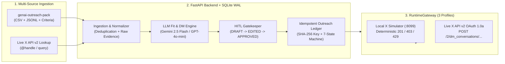

# X-Scout AI Talent Scout & Outreach Copilot — One-Page Technical Write-Up

**Author:** Forward Deployed Engineer (FDE) Candidate  
**Target Role Context:** Technical Founding Engineer / AI Lead (Robotics & Physical AI Startup, Vietnam — Cohort Batch 01)  
**Repository Deliverables:** Working Prototype (`Next.js 16` + `FastAPI` + `X API v2 OAuth 1.0a` + `Docker Compose` + `AWS Terraform`), `README.md`, and this Write-Up.

---

## 1. Approach & Architecture

We designed **Talent Scout & Outreach Copilot** around a strict **Evidence-Grounded, Human-in-the-Loop (HITL), Idempotent State Machine** architecture so a founder or Venture Partner can source, evaluate, and message high-signal AI/Robotics engineers without risking hallucinated claims or duplicate outreach.

### Key Architectural Pillars
1. **Strict Evidence Grounding (Anti-Hallucination Invariant):** Every candidate profile stores verifiable `evidence_snippets` (exact X post IDs/timestamps, GitHub URLs, arXiv papers, and bio strings). The AI Scorer (`fit_score` 0–100, `role_fit`, `Thesis & Why Now`, `Risk Flags`) and DM Drafter must cite concrete `evidence_refs` from the ingested payload. Unverified claims are rejected by Pydantic schema validation and post-generation grounding checks.
2. **Enforced Human-in-the-Loop (HITL) Gate:** No outbound DM can ever be dispatched from `DRAFT` status. The backend enforces a strict transition (`DRAFT` / `EDITED` $\rightarrow$ `APPROVED` with `approved_by` and `approved_at` audit metadata) before the dispatch endpoint (`POST /api/ledger/send/{id}`) unlocks.
3. **Triple-Layer Idempotency & Transparent Error Handling:**
   - **Database Layer:** `outreach_ledger.idempotency_key` (`UNIQUE` SHA-256 hash of `normalized_handle + campaign_id`) prevents duplicate rows under concurrent requests (`409 IDEMPOTENCY_LOCK_ACTIVE`).
   - **Application State Machine:** Once a candidate reaches `SENT` or `REPLIED`, any re-send attempt is blocked before calling the X API, logging a transparent `DUPLICATE_BLOCKED` audit event.
   - **Explicit Privacy/Error Surfacing:** When X API returns `403 Forbidden` (e.g., `@arjun_infer` has closed DMs), the system transitions the candidate to `BLOCKED_DM_CLOSED` and surfaces a clear UI banner with a one-click **Copy Fallback Email / LinkedIn Pitch** action instead of failing silently.
4. **3-Mode Runtime Gateway (`OFFLINE_MOCK`, `HYBRID_SAFE`, `LIVE_PRODUCTION`):** Centralizes switching between deterministic fixtures, live LLM + local `x-simulator` (`:8099`), and full OAuth 1.0a live X API v2 dispatch, stamping every API response with `execution_meta` (`ai_engine`, `x_transport`, `fallback_triggered`) for UI observability badges.

---

## 2. Key Technical Trade-Offs

| Decision Area | Chosen Approach | Alternative Considered | Rationale & Trade-Off |
| :--- | :--- | :--- | :--- |
| **Database & Queue** | **SQLite (WAL mode) + SQL-backed `JobQueue`** | PostgreSQL + Redis + Celery | Zero external daemon friction (`< 15 min` reviewer setup) while preserving ACID unique locks for idempotency. Trade-off: single-writer throughput limit (~1,000 concurrent writes/sec), acceptable for curated founder outreach. |
| **Frontend Proxy** | **Next.js 16 App Router BFF Proxy** (`/api/[...path]`) | Direct Browser $\rightarrow$ FastAPI CORS calls | Keeps backend and `x-simulator` Inside a private network (or AWS private security group rules) and prevents exposing any secrets to the browser bundle. |
| **X API Auth & Tier Support** | **OAuth 1.0a User Context (`HMAC-SHA1`) + Pay-Per-Use / Basic v2** | OAuth 2.0 PKCE User Flow | For a single-tenant founder tool, OAuth 1.0a static Consumer + Access Token keys in `.env` enable immediate CLI verification (`verify_live_keys.py`) and DM sending without requiring a public OAuth callback URL during local testing. |
| **AI Fallback Strategy** | **Live Gemini/OpenAI Primary + Deterministic Grounded Fallback (tagged in UI)** | Hard-failing when reviewer has no API key | Ensures reviewers can run the repo immediately out-of-the-box while preventing silent mocking: every response explicitly surfaces `LIVE_GEMINI` vs `DETERMINISTIC_FALLBACK` in the UI badge. |

---

## 3. What Comes Next (Production Scaling Roadmap)

If deployed across all **X-Scout AI** portfolio companies and partner scouts:
1. **Multi-Channel Fallback Orchestration:** Automatically draft and queue warm intros via **Email (Resend/SendGrid)** or **LinkedIn** whenever a candidate hits `BLOCKED_DM_CLOSED` on X.
2. **Webhook & Two-Way Inbox Sync:** Subscribe to X Account Activity API webhooks (and Gmail webhooks) to automatically transition candidates from `SENT` $\rightarrow$ `REPLIED` and trigger AI sentiment/intent classification on replies.
3. **Cross-Source Identity Resolution:** Enrich X handles automatically with GitHub commit graphs, Google Scholar / arXiv citation velocity, and Crunchbase/LinkedIn history via background workers.
4. **Multi-Tenant Postgres + pgvector:** Migrate from SQLite WAL to AWS RDS PostgreSQL with `pgvector` for semantic talent search across thousands of historical candidates and portfolio roles.

---

## 4. Estimated Costs (Prototype vs. Production Scale)

| Component | Tier / Service Used | Unit Pricing | Prototype / Demo Cost | Monthly Production Estimate (1,000 Candidates / mo) |
| :--- | :--- | :--- | :--- | :--- |
| **LLM Scoring & DM Drafting** | **Gemini 2.5 Flash** (or `gpt-4o-mini`) | ~\$0.15 / 1M input tokens, \$0.60 / 1M output tokens (~2.5K tokens/candidate) | **< \$0.02** (Free tier / pennies) | **~\$1.50 – \$3.00 / month** (incl. re-scoring & calibration) |
| **X API v2 (Lookup + DM)** | **X API v2 Pay-Per-Use Credits** (or Basic Tier) | Pay-Per-Use: ~\$0.005–\$0.01/request (min \$5 credit top-up) \| Basic: \$100–\$200/mo | **\$5.00** one-time credit top-up (or \$0 on `x-simulator`) | **\$5.00 – \$15.00 / month** (Pay-Per-Use) for ~500 targeted DMs |
| **Cloud Infrastructure** | **AWS ECS Fargate (`ap-southeast-1`)** + ALB + EFS + CloudWatch | 3 small Fargate tasks (`0.25 vCPU / 0.5 GB`) + 1 ALB | **< \$0.50** (spun up for live validation & destroyed) | **~\$38.00 – \$45.00 / month** (always-on single-AZ dev/prod) |
| **Total Operating Cost** | — | — | **~\$0.00 – \$5.50 total** | **~\$45.00 – \$63.00 / month** |

---

## 5. How We Used AI Tools & Verified Their Output

We used **Antigravity (Agentic Coding Assistant)** as an engineering pair throughout system design, implementation, and infrastructure provisioning—governed by a strict **Spec-First & 3-Tier Verification Harness** so no AI-generated code was trusted blindly:

1. **Context-Driven Spec Decomposition (`context/features/01..07`):** Before generating application code, we broke the assignment invariants into 7 granular feature specifications with explicit data schemas, state-machine transitions, and failure modes.
2. **Anti-Hallucination & Guardrail Auditing:** We wrote explicit unit and integration assertions verifying that every AI-generated score and DM draft references only real `evidence_snippets` from `candidates.csv` and `x_posts.jsonl`, and that `DRAFT` candidates cannot bypass the HITL approval gate (`403 HITL_APPROVAL_REQUIRED`).
3. **3-Tier Automated Verification Gate (`tests/manual/test-all.ps1`):** Every AI-assisted change had to pass three deterministic verification layers before completion:
   - **Tier 1 — Backend Pytest Suite (44 tests):** Validates OAuth 1.0a signature generation, SQLite idempotency locks (`409 Conflict` on duplicate send), closed-DM `403` handling (`BLOCKED_DM_CLOSED`), AI evidence grounding, and calibration re-scoring.
   - **Tier 2 — Headless Playwright E2E Suite (`PW-01` to `PW-09`):** Drives a real Chromium browser through login, ingestion, candidate inspection, HITL edit & approval, live/simulated X DM dispatch, duplicate send prevention, and calibration slider updates.
   - **Tier 3 — Golden E/R Contract Comparator (`compare_er_contract.py`):** Diffs live API responses against a locked Golden Expected Result JSON contract (`100%` structural and invariant match).
4. **Live Infrastructure Validation:** Validated all Terraform modules (`terraform fmt`, `validate`, `plan`, `apply`, and `destroy`) against a real AWS account (`ap-southeast-1`) and caught real-world edge cases (Windows PowerShell 5.1 CRLF pipe encoding on `docker login`, AWS Security Group description regex restrictions, and non-empty ECR teardown).

