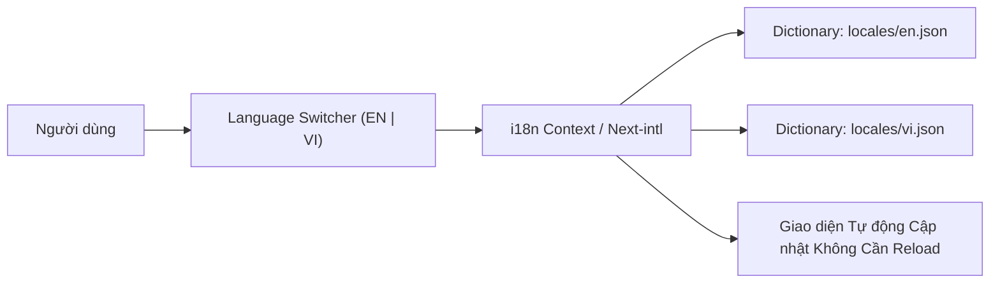

# Feature Spec 00: Base Layout, Navigation Shell & Atomic Design System
*(Foundation / Design System & Layout Architecture)*

---

## 1. Mục tiêu & Tầm nhìn (Purpose & Vision)

Tài liệu này định nghĩa **Hệ thống Thiết kế Nguyên tử (Atomic Design System)**, **Bảng Mã màu Semantic (Design Tokens với Tailwind CSS)**, **Khung Giao diện Khung vỏ Ứng dụng (AppShell with Sidebar Layout)**, **Bộ điều phối Đa ngôn ngữ (i18n)**, **Bộ tinh chỉnh Breakpoint Responsive**, và **Hệ thống Màn hình Báo lỗi (401, 403, 500, Error Boundary)** dùng chung cho toàn bộ các màn hình nghiệp vụ của hệ thống GenAI Fund Autonomous Scouting:
- **Module 01:** Thu thập & Nạp dữ liệu ([01-data-pack-and-ingestion.md](file:///d:/AssignmentFDE/context/features/01-data-pack-and-ingestion.md))
- **Module 05:** Bàn làm việc Kiểm duyệt HITL & Soạn thảo DM ([05-hitl-review-and-composer-ui.md](file:///d:/AssignmentFDE/context/features/05-hitl-review-and-composer-ui.md))
- **Module 06:** Sổ cái Chiến dịch, CRM Theo dõi & Đối chiếu Điểm chuẩn ([06-outreach-ledger-and-dashboard.md](file:///d:/AssignmentFDE/context/features/06-outreach-ledger-and-dashboard.md))

### 4 Trụ cột Cốt lõi:
1. **Phong cách Deep-Tech Venture Capital:** Tông màu chủ đạo xanh Navy `#021337` sang trọng kết hợp sắc xanh Royal Blue `#314ae9` và Cyan `#13cfde`, mang lại cảm giác tin cậy, chuẩn mực, hiện đại của một quỹ đầu tư công nghệ cao.
2. **Top Header & Sidebar Tinh giản, Chuyên nghiệp:** 
   - Sidebar cố định bên trái, hỗ trợ **Nút Thu gọn (Collapse/Expand Toggle)** linh hoạt giữa 2 chế độ w-64 và w-16.
   - Top Header tinh giản tối đa: **Bên trái là Tiêu đề Màn hình (Screen Title)**, **Bên phải chỉ có Profile người dùng và Menu Đăng xuất**.
3. **Chuẩn hóa Biểu tượng Độc quyền (`lucide-react`):** Tuyệt đối không tạo icon bừa bãi hay nhúng SVG tự do; toàn bộ biểu tượng được quản lý tập trung theo ma trận ánh xạ chuẩn.
4. **Đa ngôn ngữ Linh hoạt (i18n):** Hỗ trợ song ngữ **Tiếng Anh (EN)** (chuẩn quốc tế cho VC và giám khảo) và **Tiếng Việt (VI)** (thuận tiện vận hành nội bộ).
5. **Khả năng Phục hồi & Xử lý Ngoại lệ (Resilience & Error States):** Định nghĩa sẵn các màn hình `401 Unauthorized`, `403 Forbidden`, `500 Server Error`, và `Global Error Boundary` để ứng dụng không bao giờ bị "màn hình trắng chết chóc" (*White Screen of Death*).

---

## 2. Design Tokens & Cấu hình Tailwind CSS (@theme)

Toàn bộ hệ thống giao diện được định nghĩa thông qua các CSS Custom Properties chuẩn của Tailwind CSS v4:

```css
@import "tailwindcss";

@theme {
  /* Primary brand colors */
  --color-primary: #314ae9;
  --color-secondary: #13cfde;
  --color-tertiary: #35abff;

  /* Semantic colors for UI components */
  --color-primary-foreground: #ffffff;
  --color-secondary-foreground: #ffffff;
  --color-tertiary-foreground: #ffffff;
  --color-destructive: #e5240c;
  --color-destructive-foreground: #ffffff;
  --color-background: #ffffff;
  --color-foreground: #021337;
  --color-accent: #f8fafc;
  --color-accent-foreground: #021337;
  --color-muted: #f1f5f9;
  --color-muted-foreground: #677187;
  --color-border: #e2e8f0;
  --color-input: #ffffff;
  --color-ring: #314ae9;

  /* Content colors for text and elements */
  --color-content-primary: #314ae9;
  --color-content-primary-20: #314ae933;
  --color-content-primary-disabled: #cbcee3;
  --color-content-dark: #021337;
  --color-content-positive: #00a349;
  --color-content-secondary: #677187;
  --color-content-positive-secondary: #0f741f;
  --color-content-tertiary: #a1abbf;
  --color-content-warning: #f59e0b;
  --color-content-warning-secondary: #805f0c;
  --color-content-disabled: #737c8f;
  --color-content-negative: #e5240c;
  --color-content-negative-secondary: #9f2626;
  --color-content-primary-2: #00359E;
  --color-content-secondary-2: #667085;
  --color-content-dark-2: #2C2A2A;

  /* Background semantic colors */
  --color-background-white: #ffffff;
  --color-background-light-grey: #f2f4f5;
  --color-background-grey: #e6e9ed;
  --color-background-light-blue-grey: #edf2fd;
  --color-background-dark: #1a1717;
  --color-background-primary: #314ae9;
  --color-background-primary-hover: #5c70f3;
  --color-background-light-primary: #cfddff;
  --color-background-primary-disable: #cbcee3;
  --color-background-secondary: #13cfde;
  --color-background-positive: #00a349;
  --color-background-warning: #ffa916;
  --color-background-light-warning: #ffe2a9;
  --color-background-negative: #e5240c;
  --color-background-light-negative: #ffd3d5;
  --color-background-purple: #7620c1;
  --color-background-soft-purple: #e1d9f9;
  --color-background-disabled: #d3dce0;

  /* Border semantic colors */
  --color-border-default: #cfd6de;
  --color-border-strong: #b0b9c5;
  --color-border-dark: #021337;
  --color-border-selected: #3273f1;
  --color-border-positive: #00a349;
  --color-border-warning: #f59e0b;
  --color-border-negative: #e5240c;

  /* Short alias mapping */
  --color-dark: #021337;
  --color-dark-secondary: #677187;
  --color-dark-tertiary: #a1abbf;
  --color-white: #ffffff;
  --color-disabled: #737c8f;
  --color-primary-disable: #cbcee3;
  --color-positive: #00a349;
  --color-positive-secondary: #0f741f;
  --color-warning: #f59e0b;
  --color-warning-secondary: #805f0c;
  --color-negative: #e5240c;
  --color-negative-secondary: #9f2626;

  /* Custom shadows */
  --shadow-xs: 0 1px 2px 0 rgb(0 0 0 / 0.05);
}

* {
  box-sizing: border-box;
}

html,
body {
  margin: 0;
  padding: 0;
  background-color: var(--color-accent);
  color: var(--color-foreground);
  font-family: -apple-system, BlinkMacSystemFont, "Segoe UI", Roboto, "Helvetica Neue", Arial, sans-serif;
  -webkit-font-smoothing: antialiased;
}

/* Custom sleek scrollbars for Sidebar & Wide DataTables */
::-webkit-scrollbar {
  width: 6px;
  height: 6px;
}

::-webkit-scrollbar-track {
  background: var(--color-muted);
}

::-webkit-scrollbar-thumb {
  background: var(--color-border-strong);
  border-radius: 9999px;
}

::-webkit-scrollbar-thumb:hover {
  background: var(--color-dark-secondary);
}
```

---

## 3. Quy chuẩn Thư viện Icon Độc quyền (`lucide-react`)

Để đảm bảo tính nhất quán tuyệt đối về thị giác và tránh tình trạng lập trình viên tạo icon SVG inline bừa bãi hoặc cài đặt thư viện hỗn tạp, **toàn bộ dự án quy định CHỈ SỬ DỤNG DUY NHẤT thư viện `lucide-react`**.

### Ma trận Ánh xạ Biểu tượng Chuẩn (Design System Icon Matrix):

| Nhóm chức năng | Tên Icon (`lucide-react`) | Ý nghĩa nghiệp vụ / Vị trí sử dụng |
| :--- | :--- | :--- |
| **Navigation (Điều hướng)** | `DownloadCloud` | Nạp ứng viên (Ingestion Hub) |
| | `UserCheck` | Bàn duyệt HITL (Review Workspace) |
| | `Inbox` | Sổ cái Gửi tin (Outreach Ledger & CRM) |
| | `SlidersHorizontal` | Đối chiếu AI (Calibration Matrix) |
| | `Activity` | Giám sát hàng đợi & Sức khỏe hệ thống |
| **Sidebar Collapse** | `PanelLeftClose` / `ChevronLeft` | Nút thu gọn Sidebar (w-64 $\rightarrow$ w-16) |
| | `PanelLeftOpen` / `ChevronRight` | Nút mở rộng Sidebar (w-16 $\rightarrow$ w-64) |
| **Action Buttons (Hành động)** | `Send` | Phê duyệt & Gửi tin (`Approve & Send`) |
| | `XCircle` / `Trash2` | Từ chối ứng viên (`Reject`) / Xóa khỏi hàng chờ |
| | `RotateCw` | Thử lại phân tích AI (`Retry Evaluation`) |
| | `Sparkles` | Tạo lại bản nháp DM bằng AI (`Regenerate Draft`) |
| | `Filter` | Bộ lọc trạng thái ứng viên |
| | `Search` | Ô tìm kiếm tên / handle |
| | `Copy` | Sao chép nội dung tin nhắn đã gửi |
| | `Eye` | Xem chi tiết hồ sơ & mở Modal duyệt |
| | `ExternalLink` | Mở link trang cá nhân hoặc tin nhắn trực tiếp trên X |
| | `Check` / `CheckCheck` | Đánh dấu đã tiếp quản (`Mark Handled`) |
| | `X` | Nút đóng Modal / Drawer |
| **Table & Pagination (Phân trang)** | `ChevronLeft` / `ChevronRight` | Nút chuyển trang Trước / Sau |
| | `ChevronsLeft` / `ChevronsRight`| Nút nhảy về Trang đầu / Trang cuối |
| **Status Indicators (Trạng thái)** | `CheckCircle2` | Match điểm cao / Gửi thành công (`SENT`) |
| | `AlertTriangle` | Cần người xem xét (`NEEDS_HUMAN`) / Thiếu dữ liệu |
| | `AlertCircle` | Cảnh báo khẩn cấp (`NEEDS_ATTENTION` - Đỏ) |
| | `Lock` / `ShieldAlert` | Khóa DM (`SEND_BLOCKED`) / Prompt Attack bị chặn |
| | `Clock` / `Loader2` | Đang trong hàng đợi (`QUEUED_FOR_AI` - quay tròn) |
| | `MessageSquareReply` / `MessageSquare` | Ứng viên đã trả lời (`REPLIED` / `NEEDS_ATTENTION`) |
| | `Info` | Hộp thông tin hướng dẫn / Audit note |
| **Data Ingestion (Nạp dữ liệu)** | `UploadCloud` | Kéo thả file CSV nạp dữ liệu |
| | `FileSpreadsheet` / `FileText` | Biểu tượng tệp dữ liệu đã nạp |
| **Profile & System Controls** | `User` | Avatar đối tác quỹ |
| | `LogOut` | Đăng xuất khỏi hệ thống |
| | `Globe` | Chuyển đổi ngôn ngữ (Language Switcher) |

> [!IMPORTANT]
> **Quy tắc Bất biến:** Cấm tự tạo thẻ `<svg>` trực tiếp trong code component hoặc cài đặt thêm thư viện icon khác (FontAwesome, Heroicons, React-Icons). Toàn bộ icon bắt buộc phải được import trực tiếp từ `lucide-react`.

---

## 4. Kiến trúc Đa ngôn ngữ (Multi-language / i18n Architecture)

Hệ thống được thiết kế sẵn sàng cho môi trường đa quốc gia với 2 ngôn ngữ:
- **English (`en`) - Mặc định:** Ngôn ngữ làm việc chuẩn quốc tế của quỹ đầu tư và hội đồng chấm bài.
- **Tiếng Việt (`vi`):** Dành cho đội ngũ scout/associate bản địa tại Việt Nam.



### Cấu trúc Từ điển i18n Chuẩn:
```json
// locales/en.json
{
  "nav": {
    "ingestion": "Candidate Ingestion",
    "workspace": "HITL Review Workspace",
    "ledger": "Outreach Ledger & CRM",
    "calibration": "AI Calibration Matrix",
    "logout": "Sign Out"
  },
  "actions": {
    "approve_send": "Approve & Send",
    "reject": "Reject",
    "retry": "Retry Evaluation",
    "regenerate": "Regenerate Draft"
  },
  "status": {
    "match": "High Fit",
    "needs_human": "Needs Human Review",
    "blocked": "DMs Closed"
  }
}
```

---

## 5. Component Bọc Tinh chỉnh Breakpoint (`BreakpointLayout`)

Nhằm tối ưu hóa trải nghiệm trên nhiều kích thước màn hình (Laptop 13", Màn hình ngoài 27", hoặc Tablet), hệ thống cung cấp component bao bọc layout `BreakpointLayout`:

```mermaid
graph TD
    Screen{"Screen Width"}
    Screen -->|< 768px (Mobile)| ModeMobile["Drawer Mode: Sidebar ẩn thành Drawer vuốt"]
    Screen -->|768px - 1024px (Tablet/Small Laptop)| ModeTablet["Compact Mode: Sidebar co gọn (w-16 Icons), Content cuộn độc lập"]
    Screen -->|> 1024px (Standard Desktop / Wide)| ModeDesktop["Full Mode: Sidebar mở rộng (w-64), Split-Pane 60/40 hiển thị song song"]
```

### Đặc tả Breakpoint Tokens:
- **`sm` (640px):** Mobile layout, các bảng data chuyển sang dạng thẻ danh sách rút gọn.
- **`md` (768px):** Tablet layout, sidebar thu gọn thành thanh icon (w-16).
- **`lg` (1024px):** Desktop chuẩn, sidebar mở đầy đủ (w-64), chia 2 cột Master-Detail.
- **`xl` (1280px) & `2xl` (1536px):** Wide desktop, mở rộng bảng Sổ cái và tăng diện tích soạn thảo tin nhắn.

---

## 6. Phân rã Hệ thống theo Phương pháp luận Atomic Design

```mermaid
graph LR
    subgraph Atoms["1. ATOMS (Nguyên tử)"]
        A1["Button (Primary / Destructive / Positive / Outline)"]
        A2["Status Badge & Score Pill (1..4, Urgent Pulse)"]
        A3["Input & Textarea (Inline Composer with Counter)"]
        A4["Evidence Mark (<mark> Amber Highlight)"]
        A5["Lucide Icon & User Avatar"]
        A6["Checkbox & Radio Segment"]
    end

    subgraph Molecules["2. MOLECULES (Phân tử)"]
        M1["Tabs Navigation (Line Tabs & Filter Pills)"]
        M2["Table Pagination Controls (Rows/page & Nav)"]
        M3["StatCard (KPI Metrics with Urgent Border)"]
        M4["File Upload Dropzone (Drag-and-Drop)"]
        M5["Evidence Snippet Callout Box"]
        M6["Toast Notification (Success / Error / Info)"]
        M7["User Profile Dropdown Menu"]
    end

    subgraph Organisms["3. ORGANISMS (Sinh vật)"]
        O1["App Sidebar (Expandable w-64 / Collapsible w-16)"]
        O2["Top Header Bar (Title + Profile only)"]
        O3["Compound Paginated DataTable"]
        O4["Review & Inline Composer Modal (HITL)"]
        O5["Record / Simulate Reply Modal"]
        O6["Audit Trail Slide-over Drawer"]
        O7["Error State Views (401, 403, 500)"]
    end

    subgraph Templates["4. TEMPLATES (Khuôn mẫu)"]
        T1["AppShell (Collapsible Sidebar + Header + Canvas)"]
        T2["BreakpointLayout Wrapper"]
    end

    subgraph Pages["5. PAGES (Trang hoàn chỉnh)"]
        P1["/ingestion (Module 01)"]
        P2["/workspace (Module 05)"]
        P3["/ledger & /calibration (Module 06)"]
    end

    Atoms --> Molecules
    Molecules --> Organisms
    Organisms --> Templates
    Templates --> Pages
```



---

### 6.1. Chi tiết Danh mục Component Atoms & Molecules Dùng Chung (Component Catalog)

Dưới đây là đặc tả kỹ thuật chi tiết cho các thành phần UI dùng chung trong toàn bộ các màn hình nghiệp vụ (`01`, `05`, `06`):

---

#### 1. Component `Badge` & `ScorePill` (Atoms)
Dùng để biểu thị trạng thái vòng đời ứng viên, mức độ ưu tiên và điểm số đánh giá của AI.

- **Các biến thể (Variants):**
  - `primary`: Nền `--color-background-light-primary`, viền và chữ `--color-primary` (Dùng cho `QUEUED_FOR_AI`, `📤 ĐÃ GỬI`).
  - `positive`: Nền xanh lá nhạt, viền và chữ `--color-content-positive` (Dùng cho `MATCH`, `💬 ĐÃ PHẢN HỒI`).
  - `warning`: Nền vàng hổ phách nhạt, chữ `--color-content-warning-secondary` (Dùng cho `PENDING_REVIEW`, `⚠️ Trùng lặp`).
  - `destructive`: Nền đỏ nhạt, viền và chữ `--color-content-negative` (Dùng cho `REJECTED`, `🔴 Khóa DM`).
  - `urgent` **(Đặc biệt):** Nền đỏ đậm `--color-destructive` kết hợp chữ trắng `--color-destructive-foreground`, có hiệu ứng nhấp nháy nhẹ `animate-pulse` (Dành riêng cho cờ `🚨 NEEDS ATTENTION`).
  - `muted`: Nền xám nhạt `--color-muted`, chữ `--color-muted-foreground` (Dùng cho `🧪 Sandbox`).
- **Score Pill (Điểm AI):**
  - Điểm `4/4` (DeepTech): Badge xanh lá đậm viền nổi bật.
  - Điểm `3/4` (Application Fit): Badge xanh lục sáng.
  - Điểm `2/4` (Wrapper): Badge màu hổ phách cảnh báo.
  - Điểm `1/4` (Noise/Injection): Badge đỏ gạch kèm icon `ShieldAlert`.
  - Điểm `0/4` (Sparse Profile): Badge xám kèm icon `AlertTriangle`.

```tsx
// Interface định nghĩa Props
interface BadgeProps {
  variant?: 'primary' | 'positive' | 'warning' | 'destructive' | 'urgent' | 'muted';
  size?: 'sm' | 'md';
  icon?: LucideIcon;
  pulse?: boolean;
  children: React.ReactNode;
}
```

---

#### 2. Component `Tabs` (Molecules)
Hỗ trợ chuyển đổi ngữ cảnh mượt mà giữa các chế độ xem và bộ lọc.

- **Biến thể 1: `LineTabs` (Underlined Navigation Tabs):**
  - Áp dụng tại cấp độ trang: 3 Tab nạp dữ liệu tại Module 01 (`Hạt giống 1-Click` / `Tải lên CSV` / `Tra cứu Live X`), hoặc 2 Tab chính tại Module 06 (`Sổ cái & Hộp thư` / `Ma trận Hiệu chuẩn AI`).
  - Tab đang active có đường gạch chân đậm màu `--color-primary` (h-0.5), chữ in đậm, chuyển động mượt `transition-all`.
- **Biến thể 2: `PillTabs` (Segmented Filter Pills):**
  - Áp dụng cho thanh bộ lọc: Lọc trạng thái tại Module 05 (`Tất cả`, `🟢 Phù hợp Match`, `🔴 Bị chặn`) hoặc Module 06 (`Tất cả (24)`, `🔴 Cần xử lý gấp (3)`, `💬 Đã phản hồi (6)`).
  - Có badge số lượng tích hợp bên trong viên thuốc: Khi active, nền chuyển sang `--color-primary` chữ trắng; khi inactive, nền `--color-muted` chữ xám `--color-muted-foreground`.

```tsx
interface TabItem {
  key: string;
  label: string;
  icon?: LucideIcon;
  count?: number;
  badgeVariant?: 'primary' | 'destructive';
}

interface TabsProps {
  variant?: 'line' | 'pills';
  items: TabItem[];
  activeKey: string;
  onChange: (key: string) => void;
}
```

---

#### 3. Component `Table` & `TablePagination` (Molecules & Organisms)

##### ⚖️ Đánh giá Kiến trúc Chuyên sâu: React Virtualized Table vs Paginated Table

| Tiêu chí | React Virtualized Table (`@tanstack/react-virtual`) | Standard Paginated Table (Bảng Phân Trang Chuẩn Mực) |
| :--- | :--- | :--- |
| **Quy mô dữ liệu dự án** | Tối ưu khi có > 5,000 đến 50,000 dòng dữ liệu liên tục không phân trang. | **Phù hợp hoàn hảo:** Mỗi mẻ nạp ứng viên thông thường từ 20 đến 500 hồ sơ. |
| **Bản chất nghiệp vụ VC/HITL** | Cuộn vô tận thích hợp cho mạng xã hội lướt tin (Twitter feed), **không phù hợp** cho công tác thẩm định đầu tư cần rà soát có điểm dừng và kiểm soát tiến độ. | **Chuẩn mực CRM/FinTech:** Cho phép Partner kiểm soát rõ ràng từng trang ("Đã duyệt 10/10 người trang 1"), tránh sót người. |
| **Xử lý Chiều cao dòng động (Dynamic Row Height)** | **Rất phức tạp & Dễ lỗi giật màn hình:** Dòng có trích dẫn tweet dài 3-4 dòng hoặc badge mở rộng khiến thuật toán ảo hóa phải đo lại DOM liên tục (`measureElement`). | **Mượt mà 100%:** Bảng HTML chuẩn tự động co giãn dòng tự nhiên mà không bao giờ bị lệch vị trí cuộn hay nhấp nháy. |
| **Tương thích Next.js & Tìm kiếm Ctrl+F** | DOM chỉ chứa các phần tử trong viewport $\rightarrow$ Không thể dùng phím `Ctrl + F` của trình duyệt để tìm nhanh handle; khó SSR. | **Thân thiện tuyệt đối:** Toàn bộ dòng trong trang hiện diện đầy đủ trong DOM, tìm kiếm và render tức thì. |
| **Đồng bộ URL & Trải nghiệm chia sẻ** | Khó lưu vị trí cuộn khi reload trang hoặc chia sẻ link. | **Dễ dàng lưu vào URL Query Params:** `?page=2&pageSize=10` giúp các Partner chia sẻ link trực tiếp đúng trang đang xem. |

> [!TIP]
> **Quyết định Thiết kế:** 
> - **Lựa chọn mặc định:** Áp dụng **Compound Paginated Table** làm tiêu chuẩn cho toàn hệ thống với các tùy chọn phân trang linh hoạt: `10`, `25`, `50` dòng trên một trang.
> - **Cấu trúc Module:** Tách biệt hoàn toàn thành các hạt nguyên tử (`Table`, `TableHeader`, `TableBody`, `TableRow`, `TableCell`, `TablePagination`, `TableEmptyState`, `TableLoadingSkeleton`). Thiết kế này vừa nhẹ, vừa tương thích React 19/Next.js SSR, và nếu sau này quỹ cần mở rộng danh sách lên > 10,000 dòng, ta có thể cắm thêm Virtualization Provider mà không phải sửa giao diện các màn hình nghiệp vụ.

##### Cấu trúc Compound Table & Pagination:
```tsx
// Cấu trúc phân trang chuẩn
interface TablePaginationProps {
  currentPage: number;
  pageSize: number;
  totalItems: number;
  pageSizeOptions?: number[]; // [10, 25, 50]
  onPageChange: (page: number) => void;
  onPageSizeChange: (size: number) => void;
}
```

```text
Giao diện thanh phân trang chuẩn:
┌────────────────────────────────────────────────────────────────────────────────────────────────┐
│ Hiển thị 1 - 10 của 24 bản ghi outreach         Số dòng: [ 10 / trang ▾ ]  [◀ Trước] [1] [2] [3] [Sau ▶] │
└────────────────────────────────────────────────────────────────────────────────────────────────┘
```

---

#### 4. Component `Modal` & `Drawer` (Molecules & Organisms)
Cung cấp vùng làm việc tập trung cao độ, tránh tình trạng chia cột hẹp gây che khuất thông tin.

- **`Modal` (Accessible Centered Dialog):**
  - **Sử dụng tại:** 
    - Modal Kiểm duyệt & Soạn thảo DM (Module 05).
    - Modal Ghi nhận / Mô phỏng phản hồi từ Founder (Module 06).
  - **Đặc tính kỹ thuật:**
    - Lớp nền mờ tối (`fixed inset-0 bg-black/50 backdrop-blur-xs z-50 animate-in fade-in`).
    - Hộp thoại căn giữa màn hình với độ rộng linh hoạt (`max-w-2xl` cho form ghi nhận, `max-w-5xl` cho HITL Composer).
    - Khóa cuộn trang nền (`document.body.style.overflow = 'hidden'`).
    - Hỗ trợ phím tắt `Escape` để đóng và click ngoài backdrop để đóng.
    - Cấu trúc: `ModalHeader` (Tiêu đề + nút đóng `X`), `ModalBody` (cuộn độc lập), `ModalFooter` (hàng nút bấm hành động).
- **`Drawer` (Slide-over Right Panel):**
  - **Sử dụng tại:** 
    - Drawer xem Dấu vết Kiểm toán Bất biến & Lịch sử Hội thoại chi tiết (Module 06).
  - **Đặc tính kỹ thuật:**
    - Cố định mép phải màn hình (`fixed right-0 top-0 h-full w-[520px] bg-white shadow-2xl z-50`).
    - Trượt từ phải sang trái mượt mà (`transition-transform duration-300 ease-out`).

---

#### 5. Component `StatCard` (Molecules - Thẻ Chỉ số KPI)
Hiển thị tổng quan các chỉ số đo lường hiệu quả chiến dịch tại Top Dashboard (Module 06).

- **Thuộc tính:**
  - `icon`: Icon Lucide (`Send`, `MessageSquare`, `AlertCircle`, `ShieldCheck`).
  - `label`: Tên chỉ số ("ĐÃ GỬI DM", "PHẢN HỒI", "CẦN XỬ LÝ GẤP", "BẢO VỆ CHỐNG LẶP").
  - `value`: Số liệu chính cỡ chữ lớn (`text-2xl font-bold`).
  - `subtext`: Chú thích ngữ cảnh ("Tỷ lệ rep: 25%", "100% tỷ lệ an").
  - `variant`: Mặc định nền trắng viền xám nhẹ; riêng thẻ khẩn cấp có variant `urgent` với viền đỏ nổi bật `--color-destructive` và nền đỏ nhạt 5%.

---

#### 6. Component `EvidenceMark` (Atoms - Dẫn chứng Nguyên văn Hổ phách)
Tô sáng từ khóa hoặc câu tweet nguyên văn chứng minh năng lực DeepTech của ứng viên tại Module 05.

- **Quy chuẩn hiển thị:**
  - Sử dụng thẻ ngữ nghĩa `<mark>` với styling: `bg-amber-100 text-amber-900 border-b-2 border-amber-400 font-medium px-1 rounded-xs`.
  - Giúp mắt người duyệt (Human Reviewer) bắt ngay được bằng chứng trong vòng < 2 giây mà không cần đọc hết 500 từ bio/tweet.

---

#### 7. Component `InlineComposer` & `TextareaWithCounter` (Molecules)
Khung soạn thảo tin nhắn DM cá nhân hóa với giới hạn ký tự nghiêm ngặt.

- **Thuộc tính:**
  - Bộ đếm ký tự trực tiếp: `284 / 500 ký tự`.
  - Trạng thái cảnh báo:
    - Khi $\le 500$ ký tự: Chữ xám `--color-muted-foreground` ("Độ dài: Chuẩn mực").
    - Khi $> 500$ ký tự: Viền khung chuyển đỏ gạch `--color-destructive`, chữ cảnh báo đỏ nhấp nháy ("Vượt quá giới hạn DM của X").
  - Đi kèm nút tắt `[✨ Tạo lại bằng AI]` và tùy chọn kênh gửi (`⚡ Live X` / `🧪 Sandbox`).

---

#### 8. Component `ToastNotification` (Atoms / Notification)
Thông báo kết quả thao tác không xâm lấn (Non-blocking notification) nổi tại góc dưới bên phải màn hình (`bottom-5 right-5 z-50`).

- **3 trạng thái chuẩn:**
  - `success`: Xanh lá, icon `CheckCircle2` (ví dụ: *"Đã phê duyệt và xếp hàng gửi DM cho @minh_quant"*).
  - `error`: Đỏ gạch, icon `AlertCircle` (ví dụ: *"Lỗi kết nối Backend FastAPI"*).
  - `info`: Xanh dương, icon `Info` (ví dụ: *"Đã nạp thành công 20 hồ sơ hạt giống"*).

---

#### 9. Component `FileDropzone` (Molecules - Vùng Tải lên CSV)
Khu vực kéo thả file dữ liệu tại Tab 2 Module 01.

- **Thuộc tính:**
  - Khung viền nét đứt (`border-2 border-dashed border-border hover:border-primary transition-colors`).
  - Icon trung tâm `UploadCloud` lớn màu xanh.
  - Hỗ trợ cả 2 phương thức: Kéo-thả trực tiếp (Drag & Drop) hoặc click nút `[Chọn tệp CSV từ máy tính]`.
  - Hiển thị kiểm tra định dạng trước khi nạp (Pre-flight validation status).

---

## 7. Kiến trúc Khung vỏ Ứng dụng & Cơ chế Thu gọn Sidebar (AppShell with Collapsible Sidebar)

Sidebar hỗ trợ **2 trạng thái thu gọn linh hoạt**:
1. **Trạng thái Mở rộng (Expanded - w-64):** Hiển thị Logo, tên menu, huy hiệu số lượng, và nút `[◀ Thu gọn]`.
2. **Trạng thái Thu gọn (Collapsed - w-16):** Thu gọn thành thanh icon gọn gàng, hiển thị Tooltip tên chức năng khi hover, và nút `[▶ Mở rộng]`.
3. **Lưu trữ trạng thái:** Trạng thái co/giãn được lưu vào `localStorage.getItem('sidebar_collapsed')` để người dùng không phải bấm lại khi tải trang.

Top Header được chuẩn hóa tuyệt đối:
- **Bên trái (Left):** Tiêu đề Màn hình hiện tại (`Screen Title`).
- **Bên phải (Right):** Duy nhất Profile Người dùng và Menu Đăng xuất (`[👤 General Partner ▾]` $\rightarrow$ `[🚪 Đăng xuất]`).

---

### Wireframe 1: Trạng thái Sidebar Mở rộng (Expanded Sidebar Layout - w-64)

```
┌──────────────────────────────────────────────────────────────────────────────────────────────────┐
│ [GenAI Fund Logo] ◀│ 🎯 BÀN DUYỆT ỨNG VIÊN (REVIEW WORKSPACE)             [👤 General Partner ▾]│
│                    │                                                      ┌───────────────────┐ │
│                    │                                                      │ 🌐 Ngôn ngữ: EN/VI│ │
│                    │                                                      │ 🚪 Đăng xuất      │ │
│                    │                                                      └───────────────────┘ │
├────────────────────┼─────────────────────────────────────────────────────────────────────────────┤
│                    │                                                                             │
│ 🧭 ĐIỀU HƯỚNG       │                                                                             │
│                    │                                                                             │
│ 📥 Nạp Ứng viên    │                                                                             │
│    (Ingestion Hub) │                                                                             │
│                    │                                                                             │
│ 🎯 Bàn Duyệt HITL  │                      DYNAMIC CONTENT CANVAS (flex-1)                        │
│    [Queue: 17]     │                 (Thay đổi tùy theo màn hình đang chọn)                      │
│                    │                                                                             │
│ 📜 Sổ cái Gửi tin  │    • Nếu chọn "Bàn Duyệt": Hiện Split-Pane Master/Detail (Module 05)        │
│    [Needs: 2]      │    • Nếu chọn "Sổ cái": Hiện Bảng CRM & Cờ Needs Attention (Module 06)      │
│                    │    • Nếu chọn "Đối chiếu": Hiện Calibration Benchmark Matrix (Module 06)    │
│ ⚖️ Đối chiếu AI    │                                                                             │
│                    │                                                                             │
│ ⚙️ Sức khỏe Queue  │                                                                             │
│                    │                                                                             │
├────────────────────┤                                                                             │
│ [◀ Thu gọn Sidebar]│                                                                             │
├────────────────────┤                                                                             │
│ [v1.0.0 • WAL DB]  │                                                                             │
└────────────────────┴─────────────────────────────────────────────────────────────────────────────┘
```

---

### Wireframe 2: Trạng thái Sidebar Thu gọn (Collapsed Sidebar Layout - w-16)

Khi nhấn nút thu gọn `[◀]`, Sidebar co về `w-16`, mở rộng tối đa không gian cho màn hình làm việc:

```
┌──────────────────────────────────────────────────────────────────────────────────────────────────┐
│ [Logo] ▶ │ 🎯 BÀN DUYỆT ỨNG VIÊN (REVIEW WORKSPACE)                       [👤 General Partner ▾]│
├──────────┼───────────────────────────────────────────────────────────────────────────────────────┤
│          │                                                                                       │
│   📥     │                                                                                       │
│          │                                                                                       │
│   🎯(17) │                         DYNAMIC CONTENT CANVAS (flex-1)                               │
│          │                           (Không gian hiển thị tăng thêm 20%)                         │
│   📜(2)  │                                                                                       │
│          │                                                                                       │
│   ⚖️     │                                                                                       │
│          │                                                                                       │
│   ⚙️     │                                                                                       │
│          │                                                                                       │
├──────────┤                                                                                       │
│   [▶]    │                                                                                       │
└──────────┴───────────────────────────────────────────────────────────────────────────────────────┘
```

---

## 8. Các Màn hình Trạng thái & Xử lý Lỗi (401, 403, 500 & Global Error Boundary)

Để đảm bảo tính kiên cường (Resilience) của hệ thống, 4 màn hình lỗi được thiết kế đồng bộ với hệ thống Design System:

### Wireframe 1: Màn hình 401 Unauthorized (Hết hạn phiên / Chưa đăng nhập)
```
┌──────────────────────────────────────────────────────────────────────────────────┐
│                                                                                  │
│                                   🔒                                             │
│                        401 - PHIÊN LÀM VIỆC ĐÃ HẾT HẠN                           │
│           (Session Expired / Authentication Required)                            │
│                                                                                  │
│   Phiên đăng nhập của bạn đã hết hạn hoặc bạn chưa được cấp quyền truy cập.      │
│   Vui lòng đăng nhập lại để tiếp tục sử dụng hệ thống.                          │
│                                                                                  │
│                        ┌───────────────────────────────┐                         │
│                        │     ⚡ QUAY LẠI ĐĂNG NHẬP     │                         │
│                        └───────────────────────────────┘                         │
│                                                                                  │
└──────────────────────────────────────────────────────────────────────────────────┘
```

### Wireframe 2: Màn hình 403 Forbidden (Không đủ quyền truy cập)
```
┌──────────────────────────────────────────────────────────────────────────────────┐
│                                                                                  │
│                                   🛡️                                             │
│                         403 - TỪ CHỐI TRUY CẬP                                   │
│                           (Access Forbidden)                                     │
│                                                                                  │
│   Tài khoản hiện tại không có quyền thực hiện hành động này.                    │
│   Chức năng này chỉ dành riêng cho tài khoản đối tác cấp cao (General Partner).  │
│                                                                                  │
│                        ┌───────────────────────────────┐                         │
│                        │       VỀ TRANG REVIEW         │                         │
│                        └───────────────────────────────┘                         │
│                                                                                  │
└──────────────────────────────────────────────────────────────────────────────────┘
```

### Wireframe 3: Màn hình 500 Internal Server Error (Lỗi máy chủ / Mất kết nối Backend)
```
┌──────────────────────────────────────────────────────────────────────────────────┐
│                                                                                  │
│                                   ⚠️                                             │
│                        500 - LỖI HỆ THỐNG MÁY CHỦ                                │
│                     (Internal Server Connection Error)                           │
│                                                                                  │
│   Không thể kết nối tới Backend FastAPI (http://localhost:8000).                │
│   Vui lòng kiểm tra lại tiến trình máy chủ hoặc cấu hình file .env.              │
│                                                                                  │
│       Chi tiết kỹ thuật: Failed to fetch /api/candidates - Status: 500           │
│                                                                                  │
│              ┌────────────────────────┐    ┌────────────────────────┐            │
│              │    🔄 THỬ LẠI KẾT NỐI  │    │  🔍 KIỂM TRA HEALTH    │            │
│              └────────────────────────┘    └────────────────────────┘            │
│                                                                                  │
└──────────────────────────────────────────────────────────────────────────────────┘
```

### 4. Global Error Boundary (React Runtime Fallback):
- Bọc ngoài toàn bộ Dynamic Content Canvas. Nếu có bất kỳ component React con nào bị crash do parse dữ liệu JSON lỗi, Error Boundary sẽ hứng ngoại lệ, hiển thị nút `[Tải lại thành phần]` mà **không làm crash thanh Sidebar hay Header**.

---

## 9. Kịch bản Kiểm thử Giao diện (Acceptance Criteria)
- [ ] **Test Icon Library Purity:** Toàn bộ component chỉ import từ `lucide-react`, không có thẻ `<svg>` inline thủ công hoặc thư viện icon khác.
- [ ] **Test Sidebar Collapse:** Nhấn nút `[◀]` trên Sidebar $\rightarrow$ Sidebar co về `w-16`, các nhãn chữ ẩn đi và chỉ còn icon; nhấn nút `[▶]` $\rightarrow$ Sidebar mở rộng về `w-64`.
- [ ] **Test Sidebar Persistence:** Sau khi thu gọn Sidebar, refresh trang hoặc chuyển sang trang khác $\rightarrow$ Sidebar vẫn giữ nguyên trạng thái thu gọn.
- [ ] **Test Header Simplicity:** Header chỉ hiển thị Tiêu đề màn hình bên trái và Profile + Đăng xuất bên phải, không có nút bấm thừa.
- [ ] **Test Language Switch:** Chuyển đổi giữa EN và VI $\rightarrow$ các nhãn trên Sidebar, Header, và nút bấm thay đổi tức thì mà không bị reload trang.
- [ ] **Test Paginated Table Navigation:** Thay đổi chọn số dòng `[ 10 / trang ▾ ]` $\rightarrow$ `[ 25 / trang ▾ ]` $\rightarrow$ Bảng tự động hiển thị 25 dòng; bấm `[Sau ▶]` $\rightarrow$ chuyển sang trang 2 và URL cập nhật `?page=2`.
- [ ] **Test Accessible Modal Interaction:** Mở Modal $\rightarrow$ nền phía sau bị làm mờ, không thể cuộn trang; nhấn phím `Escape` hoặc bấm `[✕]` $\rightarrow$ Modal đóng mượt mà và trả lại quyền cuộn trang.
- [ ] **Test Urgent Badge Rendering:** Khi ứng viên có `needs_attention = true` $\rightarrow$ hiển thị huy hiệu `🚨 NEEDS ATTENTION` với nền đỏ đậm và hiệu ứng nhấp nháy `animate-pulse`.
- [ ] **Test 401 Interception:** Khi xóa cookie hoặc token hết hạn $\rightarrow$ giao diện hiển thị màn hình 401 kèm nút điều hướng về `/login`.
- [ ] **Test 500 Graceful Recovery:** Khi tắt server backend Python $\rightarrow$ giao diện hiển thị màn hình 500 với nút `[Thử lại kết nối]` rõ ràng.
