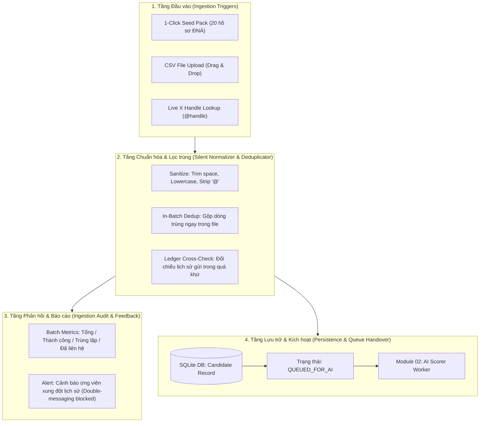
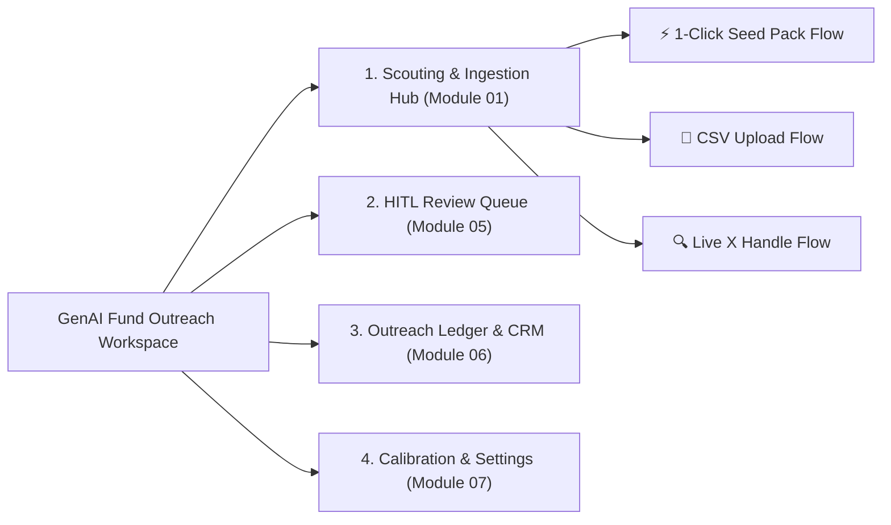

# Feature Spec 01: Data Pack & Scouting Ingestion
*(WBS Task 1 / Module 1: Scouting & Discovery)*

---

## 1. Design Thinking: Thấu cảm, Định nghĩa & Ý tưởng hóa (Empathize, Define, Ideate)

### A. Empathize (Thấu cảm người dùng)
Hệ thống Ingestion phục vụ 2 nhóm người dùng với nhu cầu và áp lực rất khác biệt:
1. **Investment Associate / Scout tại GenAI Fund (Người dùng vận hành):**
   - *Hành vi:* Thường xuyên lùng sục trên X, lưu danh sách founder vào Google Sheets hoặc CSV xuất từ nhiều nguồn.
   - *Nỗi sợ lớn nhất:* **Nhắn tin nhầm hoặc nhắn tin trùng (Double-messaging)** cho cùng một founder giữa các thành viên trong quỹ, gây tổn hại hình ảnh chuyên nghiệp của GenAI Fund.
   - *Sự ức chế:* File CSV thường lộn xộn: handle có lúc có `@` có lúc không, viết hoa/thường lẫn lộn, thừa khoảng trắng. Họ cần hệ thống tự làm sạch thay vì báo lỗi bắt sửa tay.
2. **Hiring Committee / Giám khảo bài test (Người đánh giá):**
   - *Áp lực:* Chấm bài trên máy tính mới (*clean machine*), thời gian kiểm thử chỉ **dưới 15 phút**.
   - *Rào cản:* **Không muốn bỏ ra $100/tháng mua gói X API Basic** chỉ để test một bài tuyển dụng.
   - *Kỳ vọng:* Bấm 1 nút là có ngay bộ dữ liệu mẫu thực tế, chạy trơn tru, không văng lỗi vặt.

### B. Define (Định nghĩa bài toán & HMW)
- **Tuyên ngôn vấn đề (POV):**
  > *"Đội ngũ đầu tư GenAI Fund và Giám khảo bài test cần một cơ chế nạp ứng viên hoàn toàn 0-ma sát, tự chuẩn hóa dữ liệu và chặn trùng lặp ngay tại cửa ngõ, bởi vì dữ liệu sourcing từ X luôn phân mảnh, lộn xộn, và nếu để lọt dữ liệu bẩn vào trong thì AI phía sau sẽ bị ô nhiễm và gây rủi ro thương hiệu cho quỹ."*
- **4 Câu hỏi cốt lõi (How Might We):**
  - **HMW-1 (Zero Friction for Reviewer):** Làm thế nào để người chấm nạp ngay 20 hồ sơ AI/Robotics thực tế tại ĐNÁ trong < 3 giây mà không cần trả tiền mua X API?
  - **HMW-2 (Fault-Tolerant Ingestion):** Làm thế nào để tiếp nhận mọi file CSV dù định dạng lộn xộn mà không bao giờ crash hệ thống?
  - **HMW-3 (Gatekeeper Deduplication):** Làm thế nào để phát hiện và ngăn chặn trùng lặp ngay tại thời điểm nạp (cả trùng trong file lẫn trùng với lịch sử đã gửi)?
  - **HMW-4 (Context Preservation):** Làm thế nào để bảo toàn nguyên vẹn 100% ngữ cảnh thô (raw bio, tweets) phục vụ trích xuất bằng chứng ở các bước sau?

### C. Ideate (Ý tưởng hóa giải pháp)
1. **Mô hình "Cửa ngõ 3 lối vào" (Triple-Door Ingestion):**
   - *Lối 1 (1-Click Seed Pack):* Nút bấm `[⚡ Nạp 20 Hồ sơ Mẫu ĐNÁ]` để giám khảo test ngay lập tức với đầy đủ ca Match, Noise, Prompt Injection, Khóa DM.
   - *Lối 2 (Drag & Drop CSV):* Kéo thả file CSV bất kỳ với các trường cơ bản.
   - *Lối 3 (Live Handle Lookup):* Ô nhập `@handle` gọi trực tiếp X API v2 (nếu có cấu hình key).
2. **Bộ chuẩn hóa "Bàn tay vô hình" (Silent Normalizer):**
   - Tự động hạ lowercase, xóa ký tự `@` và khoảng trắng thừa.
   - Tự động gán giá trị mặc định cho các cột không bắt buộc (`location`, `segment`).
3. **Báo cáo nạp dữ liệu minh bạch (Ingestion Feedback Report):**
   - Hiển thị rõ số lượng nạp thành công, số lượng bản ghi trùng lặp bị bỏ qua trong batch, và số ứng viên đã từng liên hệ trong lịch sử.

---

## 2. Kiến trúc Thông tin (Information Architecture - IA)

Hệ thống nạp dữ liệu được cấu trúc phân tầng rõ ràng từ điểm chạm người dùng đến tầng cơ sở dữ liệu:



### Phân cấp Dữ liệu & Thực thể (Data Taxonomy):
- **Input Data Contract:**
  - *Bắt buộc:* `handle` (string), `name` (string), `bio` (string), `recent_tweets` (string/json).
  - *Tùy chọn:* `location` (string, default: "Southeast Asia"), `can_dm` (boolean, default: true), `segment` (string, default: "SEA AI/Robotics Ecosystem").
- **Ingestion Audit States:**
  - `NEW_QUEUED`: Hồ sơ mới hợp lệ $\rightarrow$ đưa vào hàng đợi `QUEUED_FOR_AI`.
  - `IN_BATCH_DUPLICATE`: Hồ sơ bị lặp lại trong cùng 1 file (ví dụ `P002` & `P020`) $\rightarrow$ tự động gộp, chỉ lưu 1 bản ghi duy nhất.
  - `HISTORICAL_COLLISION`: Handle đã tồn tại trong `outreach_ledger` với trạng thái `SENT` hoặc `REPLIED` $\rightarrow$ chặn nạp lại để chống gửi trùng (Zero Double-Messaging).
  - `MALFORMED_ROW`: Dòng dữ liệu thiếu cột bắt buộc $\rightarrow$ ghi nhận lỗi chi tiết theo chỉ số dòng.

---

## 3. Sơ đồ Điều hướng & Luồng Người dùng (Sitemaps & User Flows)

Module 01 đóng vai trò là cửa ngõ nạp ứng viên trong kiến trúc Single-Page Dashboard:



### 3 Luồng Thao tác Chính:
1. **Flow 1 – Giám khảo Kiểm thử Nhanh (Reviewer Express Flow - < 3 giây):**
   - Người dùng bấm nút `[⚡ Nạp 20 Hồ sơ Mẫu ĐNÁ]` trên Header/Modal.
   - Backend gọi `POST /api/candidates/seed`, nạp 20 hồ sơ từ [`candidates_seed.csv`](file:///d:/AssignmentFDE/genai-outreach-pack/candidates_seed.csv).
   - Hệ thống hiển thị Toast thành công, danh sách trên Review Workspace tự động cập nhật sang trạng thái sẵn sàng duyệt.
2. **Flow 2 – Tải tệp CSV tùy chỉnh (Bulk CSV Ingestion Flow):**
   - Associate kéo thả file CSV vào khu vực Dropzone.
   - Client pre-flight kiểm tra sự tồn tại của các cột bắt buộc.
   - Backend phân tích cú pháp, chuẩn hóa, lọc trùng và trả về bản tóm tắt **Ingestion Audit Drawer**.
3. **Flow 3 – Tra cứu Trực tiếp Handle trên X (Live Handle Lookup Flow):**
   - Associate nhập `@handle` vào ô tìm kiếm.
   - Backend gọi X API v2 `/2/users/by/username` và `/2/users/:id/tweets`.
   - Hiển thị thẻ xem trước tóm tắt (Avatar, Bio, Tweets, Trạng thái DM).
   - Associate bấm `[Nạp vào Hàng đợi AI]`.

---

## 4. Khung dây Giao diện (Wireframes & UI Component Blueprints)

### Wireframe 1: Modal Trung tâm Nạp Dữ liệu (Ingestion Hub Modal)
```
┌──────────────────────────────────────────────────────────────────────────────────┐
│  📥 THU THẬP & NẠP HỒ SƠ ỨNG VIÊN (Scouting & Ingestion)                     [✕] │
├──────────────────────────────────────────────────────────────────────────────────┤
│  [⚡ 1-Click Seed Pack (Được chọn)]    [📁 Tải lên CSV]    [🔍 Tra cứu Live X]   │
├──────────────────────────────────────────────────────────────────────────────────┤
│                                                                                  │
│  ┌────────────────────────────────────────────────────────────────────────────┐  │
│  │ ⚡ GÓI DỮ LIỆU MẪU ĐÔNG NAM Á (genai-outreach-pack)                       │  │
│  │                                                                            │  │
│  │ Dành riêng cho Giám khảo / Test nhanh: Nạp tức thì 20 hồ sơ AI/Robotics   │  │
│  │ thực tế tại Việt Nam, Singapore, Indonesia mà không cần trả phí X API.    │  │
│  │                                                                            │  │
│  │ • Bao gồm: Founder Infra, Robotics, Edge AI, Stealth, Noise, Prompt Attack │  │
│  │ • Tự động liên kết: 3 ứng viên đã có lịch sử liên hệ trong quá khứ       │  │
│  │ • Lưu trữ: Ghi trực tiếp vào SQLite bền vững (outreach.db)                │  │
│  └────────────────────────────────────────────────────────────────────────────┘  │
│                                                                                  │
│  Phân khúc mặc định: [ SEA AI & Robotics Ecosystem ▼ ]                           │
│                                                                                  │
│                                           [Hủy]   [⚡ NẠP NGAY 20 HỒ SƠ MẪU]     │
└──────────────────────────────────────────────────────────────────────────────────┘
```

### Wireframe 2: Tab Kéo thả Tệp CSV (CSV Drag & Drop View)
```
┌──────────────────────────────────────────────────────────────────────────────────┐
│  📥 THU THẬP & NẠP HỒ SƠ ỨNG VIÊN                                            [✕] │
├──────────────────────────────────────────────────────────────────────────────────┤
│  [⚡ 1-Click Seed Pack]    [📁 Tải lên CSV (Được chọn)]    [🔍 Tra cứu Live X]   │
├──────────────────────────────────────────────────────────────────────────────────┤
│                                                                                  │
│  ┌ - - - - - - - - - - - - - - - - - - - - - - - - - - - - - - - - - - - - -  ┐  │
│  │                      📂 Kéo thả file .CSV vào đây                         │  │
│  │                         hoặc [Chọn file từ máy tính]                       │  │
│  │                                                                            │  │
│  │    Hỗ trợ định dạng CSV có các cột: handle, name, bio, recent_tweets       │  │
│  │    [Tải file CSV mẫu chuẩn] | Tự động làm sạch @, lowercase và khoảng trắng│  │
│  └ - - - - - - - - - - - - - - - - - - - - - - - - - - - - - - - - - - - - -  ┘  │
│                                                                                  │
│  Tùy chọn nạp:                                                                   │
│  ☑ Tự động kích hoạt AI chấm điểm ngay sau khi nạp xong                          │
│  ☑ Bỏ qua các ứng viên đã có lịch sử gửi tin nhắn (Bảo vệ Double-Messaging)     │
│                                                                                  │
│                                           [Hủy]   [Nạp & Xử lý File CSV]         │
└──────────────────────────────────────────────────────────────────────────────────┘
```

### Wireframe 3: Báo cáo Kiểm duyệt Nạp (Ingestion Audit & Feedback Drawer)
```
┌──────────────────────────────────────────────────────────────────────────────────┐
│  ✅ KẾT QUẢ NẠP DỮ LIỆU (Ingestion Audit Report)                             [✕] │
├──────────────────────────────────────────────────────────────────────────────────┤
│                                                                                  │
│  ┌───────────────┐  ┌───────────────┐  ┌───────────────┐  ┌───────────────┐      │
│  │ 🟢 17 HỒ SƠ   │  │ 🟡 1 ĐÃ GỘP   │  │ 🔴 2 ĐÃ GỬI   │  │ ⚪ 0 LỖI      │      │
│  │ Nạp thành công│  │ Trùng lặp file│  │ Đã gửi quá khứ│  │ Thiếu cột     │      │
│  └───────────────┘  └───────────────┘  └───────────────┘  └───────────────┘      │
│                                                                                  │
│  Chi tiết xử lý bảo vệ an toàn:                                                  │
│  ──────────────────────────────────────────────────────────────────────────────  │
│  • 🟡 Trùng lặp trong file: Đã gộp dòng P020 vào @minh_quant (chỉ giữ 1 bản ghi)│
│  • 🔴 Đã liên hệ trước đây: Bỏ qua @arjun_infer và @kevin_wrapper vì đã có      │
│     trạng thái SENT trong Outreach Ledger (Tránh Double-Messaging).             │
│  • 🟢 17 ứng viên mới đã chuyển sang trạng thái: [ QUEUED_FOR_AI ]              │
│                                                                                  │
│                                                    [Đóng]   [Chuyển tới Bàn Duyệt]│
└──────────────────────────────────────────────────────────────────────────────────┘
```

---

## 5. Mục tiêu cốt lõi (Core Purpose)
Cho phép đội ngũ GenAI Fund nạp danh sách ứng viên mục tiêu từ tệp CSV chuẩn hóa (`handle`, `name`, `bio`, `recent_tweets`) hoặc tra cứu trực tiếp tài khoản X (Live Handle Lookup), tự động chuẩn hóa dữ liệu và đưa vào hệ thống với tính toàn vẹn cao nhất.

---

## 6. Yêu cầu từ Đề bài (Requirements from Prompt)
- Hệ thống nhận đầu vào là phân khúc mục tiêu (*target segment*) hoặc danh sách tài khoản hạt giống (*seed accounts / handles*).
- Tìm kiếm đúng đối tượng: AI & Robotics founders, builders, researchers tại Đông Nam Á.
- Dễ dàng chạy và nạp dữ liệu trên máy mới mà không đòi hỏi cài đặt phức tạp.

---

## 7. Thách thức Kỹ thuật ngầm (Under-the-hood Technical Challenges)
- **Quy định "No Prohibited Scraping":** Đề bài nghiêm cấm cào dữ liệu trái phép (headless scraping, Puppeteer bypass).
- **Rào cản chi phí X API v2:**
  - *Free Tier:* Chỉ cho phép thao tác ghi cơ bản, hoàn toàn không hỗ trợ endpoint tìm kiếm người dùng (`/2/users/by/username` hoặc user search).
  - *Basic Tier:* $100/tháng (giới hạn rất khắt khe).
  - *Pro Tier:* $5,000/tháng (bất khả thi cho bài take-home).
- **Trùng lặp ngay trong tệp nạp (In-batch duplicates):** File CSV có thể chứa nhiều dòng có cùng `@handle` (viết hoa/thường khác nhau hoặc có/không có `@`).
- **Dữ liệu nhiễu và định dạng lỗi:** Dòng thiếu trường bắt buộc, ký tự Unicode đặc biệt trong bio hoặc bài viết.

---

## 8. Phân tích Đánh đổi Kỹ thuật (Trade-off Analysis)

| Hướng tiếp cận | Ưu điểm | Nhược điểm / Rủi ro | Quyết định & Lý do |
| :--- | :--- | :--- | :--- |
| **Cách tiếp cận A: Ép buộc 100% Live X Search API** | Dữ liệu luôn mới nhất từ X. | - Người chấm bài **bắt buộc phải có tài khoản X trả phí $100/mo** mới chạy thử được.<br>- Nguy cơ cạn kiệt quota ngay lần test đầu tiên.<br>- Vi phạm tiêu chí nộp bài: *"We should be able to use it without you beside us... setup in under 15 minutes."* | ❌ **LOẠI BỎ** |
| **Cách tiếp cận B: Chỉ Mock cứng dữ liệu trong bộ nhớ** | Rất dễ code, không tốn tiền API. | - Không chứng minh được năng lực làm việc với hệ thống thật của một Forward Deployed Engineer.<br>- Bị gắn cờ **Red Flag**: *"Không chấp nhận lưu trữ tạm trong bộ nhớ (In-memory storage) cho thử thách này."* | ❌ **LOẠI BỎ** |
| **Cách tiếp cận C (ĐƯỢC CHỌN): Dual-Source Ingestion Engine (CSV Seed Pack + Optional Live X Lookup)** | - **Turnkey < 15 phút:** Cung cấp sẵn tệp [`candidates_seed.csv`](file:///d:/AssignmentFDE/genai-outreach-pack/candidates_seed.csv) với 20 hồ sơ thực tế tại ĐNÁ, nạp vào SQLite bền vững trong 1 giây mà không tốn $1 nào.<br>- **Hỗ trợ Live:** Có sẵn service gọi X API v2 nếu người dùng điền `X_BEARER_TOKEN` vào `.env`. | Cần thiết kế tầng Ingestion trừu tượng hóa để xử lý thống nhất cả 2 nguồn dữ liệu. |  **CHỌN LỰA** (Thể hiện trọn vẹn tư duy FDE: Graceful Fallback & Production-ready). |

---

## 9. Ràng buộc & Điều kiện bất biến (What Must Be True)
1. **Chuẩn hóa Handle:** Toàn bộ handle phải được đưa về dạng chữ thường (`lowercase`), cắt bỏ ký tự `@` và khoảng trắng thừa trước khi lưu DB.
2. **Idempotent Ingestion:** Nạp cùng 1 tệp CSV nhiều lần (hoặc file chứa các dòng trùng lặp như `P002` và `P020`) chỉ tạo đúng **1 bản ghi duy nhất** cho mỗi handle trong database.
3. **Bảo toàn dữ liệu gốc:** Giữ nguyên vẹn văn bản bio và tweets để làm cơ sở trích xuất bằng chứng ở Module 2.

---

## 10. Đặc tả Kỹ thuật chi tiết (Technical Specification)

### Input Schema (CSV / JSON):
- `handle` (string, required): X handle.
- `name` (string, required): Tên hiển thị của ứng viên.
- `bio` (string, required): Tiểu sử trên X.
- `recent_tweets` (string/json, required): Danh sách bài đăng gần nhất (có mốc thời gian hoặc phân cách `||`).
- `location` (string, optional): Địa điểm tự khai báo.
- `can_dm` (boolean, default: true): Trạng thái mở nhận tin nhắn.
- `segment` (string, optional): Tên phân khúc tìm kiếm (ví dụ: `SEG-01: Robotics`).

### Luồng xử lý (Data Flow):
```
[File CSV / API Form] 
       │
       ▼
[CSV Normalizer & Validator] ──(Lọc trùng trong batch, chuẩn hóa handle)
       │
       ▼
[Check Existing in DB] ──(Nếu đã có: Bỏ qua hoặc cập nhật metadata)
       │
       ▼
[Insert Candidate Record] ──(Trạng thái: QUEUED_FOR_AI)
       │
       ▼
[Push to AI Queue]
```

---

## 11. Kịch bản Kiểm thử & Nghiệm thu (Acceptance Criteria)
- [ ] **Test In-batch Dedup:** Nạp file có `P002` và `P020` (cùng `@minh_quant`), DB chỉ lưu 1 bản ghi `minh_quant`.
- [ ] **Test Normalization:** Nhập `@Minh_Quant ` $\rightarrow$ lưu thành `minh_quant`.
- [ ] **Test Missing Columns:** File CSV thiếu cột `bio` hoặc `recent_tweets` sẽ bị từ chối với thông báo lỗi rõ ràng ở dòng tương ứng.

