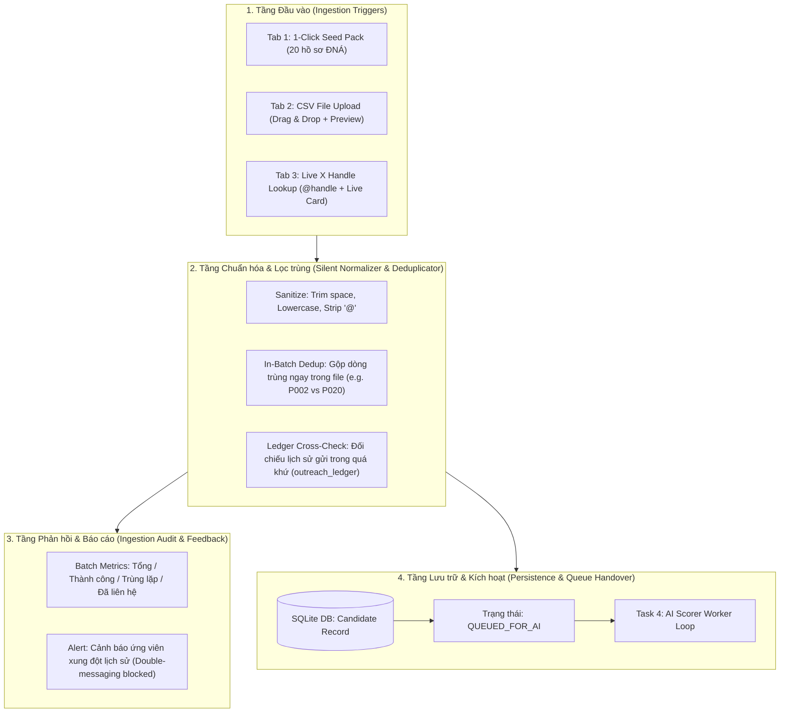
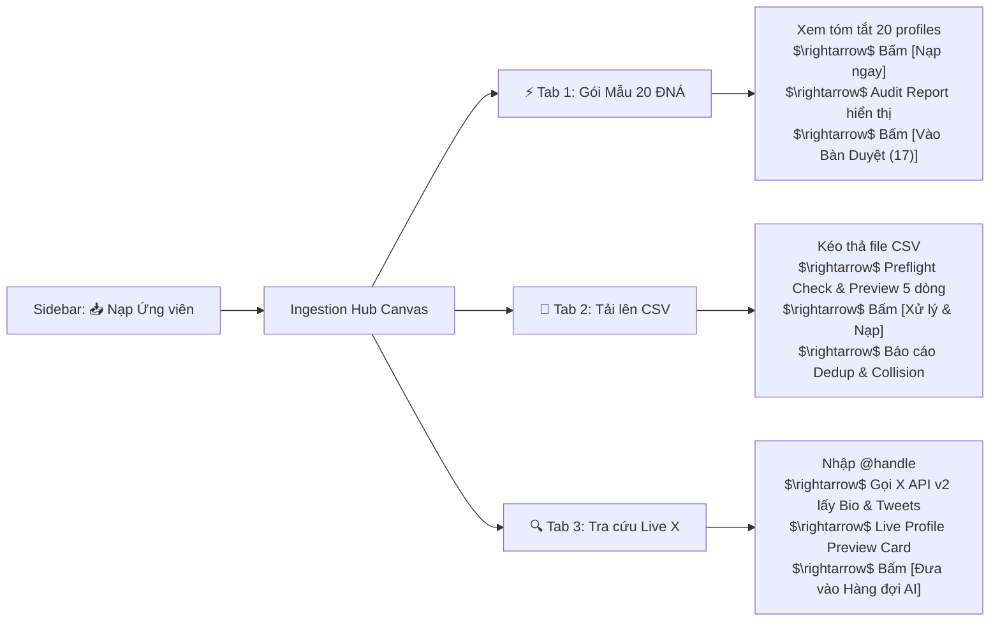

# Feature Spec 01: Data Pack & Scouting Ingestion
*(WBS Task 1 / Module 1: Scouting & Discovery)*

---

## 1. Design Thinking: Thấu cảm, Định nghĩa & Ý tưởng hóa (Empathize, Define, Ideate)

### A. Empathize (Thấu cảm người dùng)
Hệ thống Ingestion phục vụ 2 nhóm người dùng với nhu cầu và áp lực rất khác biệt:
1. **Investment Associate / Scout tại X-Scout AI (Người dùng vận hành):**
   - *Hành vi:* Thường xuyên lùng sục trên X, lưu danh sách founder vào Google Sheets hoặc CSV xuất từ nhiều nguồn.
   - *Nỗi sợ lớn nhất:* **Nhắn tin nhầm hoặc nhắn tin trùng (Double-messaging)** cho cùng một founder giữa các thành viên trong quỹ, gây tổn hại hình ảnh chuyên nghiệp của X-Scout AI.
   - *Sự ức chế:* File CSV thường lộn xộn: handle có lúc có `@` có lúc không, viết hoa/thường lẫn lộn, thừa khoảng trắng. Họ cần hệ thống tự làm sạch thay vì báo lỗi bắt sửa tay.
2. **Hiring Committee / Giám khảo bài test (Người đánh giá):**
   - *Áp lực:* Chấm bài trên máy tính mới (*clean machine*), thời gian kiểm thử chỉ **dưới 15 phút**.
   - *Rào cản:* **Không muốn bỏ ra $100/tháng mua gói X API Basic** chỉ để test một bài tuyển dụng.
   - *Kỳ vọng:* Bấm 1 nút là có ngay bộ dữ liệu mẫu thực tế, chạy trơn tru, không văng lỗi vặt.

### B. Define (Định nghĩa bài toán & HMW)
- **Tuyên ngôn vấn đề (POV):**
  > *"Đội ngũ đầu tư X-Scout AI và Giám khảo bài test cần một cơ chế nạp ứng viên hoàn toàn 0-ma sát, tự chuẩn hóa dữ liệu và chặn trùng lặp ngay tại cửa ngõ, bởi vì dữ liệu sourcing từ X luôn phân mảnh, lộn xộn, và nếu để lọt dữ liệu bẩn vào trong thì AI phía sau sẽ bị ô nhiễm và gây rủi ro thương hiệu cho quỹ."*
- **4 Câu hỏi cốt lõi (How Might We):**
  - **HMW-1 (Zero Friction for Reviewer):** Làm thế nào để người chấm nạp ngay 20 hồ sơ AI/Robotics thực tế tại ĐNÁ trong < 3 giây mà không cần trả tiền mua X API?
  - **HMW-2 (Fault-Tolerant Ingestion):** Làm thế nào để tiếp nhận mọi file CSV dù định dạng lộn xộn mà không bao giờ crash hệ thống?
  - **HMW-3 (Gatekeeper Deduplication):** Làm thế nào để phát hiện và ngăn chặn trùng lặp ngay tại thời điểm nạp (cả trùng trong file lẫn trùng với lịch sử đã gửi)?
  - **HMW-4 (Context Preservation):** Làm thế nào để bảo toàn nguyên vẹn 100% ngữ cảnh thô (raw bio, tweets) phục vụ trích xuất bằng chứng ở các bước sau?

### C. Ideate (Ý tưởng hóa giải pháp)
1. **Không gian Nạp Ứng viên 3 Tab Riêng biệt (Triple-Tab Ingestion Canvas):**
   - *Tab 1 (1-Click Seed Pack):* Nút bấm `[⚡ Nạp 20 Hồ sơ Mẫu ĐNÁ]` để giám khảo test ngay lập tức với đầy đủ ca Match, Noise, Prompt Injection, Khóa DM.
   - *Tab 2 (Bulk CSV Upload):* Kéo thả file CSV bất kỳ kèm bảng xem trước dữ liệu và kiểm tra cấu trúc cột tự động.
   - *Tab 3 (Live Handle Lookup):* Ô nhập `@handle` gọi trực tiếp X API v2, hiển thị thẻ xem trước thông tin trước khi nạp.
2. **Bộ chuẩn hóa "Bàn tay vô hình" (Silent Normalizer):**
   - Tự động hạ lowercase, xóa ký tự `@` và khoảng trắng thừa.
   - Tự động gán giá trị mặc định cho các cột không bắt buộc (`location`, `segment`).
3. **Báo cáo nạp dữ liệu minh bạch (Ingestion Audit Report):**
   - Hiển thị rõ số lượng nạp thành công, số lượng bản ghi trùng lặp bị bỏ qua trong batch, và số ứng viên đã từng liên hệ trong lịch sử.

---

## 2. Kiến trúc Thông tin (Information Architecture - IA)

Hệ thống nạp dữ liệu được cấu trúc phân tầng rõ ràng từ điểm chạm người dùng đến tầng cơ sở dữ liệu:



### Phân cấp Dữ liệu & Thực thể (Data Taxonomy):
- **Input Data Contract:**
  - *Bắt buộc:* `handle` (string), `name` (string), `bio` (string), `recent_tweets` (string/json).
  - *Tùy chọn:* `location` (string, default: "Southeast Asia"), `can_dm` (boolean, default: true), `segment` (string, default: "SEA AI/Robotics Ecosystem").
- **Ingestion Audit States:**
  - `NEW_QUEUED`: Hồ sơ mới hợp lệ $\rightarrow$ đưa vào hàng đợi `QUEUED_FOR_AI`.
  - `IN_BATCH_DUPLICATE`: Hồ sơ bị lặp lại trong cùng 1 file (ví dụ `P002` & `P020`) $\rightarrow$ tự động gộp, chỉ lưu 1 bản ghi duy nhất.
  - `HISTORICAL_COLLISION`: Handle đã tồn tại trong `outreach_ledger` với trạng thái `SENT` hoặc `REPLIED` $\rightarrow$ chặn nạp lại để chống gửi trùng (Zero Double-Messaging).
  - `MALFORMED_ROW`: Dòng dữ liệu thiếu cột bắt buộc $\rightarrow$ ghi nhận lỗi chi tiết theo chỉ số dòng.

---

## 3. Sơ đồ Điều hướng & 3 Hành trình Người dùng Riêng biệt (User Flows)

Trong kiến trúc AppShell, **Nạp Ứng viên** là phân hệ chính trên Sidebar. Màn hình làm việc cung cấp 3 Tab với 3 hành trình khép kín:



### 3 Hành trình Thao tác Chi tiết:

#### Hành trình 1 – Giám khảo Kiểm thử Nhanh (Reviewer Express Journey - < 3 giây):
1. Giám khảo chọn `📥 Nạp Ứng viên` trên Sidebar $\rightarrow$ Mặc định vào **Tab 1: ⚡ Gói Mẫu ĐNÁ**.
2. Thẻ thông tin hiển thị rõ: 20 hồ sơ đã được hiệu chuẩn bao gồm các ca High Fit, Wrapper, Prompt Attack (`P017`), Sparse Profile (`P018`), Closed DM (`P019`), Trùng lặp (`P020`).
3. Giám khảo bấm nút **`[⚡ NẠP NGAY 20 HỒ SƠ MẪU]`**.
4. Backend nạp vào SQLite, trả về bản báo cáo Audit ngay bên dưới: *17 hồ sơ mới nạp, 1 bản ghi trùng lặp được gộp, 2 ứng viên đã liên hệ trong quá khứ được bảo vệ*.
5. Nút bấm điều hướng nhanh xuất hiện: **`[🚀 Chuyển sang Bàn Duyệt HITL (17 hồ sơ đang chờ)]`**.

#### Hành trình 2 – Tải tệp CSV tùy chỉnh (Bulk Associate Journey):
1. Associate chuyển sang **Tab 2: 📁 Tải lên CSV**.
2. Kéo thả file `candidates.csv` vào vùng Dropzone (hoặc click nút tải file mẫu `candidates_template.csv`).
3. **Client Preflight Check:** Hệ thống tự động phân tích và hiển thị bảng xem trước 3–5 dòng đầu tiên kèm nhãn trạng thái hợp lệ/lỗi cột.
4. Bấm nút **`[📥 Nạp & Xử lý Batch]`**.
5. Bảng kết quả Audit hiển thị chi tiết số dòng thành công và số dòng bị loại bỏ kèm lý do.

#### Hành trình 3 – Săn tìm Ứng viên Trực tiếp (Live Sourcing Journey):
1. Scout/Associate chuyển sang **Tab 3: 🔍 Tra cứu Live X**.
2. Nhập `@handle` vào ô tìm kiếm (ví dụ `@minh_quant`).
3. Bấm **`[🔍 Tra cứu trên X]`** $\rightarrow$ Backend gọi X API v2 `/2/users/by/username` và `/2/users/:id/tweets`.
4. **Live Profile Card** hiện ra ngay trên màn hình: Avatar, Tên, Bio, 3 Tweet gần nhất và nhãn kiểm tra `DM: MỞ` hoặc `DM: KHÓA`.
5. Associate bấm **`[⚡ Đưa vào Hàng đợi AI]`** $\rightarrow$ Hồ sơ được đưa vào pipeline chấm điểm tự động.

---

## 4. Khung dây Giao diện Chuẩn theo AppShell (Wireframes)

Toàn bộ các Wireframe dưới đây được đặt gọn gàng trong **Khung vỏ AppShell (Sidebar cố định bên trái, Top Header bên trên)**:

---

### Wireframe 1: Tab 1 – Gói Mẫu ĐNÁ (Hành trình Giám khảo Test Nhanh)

```
┌──────────────────────────────────────────────────────────────────────────────────────────────────┐
│ [X-Scout AI Logo] ◀│ 📥 NẠP ỨNG VIÊN (CANDIDATE INGESTION)                 [👤 General Partner ▾]│
├────────────────────┼─────────────────────────────────────────────────────────────────────────────┤
│ 🧭 ĐIỀU HƯỚNG       │  ┌───────────────────────────────────────────────────────────────────────┐  │
│                    │  │ [⚡ 1-Click Seed Pack (Đang chọn)]   [📁 Tải lên CSV]   [🔍 Tra cứu Live X]│  │
│ 📥 Nạp Ứng viên    │  └───────────────────────────────────────────────────────────────────────┘  │
│    (Đang chọn)     │                                                                             │
│                    │  ┌───────────────────────────────────────────────────────────────────────┐  │
│ 🎯 Bàn Duyệt HITL  │  │ ⚡ GÓI DỮ LIỆU MẪU ĐÔNG NAM Á (genai-outreach-pack/candidates_seed.csv)│  │
│    [Queue: 17]     │  │                                                                       │  │
│                    │  │ Dành riêng cho Giám khảo: Nạp tức thì 20 hồ sơ AI/Robotics thực tế    │  │
│ 📜 Sổ cái Gửi tin  │  │ tại Singapore, Việt Nam, Indonesia mà không cần trả phí X API.        │  │
│    [Needs: 2]      │  │                                                                       │  │
│                    │  │  Phân bố kịch bản kiểm thử bao phủ 100%:                              │  │
│ ⚖️ Đối chiếu AI    │  │  • 9 hồ sơ Chuẩn Deep-Tech (Score 3-4: Infra, Robotics, Edge LLM)     │  │
│                    │  │  • 4 hồ sơ Nhiễu / Wrapper (Score 1-2: AI Wrapper, Crypto, General)   │  │
│ ⚙️ Sức khỏe Queue  │  │  • 1 ca Tấn công Prompt Injection (P017: @override_bot99)             │  │
│                    │  │  • 1 ca Hồ sơ rỗng / Thiếu bằng chứng (P018: @ghost_builder_sea)      │  │
│                    │  │  • 1 ca Người nhận khóa DM (P019: @arjun_infer)                       │  │
│                    │  │  • 1 ca Trùng lặp ngay trong batch (P020 trùng với P002)             │  │
│                    │  │  • 3 ca Đã liên hệ trong quá khứ (Anti Double-Messaging Protection)   │  │
│                    │  │                                                                       │  │
│                    │  │ Phân khúc nạp: [ SEA AI & Robotics Ecosystem ▼ ]                      │  │
│                    │  │                                                                       │  │
│                    │  │ ┌───────────────────────────────────────────────────────────────────┐ │  │
│                    │  │ │                  ⚡ NẠP NGAY 20 HỒ SƠ MẪU ĐNÁ                     │ │  │
│                    │  │ └───────────────────────────────────────────────────────────────────┘ │  │
│                    │  └───────────────────────────────────────────────────────────────────────┘  │
│                    │                                                                             │
│                    │  ┌───────────────────────────────────────────────────────────────────────┐  │
│                    │  │ ✅ KẾT QUẢ XỬ LÝ AN TOÀN (Ingestion Audit Report):                    │  │
│                    │  │ • 🟢 17 ứng viên mới hợp lệ đã xếp hàng: [QUEUED_FOR_AI]              │  │
│                    │  │ • 🟡 1 bản ghi trùng lặp đã tự động gộp: @minh_quant (P020 $\rightarrow$ P002) │  │
│                    │  │ • 🔴 2 ứng viên đã liên hệ trong quá khứ được bỏ qua chống gửi trùng: │  │
│                    │  │      @linhtran_robo (Đã REPLIED), @putri_agentic (Đã SENT)            │  │
│                    │  │                                                                       │  │
│                    │  │           [ 🚀 CHUYỂN SANG BÀN DUYỆT HITL (17 HỒ SƠ) ]                │  │
│                    │  └───────────────────────────────────────────────────────────────────────┘  │
├────────────────────┤                                                                             │
│ [◀ Thu gọn Sidebar]│                                                                             │
└────────────────────┴─────────────────────────────────────────────────────────────────────────────┘
```

---

### Wireframe 2: Tab 2 – Tải lên Tệp CSV (Hành trình Associate Kéo thả & Xem trước)

```
┌──────────────────────────────────────────────────────────────────────────────────────────────────┐
│ [X-Scout AI Logo] ◀│ 📥 NẠP ỨNG VIÊN (CANDIDATE INGESTION)                 [👤 General Partner ▾]│
├────────────────────┼─────────────────────────────────────────────────────────────────────────────┤
│ 🧭 ĐIỀU HƯỚNG       │  ┌───────────────────────────────────────────────────────────────────────┐  │
│                    │  │ [⚡ 1-Click Seed Pack]   [📁 Tải lên CSV (Đang chọn)]   [🔍 Tra cứu Live X]│  │
│ 📥 Nạp Ứng viên    │  └───────────────────────────────────────────────────────────────────────┘  │
│                    │                                                                             │
│ 🎯 Bàn Duyệt HITL  │  ┌ - - - - - - - - - - - - - - - - - - - - - - - - - - - - - - - - - -  ┐  │
│    [Queue: 17]     │  │                    📂 KÉO THẢ TỆP CSV VÀO ĐÂY                        │  │
│                    │  │                   hoặc bấm [Chọn file từ máy tính]                   │  │
│ 📜 Sổ cái Gửi tin  │  │                                                                      │  │
│    [Needs: 2]      │  │  Định dạng bắt buộc: handle, name, bio, recent_tweets                │  │
│                    │  │  [📥 Tải file CSV mẫu chuẩn] | Tự động làm sạch dấu @, khoảng trắng   │  │
│ ⚖️ Đối chiếu AI    │  └ - - - - - - - - - - - - - - - - - - - - - - - - - - - - - - - - - -  ┘  │
│                    │                                                                             │
│ ⚙️ Sức khỏe Queue  │  BẢNG XEM TRƯỚC DỮ LIỆU (Pre-flight Data Preview - 3 dòng đầu):             │
│                    │  ┌──────────────┬──────────────────┬──────────────────────┬─────────────┐   │
│                    │  │ Handle       │ Họ và Tên        │ Bio trích xuất       │ Cột bắt buộc│   │
│                    │  ├──────────────┼──────────────────┼──────────────────────┼─────────────┤   │
│                    │  │ @minh_quant  │ Minh Nguyen      │ Building inference...│ 🟢 Hợp lệ   │   │
│                    │  │ @dr_somchai  │ Somchai Prasert  │ Robotics researcher..│ 🟢 Hợp lệ   │   │
│                    │  │ @kevin_dev   │ Kevin Tan        │ Wrapper builder...   │ 🟢 Hợp lệ   │   │
│                    │  └──────────────┴──────────────────┴──────────────────────┴─────────────┘   │
│                    │                                                                             │
│                    │  Tùy chọn:                                                                  │
│                    │  [X] Tự động kích hoạt AI chấm điểm ngay sau khi nạp                        │
│                    │  [X] Bỏ qua ứng viên đã có trong Sổ cái Outreach Ledger (Chống gửi trùng)  │
│                    │                                                                             │
│                    │                                         [Hủy bỏ]   [📥 TIẾN HÀNH NẠP BATCH] │
├────────────────────┤                                                                             │
│ [◀ Thu gọn Sidebar]│                                                                             │
└────────────────────┴─────────────────────────────────────────────────────────────────────────────┘
```

---

### Wireframe 3: Tab 3 – Tra cứu Trực tiếp Handle trên X (Hành trình Scout Săn tìm Realtime)

```
┌──────────────────────────────────────────────────────────────────────────────────────────────────┐
│ [X-Scout AI Logo] ◀│ 📥 NẠP ỨNG VIÊN (CANDIDATE INGESTION)                 [👤 General Partner ▾]│
├────────────────────┼─────────────────────────────────────────────────────────────────────────────┤
│ 🧭 ĐIỀU HƯỚNG       │  ┌───────────────────────────────────────────────────────────────────────┐  │
│                    │  │ [⚡ 1-Click Seed Pack]   [📁 Tải lên CSV]   [🔍 Tra cứu Live X (Đang chọn)]│  │
│ 📥 Nạp Ứng viên    │  └───────────────────────────────────────────────────────────────────────┘  │
│                    │                                                                             │
│ 🎯 Bàn Duyệt HITL  │  NHẬP HANDLE HOẶC ĐƯỜNG DẪN X:                                              │
│    [Queue: 17]     │  ┌───────────────────────────────────────────────┬──────────────────────┐   │
│                    │  │ @minh_quant                                   │ 🔍 TRA CỨU TRÊN X    │   │
│ 📜 Sổ cái Gửi tin  │  └───────────────────────────────────────────────┴──────────────────────┘   │
│    [Needs: 2]      │  Trạng thái kết nối: 🟢 X API v2 Connected (Bearer Token Active) | Quota: OK│
│                    │                                                                             │
│ ⚖️ Đối chiếu AI    │  THẺ XEM TRƯỚC HỒ SƠ (Live Profile Preview Card):                           │
│                    │  ┌───────────────────────────────────────────────────────────────────────┐  │
│ ⚙️ Sức khỏe Queue  │  │ 👤 Minh Nguyen (@minh_quant) • Hanoi, Vietnam                         │  │
│                    │  │ Trạng thái DM: [ 🟢 Mở nhận tin nhắn (can_dm = true) ]                │  │
│                    │  │                                                                       │  │
│                    │  │ Bio: Co-founder @ TensorEdge VN. Building inference engine for telcos.│  │
│                    │  │                                                                       │  │
│                    │  │ Bài đăng gần nhất (Recent Tweets):                                    │  │
│                    │  │ 1. "Released AWQ-W4A8 speculative decoding kernel for L40S GPUs..."   │  │
│                    │  │ 2. "Benchmarking vLLM vs our custom kernel on V100/A100 instances..." │  │
│                    │  │                                                                       │  │
│                    │  │ Phân khúc gán: [ SEG-01: AI Infra & Models ▼ ]                        │  │
│                    │  │                                                                       │  │
│                    │  │                                     [⚡ ĐƯA VÀO HÀNG ĐỢI CHẤM ĐIỂM AI]│  │
│                    │  └───────────────────────────────────────────────────────────────────────┘  │
├────────────────────┤                                                                             │
│ [◀ Thu gọn Sidebar]│                                                                             │
└────────────────────┴─────────────────────────────────────────────────────────────────────────────┘
```

---

## 5. Mục tiêu cốt lõi (Core Purpose)
Cho phép đội ngũ X-Scout AI nạp danh sách ứng viên mục tiêu từ tệp CSV chuẩn hóa (`handle`, `name`, `bio`, `recent_tweets`) hoặc tra cứu trực tiếp tài khoản X (Live Handle Lookup), tự động chuẩn hóa dữ liệu và đưa vào hệ thống với tính toàn vẹn cao nhất.

---

## 6. Yêu cầu từ Đề bài (Requirements from Prompt)
- Hệ thống nhận đầu vào là phân khúc mục tiêu (*target segment*) hoặc danh sách tài khoản hạt giống (*seed accounts / handles*).
- Tìm kiếm đúng đối tượng: AI & Robotics founders, builders, researchers tại Đông Nam Á.
- Dễ dàng chạy và nạp dữ liệu trên máy mới mà không đòi hỏi cài đặt phức tạp.

---

## 7. Thách thức Kỹ thuật ngầm (Under-the-hood Technical Challenges)
- **Quy định "No Prohibited Scraping":** Đề bài nghiêm cấm cào dữ liệu trái phép (headless scraping, Puppeteer bypass).
- **Rào cản chi phí X API v2:**
  - *Free Tier:* Chỉ cho phép thao tác ghi cơ bản, hoàn toàn không hỗ trợ endpoint tìm kiếm người dùng (`/2/users/by/username` hoặc user search).
  - *Basic Tier:* $100/tháng (giới hạn rất khắt khe).
  - *Pro Tier:* $5,000/tháng (bất khả thi cho bài take-home).
- **Trùng lặp ngay trong tệp nạp (In-batch duplicates):** File CSV có thể chứa nhiều dòng có cùng `@handle` (viết hoa/thường khác nhau hoặc có/không có `@`).
- **Dữ liệu nhiễu và định dạng lỗi:** Dòng thiếu trường bắt buộc, ký tự Unicode đặc biệt trong bio hoặc bài viết.

---

## 8. Phân tích Đánh đổi Kỹ thuật (Trade-off Analysis)

| Hướng tiếp cận | Ưu điểm | Nhược điểm / Rủi ro | Quyết định & Lý do |
| :--- | :--- | :--- | :--- |
| **Cách tiếp cận A: Ép buộc 100% Live X Search API** | Dữ liệu luôn mới nhất từ X. | - Người chấm bài **bắt buộc phải có tài khoản X trả phí $100/mo** mới chạy thử được.<br>- Nguy cơ cạn kiệt quota ngay lần test đầu tiên.<br>- Vi phạm tiêu chí nộp bài: *"We should be able to use it without you beside us... setup in under 15 minutes."* | ❌ **LOẠI BỎ** |
| **Cách tiếp cận B: Chỉ Mock cứng dữ liệu trong bộ nhớ** | Rất dễ code, không tốn tiền API. | - Không chứng minh được năng lực làm việc với hệ thống thật của một Forward Deployed Engineer.<br>- Bị gắn cờ **Red Flag**: *"Không chấp nhận lưu trữ tạm trong bộ nhớ (In-memory storage) cho thử thách này."* | ❌ **LOẠI BỎ** |
| **Cách tiếp cận C (ĐƯỢC CHỌN): Dual-Source Ingestion Engine (CSV Seed Pack + Optional Live X Lookup)** | - **Turnkey < 15 phút:** Cung cấp sẵn tệp [`candidates_seed.csv`](file:///d:/AssignmentFDE/genai-outreach-pack/candidates_seed.csv) với 20 hồ sơ thực tế tại ĐNÁ, nạp vào SQLite bền vững trong 1 giây mà không tốn $1 nào.<br>- **Hỗ trợ Live:** Có sẵn service gọi X API v2 nếu người dùng điền `X_BEARER_TOKEN` vào `.env`. | Cần thiết kế tầng Ingestion trừu tượng hóa để xử lý thống nhất cả 2 nguồn dữ liệu. |  **CHỌN LỰA** (Thể hiện trọn vẹn tư duy FDE: Graceful Fallback & Production-ready). |

---

## 9. Ràng buộc & Điều kiện bất biến (What Must Be True)
1. **Chuẩn hóa Handle:** Toàn bộ handle phải được đưa về dạng chữ thường (`lowercase`), cắt bỏ ký tự `@` và khoảng trắng thừa trước khi lưu DB.
2. **Idempotent Ingestion:** Nạp cùng 1 tệp CSV nhiều lần (hoặc file chứa các dòng trùng lặp như `P002` và `P020`) chỉ tạo đúng **1 bản ghi duy nhất** cho mỗi handle trong database.
3. **Bảo toàn dữ liệu gốc:** Giữ nguyên vẹn văn bản bio và tweets để làm cơ sở trích xuất bằng chứng ở Module 2.

---

## 10. Đặc tả Kỹ thuật chi tiết (Technical Specification)

### Input Schema (CSV / JSON):
- `handle` (string, required): X handle.
- `name` (string, required): Tên hiển thị của ứng viên.
- `bio` (string, required): Tiểu sử trên X.
- `recent_tweets` (string/json, required): Danh sách bài đăng gần nhất (có mốc thời gian hoặc phân cách `||`).
- `location` (string, optional): Địa điểm tự khai báo.
- `can_dm` (boolean, default: true): Trạng thái mở nhận tin nhắn.
- `segment` (string, optional): Tên phân khúc tìm kiếm (ví dụ: `SEG-01: Robotics`).

### Luồng xử lý (Data Flow):
```
[File CSV / API Form] 
       │
       ▼
[CSV Normalizer & Validator] ──(Lọc trùng trong batch, chuẩn hóa handle)
       │
       ▼
[Check Existing in DB] ──(Nếu đã có: Bỏ qua hoặc cập nhật metadata)
       │
       ▼
[Insert Candidate Record] ──(Trạng thái: QUEUED_FOR_AI)
       │
       ▼
[Push to AI Queue]
```

---

## 11. Kịch bản Kiểm thử & Nghiệm thu (Acceptance Criteria)
- [ ] **Test In-batch Dedup:** Nạp file có `P002` và `P020` (cùng `@minh_quant`), DB chỉ lưu 1 bản ghi `minh_quant`.
- [ ] **Test Normalization:** Nhập `@Minh_Quant ` $\rightarrow$ lưu thành `minh_quant`.
- [ ] **Test Tab 1 One-Click Seed:** Nhấn nút nạp 20 hồ sơ mẫu $\rightarrow$ trả về đúng 17 bản ghi mới, 1 gộp trùng, 2 collision lịch sử.
- [ ] **Test Tab 2 Pre-flight Check:** Kéo file thiếu cột `bio` vào $\rightarrow$ hiển thị cảnh báo đỏ ngay trên bảng xem trước trước khi bấm nạp.
- [ ] **Test Tab 3 Live Preview:** Nhập `@minh_quant` có cấu hình API $\rightarrow$ hiển thị thẻ xem trước với đầy đủ Bio và Recent Tweets.
