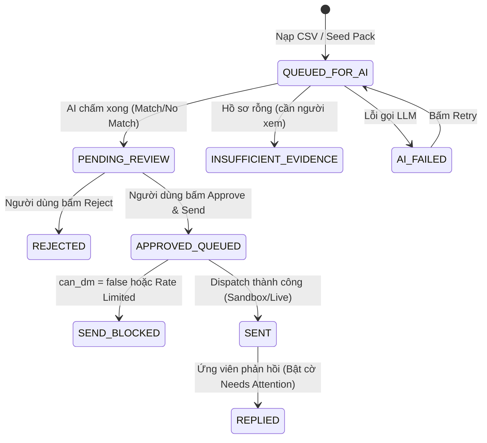

# Feature Spec 02: Database Schema, ORM Models & State Machine
*(WBS Task 2 / Module 4: State Machine & De-dupe)*

---

## 1. Design Thinking: Thấu cảm, Định nghĩa & Ý tưởng hóa (Empathize, Define, Ideate)

### A. Empathize (Thấu cảm người dùng)
1. **VC Partners & Investment Associates:**
   - *Nỗi sợ lớn nhất:* **Nhắn tin 2 lần cho cùng một founder (Double-messaging)**. Trong giới đầu tư mạo hiểm công nghệ cao, việc hai người trong cùng một quỹ cùng nhắn một câu chào generic cho một founder AI danh tiếng sẽ bị coi là thiếu chuyên nghiệp và làm suy giảm nghiêm trọng uy tín của quỹ.
   - *Hành vi vận hành:* Hay bấm nhanh, click đúp chuột khi mạng lag, hoặc nạp lại các file CSV tổng hợp sau vài tuần.
2. **Hiring Committee / Giám khảo:**
   - *Kỳ vọng:* Hệ thống chạy độc lập bằng file SQLite bền vững, không bắt cài PostgreSQL/Redis phức tạp, không mất dữ liệu khi restart server.
   - *Red Flag cấm kỵ:* *"Không chấp nhận lưu trữ tạm trong bộ nhớ (In-memory storage) cho thử thách này."*

### B. Define (Định nghĩa bài toán & HMW)
- **Tuyên ngôn vấn đề (POV):**
  > *"Hệ thống cần một cỗ máy trạng thái (State Machine) bất biến và cơ sở dữ liệu bền vững với các chốt chặn ràng buộc vật lý, nhằm triệt tiêu hoàn toàn khả năng gửi trùng tin nhắn (Zero Double-Messaging) dù người dùng click đúp, nạp lại dữ liệu cũ hay gặp sự cố mạng."*
- **4 Câu hỏi cốt lõi (How Might We):**
  - **HMW-1 (Zero Double-Messaging):** Làm thế nào để khóa chặn vật lý ở cấp Database khiến cho việc tạo bản ghi gửi tin thứ 2 cho cùng 1 người là bất khả thi?
  - **HMW-2 (Idempotency):** Làm thế nào để xử lý an toàn hiện tượng click đúp nút "Send" trong vòng vài mili-giây?
  - **HMW-3 (Zero-Config Persistence):** Làm thế nào để lưu trữ bền vững chuẩn ACID mà không bắt người chấm cài đặt bất kỳ database server nào?
  - **HMW-4 (Auditability):** Làm thế nào để lưu vết minh bạch trạng thái của từng ứng viên từ lúc nạp đến khi phản hồi?

### C. Ideate (Ý tưởng hóa giải pháp)
1. **Chốt chặn Bảo vệ 2 Lớp (Two-Tier Idempotency Gate):**
   - *Lớp 1 (Application Guard):* Kiểm tra logic trước khi tạo request (`candidate.status in ('SENT', 'REPLIED')`).
   - *Lớp 2 (Database Unique Constraint):* Khóa `UNIQUE` trên `candidate_id` và `handle` trong bảng `outreach_ledger`.
2. **Cỗ máy 9 Trạng thái Minh bạch (9-State Lifecycle Machine):**
   - Phân biệt rành mạch giữa lỗi hệ thống (`AI_FAILED`), thiếu dữ liệu (`INSUFFICIENT_EVIDENCE`), hành động bị chặn (`SEND_BLOCKED`) với trạng thái bình thường.
3. **SQLite Write-Ahead Logging (WAL Mode):**
   - Bật chế độ WAL để hỗ trợ đọc/ghi đồng thời an toàn, chịu tải mượt mà cho các background workers.

---

## 2. Mục tiêu cốt lõi (Core Purpose)
Quản lý vòng đời trạng thái của ứng viên qua cỗ máy trạng thái (State Machine) nghiêm ngặt và đảm bảo **tuyệt đối không bao giờ gửi tin nhắn 2 lần cho cùng một người (Zero Double-Messaging)** dưới mọi tình huống (kể cả click đúp, nạp lại CSV, hoặc lỗi mạng). Lưu trữ bền vững trên SQLite file (`outreach.db`).

---

## 3. Yêu cầu từ Đề bài (Requirements from Prompt)
- Tuyệt đối không gửi 2 lần cho cùng một người (*"It never double-messages anyone"*).
- Theo dõi minh bạch toàn bộ pipeline: ai đã gửi, ai đã phản hồi, cuộc hội thoại nào cần chú ý.
- Lưu trữ bền vững, không dùng In-memory storage.

---

## 4. Thách thức Kỹ thuật ngầm (Under-the-hood Technical Challenges)
- **Race Condition do Click Đúp:** Người dùng click liên tiếp 2 lần vào nút *Send* trong vài mili-giây có thể gây ra 2 request gửi tin song song.
- **Trùng lặp xuyên Chiến dịch (Cross-batch duplication):** Ứng viên `P001` và `P015` đã được gửi DM và đã phản hồi trong quá khứ (nằm trong `outreach_history_log.csv`), nhưng vài tuần sau lại xuất hiện trong một file CSV nạp mới.
- **Ràng buộc lưu trữ bền vững:** Không được dùng lưu tạm trong RAM. Phải lưu file SQLite với chế độ ghi đồng thời an toàn (WAL Mode).

---

## 5. Phân tích Đánh đổi Kỹ thuật (Trade-off Analysis)

| Hướng tiếp cận | Ưu điểm | Nhược điểm / Rủi ro | Quyết định & Lý do |
| :--- | :--- | :--- | :--- |
| **Cách tiếp cận A: Kiểm tra trùng lặp ở Frontend (Client-side Check)** | Đơn giản, code nhanh trong 5 dòng JS. | - **Red Flag nghiêm trọng:** Bất kỳ ai gọi trực tiếp API hoặc mở tab ẩn danh đều có thể bắn trùng tin nhắn.<br>- Mất sạch dữ liệu khi reload trang. | ❌ **LOẠI BỎ** |
| **Cách tiếp cận B: Dùng Redis Distributed Lock (Redlock)** | Xử lý concurrency cực mạnh ở quy mô hàng triệu user. | - Đòi hỏi người chấm phải cài đặt và chạy Redis server trên máy họ.<br>- Vi phạm cam kết cài đặt < 15 phút (*turnkey setup*). | ❌ **LOẠI BỎ** |
| **Cách tiếp cận C (ĐƯỢC CHỌN): SQLite Persistent Engine + Database-Level Unique Constraints + Immutable Outreach Ledger + Atomic Transaction** | - **Cài đặt 0-config:** SQLite chạy sẵn theo Python, lưu ra file `outreach.db`.<br>- **Ràng buộc cấp DB:** Khóa `UNIQUE` trên `handle` và `x_user_id` ở bảng `candidates` và `outreach_ledger`.<br>- **Idempotency Key:** Mỗi lệnh gửi có 1 khóa định danh duy nhất, giao dịch DB được thực hiện atomically (ACID).<br>- Nếu nạp người đã có trong Ledger $\rightarrow$ hệ thống nhận diện ngay và khóa nút Send. | Hiệu năng ghi tối đa khoảng vài nghìn write/s (dư sức phục vụ bài toán scouting VC). |  **CHỌN LỰA** (Chuẩn mực cho sản phẩm Take-home FDE). |

---

## 6. Ràng buộc & Điều kiện bất biến (What Must Be True)
1. **Khóa chống trùng cấp Database:** Cột `handle` trong bảng `outreach_ledger` bắt buộc mang ràng buộc `UNIQUE`.
2. **Khóa 1-1 giữa Ứng viên và Sổ cái Gửi tin:** Bảng `outreach_ledger` có khóa ngoại `candidate_id UNIQUE`, đảm bảo 1 hồ sơ chỉ có tối đa 1 bản ghi gửi tin trong suốt vòng đời.
3. **Chặn gửi 2 lớp (Two-tier Gate):**
   - Lớp 1 (Application logic): Trước khi gửi, kiểm tra `status in ('SENT', 'REPLIED')` HOẶC tồn tại trong `outreach_ledger`.
   - Lớp 2 (Database constraint): Câu lệnh `INSERT INTO outreach_ledger` sẽ ném ngoại lệ `IntegrityError` nếu có race condition lọt qua lớp 1.

---

## 7. Đặc tả Kỹ thuật chi tiết (Technical Specification)

### Sơ đồ Cỗ máy Trạng thái (9-State Lifecycle):


### Bảng Mô tả 9 Trạng thái:
| Trạng thái (`status`) | Ý nghĩa nghiệp vụ | Hành động khả dụng trên UI |
| :--- | :--- | :--- |
| `QUEUED_FOR_AI` | Mới nạp vào hệ thống, đang chờ Worker AI xử lý | Hiển thị spinner / Badge chờ |
| `PENDING_REVIEW` | AI đã chấm xong, có bản nháp DM | Cho phép Edit DM, Regenerate, Approve, Reject |
| `INSUFFICIENT_EVIDENCE` | Hồ sơ quá ngắn / rỗng (như `P018`), không đủ bằng chứng | Khóa nút Send, cảnh báo "Thiếu bằng chứng" |
| `AI_FAILED` | Lỗi mạng / timeout khi gọi LLM | Nút **[Retry AI Evaluation]** |
| `REJECTED` | Đầu tư viên đã từ chối hồ sơ | Lưu vết, chuyển sang tab Rejected |
| `APPROVED_QUEUED` | Đã duyệt gửi, đang nằm trong hàng đợi dispatch | Hiển thị tiến trình gửi |
| `SEND_BLOCKED` | Bị chặn do người nhận khóa DM (`can_dm=false`) hoặc lỗi quyền | Cảnh báo lý do bị chặn rõ ràng |
| `SENT` | Đã gửi DM thành công (Sandbox hoặc Live X) | Hiển thị nội dung đã gửi, nút [Record Reply] |
| `REPLIED` | Ứng viên đã trả lời | Bật cờ đỏ `NEEDS ATTENTION` cho Partner |

### SQLAlchemy ORM Data Models (SQLite):
```python
# backend/app/models/
class User(Base):
    __tablename__ = "users"
    id = Column(Integer, primary_key=True, index=True)
    email = Column(String, unique=True, index=True, nullable=False)
    full_name = Column(String, nullable=False)
    hashed_password = Column(String, nullable=False)
    role = Column(String, default="partner") # 'partner' | 'analyst'
    created_at = Column(DateTime, default=datetime.utcnow)

class Candidate(Base):
    __tablename__ = "candidates"
    id = Column(Integer, primary_key=True, index=True)
    x_user_id = Column(String, unique=True, nullable=True, index=True)
    handle = Column(String, unique=True, index=True, nullable=False)
    name = Column(String, nullable=False)
    location = Column(String, default="Southeast Asia")
    bio = Column(Text, default="")
    recent_tweets = Column(Text, default="")
    can_dm = Column(Boolean, default=True)
    segment = Column(String, default="SEA AI/Robotics Ecosystem")
    
    is_match = Column(Boolean, nullable=True)
    fit_score = Column(Integer, nullable=True) # 1 to 4
    fit_reason = Column(Text, nullable=True)
    evidence_snippet = Column(Text, nullable=True)
    draft_dm = Column(Text, nullable=True)
    edited_dm = Column(Text, nullable=True)
    
    status = Column(String, default="QUEUED_FOR_AI", index=True)
    error_message = Column(Text, nullable=True)
    created_at = Column(DateTime, default=datetime.utcnow)
    updated_at = Column(DateTime, default=datetime.utcnow, onupdate=datetime.utcnow)

class OutreachLedger(Base):
    __tablename__ = "outreach_ledger"
    id = Column(Integer, primary_key=True, index=True)
    candidate_id = Column(Integer, ForeignKey("candidates.id"), unique=True, nullable=False)
    handle = Column(String, unique=True, index=True, nullable=False)
    idempotency_key = Column(String, unique=True, nullable=False)
    sent_message = Column(Text, nullable=False)
    dispatch_mode = Column(String, default="SANDBOX") # 'SANDBOX' | 'LIVE_X'
    external_dm_id = Column(String, nullable=True)
    sent_by_user_id = Column(Integer, ForeignKey("users.id"), nullable=True)
    sent_at = Column(DateTime, default=datetime.utcnow)
    replied_at = Column(DateTime, nullable=True)
    reply_text = Column(Text, nullable=True)
    needs_attention = Column(Boolean, default=False)
    status = Column(String, default="SENT") # 'SENT' | 'REPLIED' | 'BLOCKED'

class JobQueue(Base):
    __tablename__ = "job_queue"
    id = Column(Integer, primary_key=True, index=True)
    job_type = Column(String, nullable=False) # 'AI_EVALUATE' | 'SEND_DM'
    candidate_id = Column(Integer, ForeignKey("candidates.id"), nullable=True)
    payload = Column(Text, nullable=True)
    status = Column(String, default="PENDING", index=True) # 'PENDING' | 'PROCESSING' | 'COMPLETED' | 'FAILED'
    attempts = Column(Integer, default=0)
    last_error = Column(Text, nullable=True)
    scheduled_at = Column(DateTime, default=datetime.utcnow)
    completed_at = Column(DateTime, nullable=True)
```

---

## 8. Kịch bản Kiểm thử & Nghiệm thu (Acceptance Criteria)
- [ ] **Test Click Đúp:** Gửi 2 request `POST /api/candidates/{id}/send` cùng lúc với cùng `idempotency_key`, request thứ 2 phải nhận mã `409 Conflict` và chỉ có đúng 1 tin nhắn trong ledger.
- [ ] **Test Seed History Protection:** Khi nạp lại `P001` (`@linhtran_robo`), hệ thống nhận diện đã có trong `outreach_ledger` (trạng thái `REPLIED`), nút gửi bị vô hiệu hóa và hiển thị badge *"Already Contacted"*.
- [ ] **Test Database Persistence:** Tắt server backend (`Ctrl+C`), khởi động lại, toàn bộ dữ liệu ứng viên và ledger vẫn giữ nguyên vẹn 100%.

