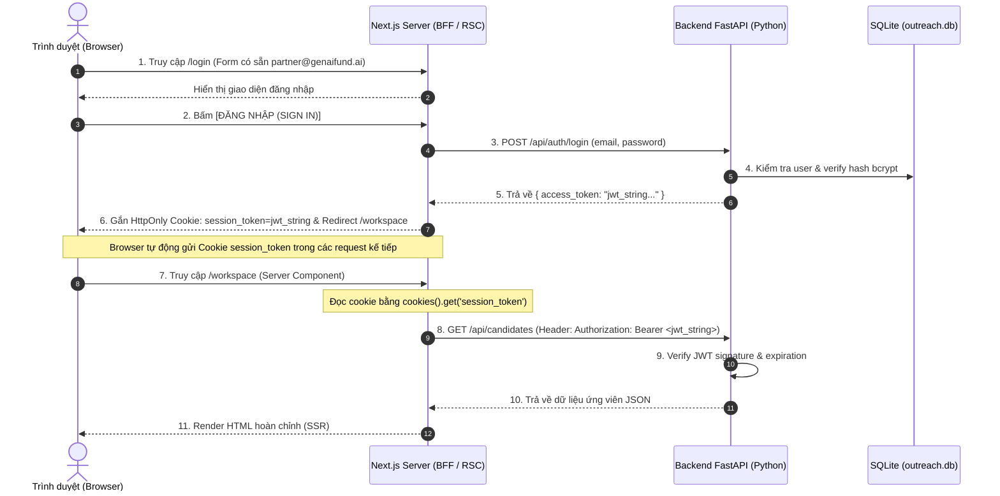

# Feature Spec 03: Authentication, Security Hygiene & Demo Login
*(WBS Task 3 / Platform Security)*

---

## 1. Design Thinking: Thấu cảm, Định nghĩa & Ý tưởng hóa (Empathize, Define, Ideate)

### A. Empathize (Thấu cảm người dùng)
1. **VC Investment Team (Người dùng thật):**
   - Cần phân quyền và định danh rõ ràng: ai là người duyệt hồ sơ (`reviewed_by`), ai là người bấm gửi DM (`sent_by`) để giữ trách nhiệm giải trình nội bộ.
   - Không muốn các API nhạy cảm (danh sách founder, draft DM, outreach history) bị lộ ra ngoài Internet.
2. **Hiring Committee / Giám khảo:**
   - *Áp lực thời gian:* Chỉ có < 15 phút để test toàn bộ ứng dụng trên máy mới.
   - *Sự ức chế lớn nhất:* Ứng dụng bắt phải cấu hình Google Cloud OAuth Client ID, Redirect URI, hoặc bắt buộc phải gõ form đăng ký tài khoản dài dòng mới vào được dashboard.
   - *Kỳ vọng:* Mở trang lên là thấy **tài khoản và mật khẩu đã được điền sẵn**, chỉ cần bấm nút `[Đăng nhập]` là vào thẳng hệ thống trong 1 giây.

### B. Define (Định nghĩa bài toán & HMW)
- **Tuyên ngôn vấn đề (POV):**
  > *"Hệ thống cần cơ chế xác thực bảo mật chuẩn công nghiệp để phân quyền và bảo vệ dữ liệu nhạy cảm, đồng thời phải cung cấp trải nghiệm đăng nhập 0-ma sát bằng thông tin tài khoản viết sẵn (pre-filled credentials) để người đánh giá kiểm thử tức thì chỉ với một cú click chuột."*
- **3 Câu hỏi cốt lõi (How Might We):**
  - **HMW-1 (Zero Friction for Reviewer):** Làm thế nào để người chấm bài vào ngay Dashboard với tư cách GenAI Fund Partner chỉ bằng 1 cú click mà không phải nhớ hay gõ bất kỳ ký tự nào?
  - **HMW-2 (Bulletproof API Security & Anti-XSS):** Làm thế nào để bảo vệ token an toàn tuyệt đối trước các nguy cơ tấn công XSS mà vẫn tương thích hoàn hảo giữa Next.js và FastAPI?
  - **HMW-3 (Secret Hygiene):** Làm thế nào để các API key (Gemini, X Token) tuyệt đối không bao giờ rò rỉ ra trình duyệt phía client?

### C. Ideate (Ý tưởng hóa giải pháp)
1. **Kiến trúc Next.js BFF (Backend-For-Frontend) với HttpOnly Cookie:**
   - Lưu trữ JWT trong `httpOnly Cookie` (`session_token`), ngăn chặn 100% mã độc JavaScript phía trình duyệt đánh cắp token qua XSS.
   - Next.js Server Components (`cookies()`) đọc cookie trên server và chuyển tiếp sang FastAPI dưới dạng header `Authorization: Bearer <jwt>`.
2. **Màn hình Đăng nhập Điền sẵn Thông tin (Pre-filled Credentials Login):**
   - Ô Email và Password được điền sẵn tài khoản đối tác hạt giống (`partner@genaifund.ai` / `GenAIFund2026!`). Người dùng chỉ cần nhấn nút `[Đăng nhập]` để vào thẳng hệ thống.
3. **Cơ chế Token Session Thực dụng (7-Day Long-Lived Token):**
   - Cấu hình access token có thời hạn 7 ngày, giúp buổi kiểm thử và demo của ban giám khảo diễn ra mượt mà, không bao giờ bị gián đoạn session.
4. **Chốt chặn Middleware FastAPI Dependency:**
   - Tiêm dependency `get_current_user` vào toàn bộ router nghiệp vụ (`/api/candidates`, `/api/outreach`, `/api/dashboard`), tự động trả `HTTP 401 Unauthorized` nếu request thiếu hoặc sai token.

---

## 2. Kiến trúc Thông tin (Information Architecture - IA)

Kiến trúc xác thực được thiết kế theo mô hình **Next.js BFF (Backend-For-Frontend)** kết hợp **FastAPI Stateless JWT**:

```mermaid
graph TD
    subgraph Client["1. Tầng Trình duyệt (Browser / Client)"]
        A1["Màn hình Đăng nhập (Pre-filled Email & Password)"]
        A2["Trình duyệt lưu: HttpOnly Cookie 'session_token' (Chống XSS)"]
        A3["Same-Origin Requests tới Next.js (/api/proxy hoặc Server Actions)"]
    end

    subgraph BFF["2. Tầng Next.js Server (BFF / Server Components)"]
        B1["Next.js Route Handler: POST /api/auth/login (Chuyển tiếp login)"]
        B2["Next.js Server Component: cookies().get('session_token')"]
        B3["Next.js Middleware: Chặn và redirect sớm nếu thiếu token"]
        B4["Gắn Header: Authorization: Bearer <JWT> gọi sang FastAPI"]
    end

    subgraph Backend_Gateway["3. Tầng FastAPI Backend (Python)"]
        C1["FastAPI Endpoint: POST /api/auth/login (Xác thực bcrypt)"]
        C2["Chốt chặn Dependency: Depends(get_current_user)"]
        C3["JWT Validator: Giải mã HS256 & Kiểm tra Hết hạn (exp)"]
        C4[("SQLite DB: users table (Bcrypt hashed_password)")]
    end

    A1 -->|1. Submit form| B1
    B1 -->|2. Forward login credentials| C1
    C1 -->|3. Query & verify hash| C4
    C1 -->|4. Return JWT access_token| B1
    B1 -->|5. Set-Cookie: session_token (HttpOnly)| A2
    A3 -->|6. Load /workspace| B2
    B2 -->|7. Server-to-server HTTP| C2
    C2 --> C3
```

### Phân cấp Dữ liệu & Thực thể (Data Taxonomy):
- **User Credentials Contract (SQLite `users` table):**
  - `email` (string, unique, lowercase, format: email).
  - `hashed_password` (string, bcrypt salted hash, không bao giờ lưu plain text).
  - `full_name` (string): Tên hiển thị của đối tác quỹ.
  - `role` (enum: `partner` | `analyst`).
- **Session & Token Payload (JWT Claims):**
  - `sub`: User ID hoặc email định danh (`partner@genaifund.ai`).
  - `exp`: Timestamp hết hạn (7 ngày kể từ lúc cấp).
  - `role`: Quyền hạn (`partner`).
- **Cookie Security Attributes:**
  - `Name`: `session_token`
  - `HttpOnly`: `true` (Trình duyệt chặn truy cập từ JavaScript `document.cookie`).
  - `SameSite`: `lax` (Bảo vệ chống tấn công CSRF).
  - `Path`: `/`
  - `Secure`: `true` khi chạy Production HTTPS.

---

## 3. Sơ đồ Điều hướng & Luồng Xác thực (Sitemaps & Auth Flows)



### Xử lý khi Token Hết Hạn (Expiration Handling):
Hệ thống áp dụng cơ chế phòng vệ 2 cấp:
1. **Tại Next.js `middleware.ts`:**
   - Đọc cookie `session_token`. Nếu không có hoặc token đã hết hạn (`exp < Date.now() / 1000`), xóa cookie và chuyển hướng ngay về `/login`.
2. **Tại Server Component / Client Fetch:**
   - Nếu FastAPI trả về `HTTP 401 Unauthorized`, Server Component tự động gọi `redirect('/login')` ngay trên máy chủ trước khi render HTML, loại bỏ hoàn toàn hiện tượng nhấp nháy màn hình.

---

## 4. Khung dây Giao diện (Wireframes & UI Component Blueprints)

### Wireframe 1: Màn hình Đăng nhập Tối giản với Thông tin Điền sẵn (Pre-filled Login Screen)
Giao diện đăng nhập chuẩn mực và tinh gọn, tài khoản và mật khẩu đã được điền sẵn:

```
┌──────────────────────────────────────────────────────────────────────────────────┐
│                                                                                  │
│                        ┌───────────────────────────────┐                         │
│                        │       [GenAI Fund Logo]       │                         │
│                        │   AUTONOMOUS SCOUTING & CRM   │                         │
│                        └───────────────────────────────┘                         │
│                                                                                  │
│         ┌─────────────────────────────────────────────────────────────┐          │
│         │                    ĐĂNG NHẬP HỆ THỐNG                       │          │
│         ├─────────────────────────────────────────────────────────────┤          │
│         │                                                             │          │
│         │  Email:                                                     │          │
│         │  ┌───────────────────────────────────────────────────────┐  │          │
│         │  │ partner@genaifund.ai                                  │  │          │
│         │  └───────────────────────────────────────────────────────┘  │          │
│         │                                                             │          │
│         │  Mật khẩu:                                                  │          │
│         │  ┌───────────────────────────────────────────────────────┐  │          │
│         │  │ ••••••••••••••• (GenAIFund2026!)                      │  │          │
│         │  └───────────────────────────────────────────────────────┘  │          │
│         │                                                             │          │
│         │  [X] Ghi nhớ đăng nhập                                      │          │
│         │                                                             │          │
│         │  ┌───────────────────────────────────────────────────────┐  │          │
│         │  │                 ĐĂNG NHẬP (SIGN IN)                   │  │          │
│         │  └───────────────────────────────────────────────────────┘  │          │
│         │                                                             │          │
│         └─────────────────────────────────────────────────────────────┘          │
│                                                                                  │
└──────────────────────────────────────────────────────────────────────────────────┘
```

### Wireframe 2: Thanh Header & Điều khiển Phiên Người dùng (Top Bar Session Controls)
Khi đã đăng nhập thành công vào hệ thống, thanh Header hiển thị Logo quỹ bên trái và Tên người dùng bên phải kèm menu tùy chọn Đăng xuất:

```
┌──────────────────────────────────────────────────────────────────────────────────┐
│ [GenAI Fund Logo]                                          [👤 General Partner ▾]│
│                                                            ┌───────────────────┐ │
│                                                            │  🚪 Đăng xuất     │ │
│                                                            └───────────────────┘ │
└──────────────────────────────────────────────────────────────────────────────────┘
```

---

## 5. Phân tích Đánh đổi Kỹ thuật (Trade-off Analysis)

### Bảng So sánh Kiến trúc Lưu trữ Session:

| Hướng tiếp cận | Ưu điểm | Nhược điểm / Rủi ro | Quyết định & Lý do |
| :--- | :--- | :--- | :--- |
| **Cách tiếp cận A: Client `localStorage` + Header Bearer** | Đơn giản, dễ code. | - **Lỗ hổng bảo mật XSS:** Bất kỳ mã script độc hại nào chạy trên trình duyệt đều đọc được token.<br>- Server Components của Next.js không thể đọc `localStorage` $\rightarrow$ không SSR được dữ liệu ban đầu. | ❌ **LOẠI BỎ** |
| **Cách tiếp cận B: OAuth2 Google / Auth0** | Chuẩn SSO doanh nghiệp. | Bắt buộc cấu hình cloud credentials phức tạp, tốn > 30 phút. | ❌ **LOẠI BỎ** |
| **Cách tiếp cận C: Dual Tokens với Refresh Token ngầm (Silent Refresh)** | Access token ngắn (15m), refresh token dài (7d). | - **Over-engineering:** Cần thêm bảng `refresh_tokens` trong SQLite, quản lý thu hồi token (token revocation), xử lý lỗi race condition khi nhiều request refresh đồng thời.<br>- Tiềm ẩn rủi ro phát sinh bug làm ngắt quãng phiên chấm thi của giám khảo. | ⏸️ **DÀNH CHO ROADMAP V2** |
| **Cách tiếp cận D (ĐƯỢC CHỌN): Next.js BFF + 7-Day HttpOnly Cookie + FastAPI Bearer JWT** | - **Bảo mật tuyệt đối:** Chống 100% XSS nhờ `httpOnly`.<br>- **SSR Mượt mà:** Next.js Server Components đọc cookie và nạp dữ liệu tức thì.<br>- **Không bị lỗi CORS:** Browser chỉ nói chuyện với Next.js (port 3000), Next.js gọi nội bộ sang FastAPI (port 8000).<br>- **0-Rủi ro gián đoạn:** Token 7 ngày đảm bảo giám khảo test liên tục không bao giờ bị văng session. | Cần cấu hình Route Handler proxy trong Next.js. |  **CHỌN LỰA** (Lựa chọn chuẩn mực của Senior FDE). |

---

## 6. Ràng buộc & Điều kiện bất biến (What Must Be True)
1. **Bảo vệ API Nghiệp vụ:** Mọi request tới `/api/candidates/*`, `/api/outreach/*`, `/api/dashboard/*` nếu không có Bearer token hợp lệ đều nhận mã lỗi `401 Unauthorized`.
2. **Không Rò rỉ Bí mật (Secret Hygiene):** Khóa bí mật (`GEMINI_API_KEY`, `X_BEARER_TOKEN`) chỉ được đọc từ biến môi trường máy chủ, tuyệt đối không xuất hiện trong bất kỳ response JSON nào gửi về trình duyệt.
3. **Mã hóa Mật khẩu Chuẩn:** Toàn bộ mật khẩu lưu trong bảng `users` bắt buộc phải được băm bằng thuật toán `bcrypt` có muối ngẫu nhiên (salt).

---

## 7. Đặc tả Kỹ thuật chi tiết (Technical Specification)

### FastAPI Auth Implementation (`backend/app/core/security.py`):
```python
pwd_context = CryptContext(schemes=["bcrypt"], deprecated="auto")
oauth2_scheme = OAuth2PasswordBearer(tokenUrl="/api/auth/login")

def verify_password(plain_password: str, hashed_password: str) -> bool:
    return pwd_context.verify(plain_password, hashed_password)

def get_password_hash(password: str) -> str:
    return pwd_context.hash(password)

def create_access_token(data: dict, expires_delta: Optional[timedelta] = None) -> str:
    to_encode = data.copy()
    # Thời hạn 7 ngày = 10080 phút
    expire = datetime.utcnow() + (expires_delta or timedelta(minutes=settings.ACCESS_TOKEN_EXPIRE_MINUTES))
    to_encode.update({"exp": expire})
    return jwt.encode(to_encode, settings.SECRET_KEY, algorithm=settings.ALGORITHM)
```

### Next.js BFF Route Handler (`app/api/auth/login/route.ts`):
```typescript
import { NextResponse } from 'next/server';

export async function POST(request: Request) {
  const body = await request.json();

  // Gọi nội bộ sang FastAPI
  const res = await fetch('http://127.0.0.1:8000/api/auth/login', {
    method: 'POST',
    headers: { 'Content-Type': 'application/json' },
    body: JSON.stringify(body),
  });

  if (!res.ok) {
    return NextResponse.json({ detail: 'Invalid credentials' }, { status: 401 });
  }

  const data = await res.json();
  const response = NextResponse.json({ success: true, user: data.user });

  // Thiết lập HttpOnly Cookie bảo mật
  response.cookies.set('session_token', data.access_token, {
    httpOnly: true,
    secure: process.env.NODE_ENV === 'production',
    sameSite: 'lax',
    path: '/',
    maxAge: 60 * 60 * 24 * 7, // 7 ngày
  });

  return response;
}
```

---

## 8. Kịch bản Kiểm thử & Nghiệm thu (Acceptance Criteria)
- [ ] **Test Unauthenticated Rejection:** Gọi `GET /api/candidates` mà không truyền Header `Authorization` $\rightarrow$ nhận mã `401 Unauthorized`.
- [ ] **Test Pre-filled Login:** Mở màn hình Login, bấm nút *"ĐĂNG NHẬP (SIGN IN)"* (khi đã điền sẵn tài khoản `partner@genaifund.ai`) $\rightarrow$ đăng nhập thành công vào Review Workspace với token JWT hợp lệ trong HttpOnly cookie.
- [ ] **Test Wrong Password:** Thử đăng nhập với mật khẩu sai $\rightarrow$ nhận mã `401 Incorrect email or password`.
- [ ] **Test Logout:** Bấm nút Đăng xuất $\rightarrow$ cookie `session_token` bị xóa, người dùng được chuyển hướng về `/login`.
