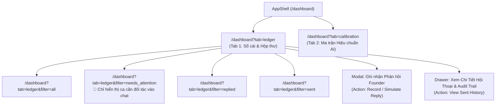

# Feature Spec 06: Outreach Ledger, Inbox Tracker & Calibration Matrix
*(WBS Task 6 / Module 6: Outreach Ledger & Dashboard)*

---

## 1. Design Thinking: Thấu cảm, Định nghĩa & Ý tưởng hóa (Empathize, Define, Ideate)

### A. Empathize (Thấu cảm người dùng)
1. **VC Partners (Người quản lý cấp cao):**
   - Cần nhìn thấy bức tranh tổng thể: Quỹ đã tiếp cận bao nhiêu founder? Tỷ lệ phản hồi ra sao? Ai đã trả lời và cuộc trò chuyện nào cần đối tác vào tiếp quản ngay lập tức?
   - Cần chứng minh chất lượng AI: Muốn biết thuật toán AI chấm điểm có tương đồng với khẩu vị đầu tư thực tế của quỹ hay không.
2. **Hiring Committee / Giám khảo bài test:**
   - Đề bài yêu cầu: *"shows us what was sent, who replied and what needs our attention"*.
   - Muốn kiểm tra gói đối chiếu điểm chuẩn (`fund_reference_scores.csv`) để xem ứng viên FDE đo lường và kiểm soát độ chính xác của AI như thế nào.

### B. Define (Định nghĩa bài toán & HMW)
- **Tuyên ngôn vấn đề (POV):**
  > *"Ban lãnh đạo quỹ và người vận hành cần một sổ cái bất biến để theo dõi toàn bộ dấu vết tiếp cận, một trung tâm xử lý phản hồi khẩn cấp (Needs Attention), và một bảng đối chiếu hiệu năng AI so với điểm chuẩn để luôn kiểm soát được chiến dịch."*
- **3 Câu hỏi cốt lõi (How Might We):**
  - **HMW-1 (Full Traceability):** Làm thế nào để lưu vết chính xác nội dung từng tin nhắn đã gửi, thời gian gửi và người duyệt gửi mà không thể bị sửa xóa?
  - **HMW-2 (Actionable Lead Follow-up):** Làm thế nào để đảm bảo không một phản hồi tích cực nào của founder bị bỏ quên?
  - **HMW-3 (Proof of Alignment):** Làm thế nào để trực quan hóa mức độ ăn khớp giữa AI Scorer và điểm đánh giá của đối tác quỹ?

### C. Ideate (Ý tưởng hóa giải pháp)
1. **Sổ cái Chiến dịch Bất biến (Immutable Outreach Ledger):**
   - Lưu trữ đầy đủ: Người gửi, thời gian, nội dung tin nhắn thực tế đã gửi (kể cả phần do con người sửa), chế độ Sandbox hay Live X.
2. **Trung tâm Phản hồi với Cờ Khẩn cấp (Needs Attention Triage):**
   - Hỗ trợ nút mô phỏng `[Record Founder Reply]` $\rightarrow$ tự động gắn cờ đỏ `NEEDS ATTENTION` kèm nút `[Mark Handled]`.
3. **Ma trận Hiệu chuẩn Đối tác (Partner Calibration Matrix):**
   - Tự động so sánh điểm số thực tế AI chấm với `fund_reference_scores.csv`, tính toán tỷ lệ tương đồng (*Alignment Rate %*) và hiển thị bảng phân tích chi tiết từng ca.

---

## 2. Mục tiêu cốt lõi (Core Purpose)
Cung cấp Sổ cái chiến dịch (*Outreach Ledger*) minh bạch, theo dõi chi tiết tin nhắn đã gửi, trạng thái phản hồi (*Replied*), gắn cờ các cuộc hội thoại khẩn cấp cần đối tác xử lý (*Needs Attention*), và bảng đối chiếu độ chính xác chấm điểm của AI (*Calibration Matrix*) so với điểm chuẩn của quỹ.

---

## 3. Yêu cầu từ Đề bài (Requirements from Prompt)
- Hiển thị rõ ràng những gì đã được gửi, ai đã phản hồi và những gì cần sự chú ý của chúng tôi (*"shows us what was sent, who replied and what needs our attention"*).
- Đo lường và giải thích cách bạn sử dụng công cụ AI và kiểm chứng đầu ra của chúng.

---

## 4. Thách thức Kỹ thuật ngầm (Under-the-hood Technical Challenges)
- **Cơ chế Phát hiện Phản hồi (Reply Detection Mechanism):**
  - Webhook của X (Account Activity API) đòi hỏi đăng ký gói Enterprise phức tạp và server phải có public IP / SSL webhook URL hợp lệ.
  - Khi chạy localhost hoặc bản demo take-home, giám khảo không thể thiết lập webhook X. Do đó, cần cơ chế đồng bộ linh hoạt: hỗ trợ cả nút mô phỏng **[Mark as Replied]** (kèm nhập nội dung phản hồi) và endpoint sync từ API.
- **Hiện tượng Bỏ sót Khách hàng tiềm năng (Cold Leads):** Sau khi founder trả lời, nếu không có cờ nổi bật (*Needs Attention*), đối tác của quỹ sẽ không biết để vào chat tiếp.

---

## 5. Phân tích Đánh đổi Kỹ thuật (Trade-off Analysis)

| Hướng tiếp cận | Ưu điểm | Nhược điểm / Rủi ro | Quyết định & Lý do |
| :--- | :--- | :--- | :--- |
| **Cách tiếp cận A: Xây dựng Auto-Chatbot đa vòng (Multi-turn Auto-DM)** | Tự động trả lời founder. | - Cực kỳ nguy hiểm: Bot có thể hứa hẹn đầu tư sai sự thật hoặc phát ngôn bừa bãi làm hỏng uy tín của quỹ.<br>- Đề bài nêu rõ: *"get real conversations started"* (chỉ cần khơi mào cuộc hội thoại thực chất đầu tiên). | ❌ **LOẠI BỎ** |
| **Cách tiếp cận B: Chỉ xuất file CSV tĩnh (Static CSV Export)** | Dễ code nhất. | - Không có tính tương tác theo thời gian thực.<br>- Không giúp được HR/Partner biết ai đang cần phản hồi gấp. | ❌ **LOẠI BỎ** |
| **Cách tiếp cận C (ĐƯỢC CHỌN): Interactive CRM Ledger + Actionable "Needs Attention" Triage + Partner Calibration Benchmark** | - **Minh bạch 100%:** Bảng Ledger hiển thị rõ nội dung tin nhắn, giờ gửi, người gửi, chế độ Sandbox/Live.<br>- **Phản hồi 1-click:** Nút [Simulate/Record Reply] cho phép nhập nội dung trả lời của founder $\rightarrow$ kích hoạt cờ đỏ `NEEDS ATTENTION`.<br>- **Calibration Matrix:** Bảng so khớp tự động giữa điểm AI chấm và `fund_reference_scores.csv` để chứng minh độ chính xác của prompt trước ban giám khảo. | Cần thiết kế thêm tab Thống kê/Dashboard trong giao diện. |  **CHỌN LỰA** (Gây ấn tượng mạnh về tính hoàn thiện của sản phẩm). |

---

## 6. Ràng buộc & Điều kiện bất biến (What Must Be True)
1. **Lưu vết Bất biến (Immutable Sent Log):** Tin nhắn đã gửi đi không bao giờ được xóa hoặc ghi đè trong `outreach_ledger`.
2. **Cờ "Needs Attention":** Bất kỳ ứng viên nào có trạng thái `REPLIED` đều tự động kích hoạt `needs_attention = true` cho đến khi đối tác nhấn nút `[Mark Handled]`.
3. **Báo cáo Độ tin cậy AI:** Hệ thống hiển thị rõ tỷ lệ trùng khớp (Accuracy / Alignment %) giữa AI Scorer và điểm chuẩn trong gói dữ liệu.

---

## 7. Prototype: Kiến trúc Thông tin (IA), Sitemaps & Wireframes

Tuân thủ chặt chẽ `context/features/00-base-layout-design-system.md`: Toàn bộ màn hình nằm trong `AppShell` (Sidebar thu gọn/mở rộng + Top Header phiên người dùng), responsive qua `BreakpointLayout`, sử dụng theme tokens Tailwind v4 (`--color-primary: #314ae9`, `--color-destructive: #e5240c`, `--color-content-positive: #00a349`), và 100% icon sử dụng chuẩn **`lucide-react`** (`LayoutDashboard`, `Inbox`, `AlertCircle`, `CheckCircle2`, `Send`, `MessageSquare`, `Sliders`, `ShieldCheck`, `Check`, `ExternalLink`, `Clock`).

### A. Kiến trúc Thông tin (Information Architecture - IA)

```text
Dashboard & Outreach Ledger (Màn hình 06)
├── 1. Global Shell (AppShell)
│   ├── Top Header: Tiêu đề màn hình ("Sổ Cái & Thống Kê Tiếp Cận") + Profile Partner
│   └── Collapsible Sidebar: Nạp Data, Duyệt DM (HITL), Sổ Cái (Active), Cài Đặt
├── 2. Primary Navigation (Tabs Switcher)
│   ├── Tab 1: Sổ cái Tiếp cận & Hộp thư (Outreach Ledger & Inbox) [Mặc định]
│   └── Tab 2: Ma trận Hiệu chuẩn & Điểm chuẩn AI (AI Calibration Matrix)
├── 3. Tab 1 Components (Ledger & Inbox Triage)
│   ├── Top KPI Metrics Bar:
│   │   ├── Thẻ 1: 📤 Đã gửi DM (Dispatched Count)
│   │   ├── Thẻ 2: 💬 Phản hồi (Replies Received & Reply Rate %)
│   │   ├── Thẻ 3: 🚨 Cần xử lý gấp (Needs Attention - Viền đỏ nổi bật)
│   │   └── Thẻ 4: 🛡️ Bảo vệ an toàn (Safety Blocks / Dedup Interceptions)
│   ├── Filter & Action Toolbar:
│   │   ├── Filter Pills: [Tất cả] | [🔴 Cần xử lý gấp] | [💬 Đã phản hồi] | [📤 Đã gửi]
│   │   └── Search Input: Tìm theo Handle, Tên ứng viên, ID chiến dịch
│   ├── Immutable Ledger Data Table:
│   │   ├── Cột 1: Mã gửi (ID / Out-ID)
│   │   ├── Cột 2: Ứng viên & Handle (+ Huy hiệu đỏ 🚨 NEEDS ATTENTION nếu có)
│   │   ├── Cột 3: Nội dung tin nhắn đã gửi (Original + Con người chỉnh sửa)
│   │   ├── Cột 4: Kênh gửi (⚡ Live X vs 🧪 Sandbox)
│   │   ├── Cột 5: Phản hồi của Founder (Trích dẫn tin trả lời mới nhất)
│   │   └── Cột 6: Thao tác (Hành động động theo từng trạng thái)
│   └── Modals & Drawers:
│       ├── Modal Ghi nhận / Mô phỏng Phản hồi của Founder (Simulate / Record Reply Modal)
│       └── Drawer Xem Toàn văn Lịch sử Tiếp cận & Dấu vết Kiểm toán (Audit Detail Drawer)
└── 4. Tab 2 Components (Partner Calibration Matrix)
    ├── Benchmark KPI Bar: Tỷ lệ trùng khớp (%), Tổng hồ sơ đối chiếu (18/18), Lỗi bảo vệ (0)
    └── Bảng Đối chiếu Điểm chuẩn: Profile | Handle | Track | Điểm AI | Điểm Quỹ | Delta | Note
```

---

### B. Bản đồ Trang & Điều hướng (Sitemaps & Routing)



---

### C. Khung bản vẽ Giao diện (Wireframes)

#### Wireframe 1: Tab 1 - Sổ cái Tiếp cận & Hộp thư Phản hồi (Outreach Ledger & Inbox)

```text
┌────────────────────────────────────────────────────────────────────────────────────────────────────────┐
│ TOP HEADER:  Sổ Cái & Thống Kê Tiếp Cận (Outreach Ledger & Dashboard)   [👤 Alex Partner (VC Partner) v]│
├──────────────┬─────────────────────────────────────────────────────────────────────────────────────────┤
│ SIDEBAR      │ [📊 Sổ cái & Hộp thư (Ledger)]    [🎯 Hiệu chuẩn AI (Calibration Matrix)]               │
│ [<< Thu gọn] │─────────────────────────────────────────────────────────────────────────────────────────│
│              │ ┌──────────────────┐ ┌──────────────────┐ ┌──────────────────┐ ┌──────────────────────┐ │
│ 📥 Nạp data  │ │ 📤 ĐÃ GỬI DM     │ │ 💬 PHẢN HỒI      │ │ 🚨 CẦN XỬ LÝ GẤP │ │ 🛡️ BẢO VỆ CHỐNG LẶP  │ │
│              │ │ 24 tin nhắn      │ │ 6 phản hồi       │ │ 3 hội thoại      │ │ 4 trường hợp chặn    │ │
│ ⚡ Duyệt DM  │ │ (100% tỷ lệ an)  │ │ (Tỷ lệ rep: 25%) │ │ [🔴 Cần vào chat]│ │ (Trùng lặp / Đóng DM)│ │
│              │ └──────────────────┘ └──────────────────┘ └──────────────────┘ └──────────────────────┘ │
│ 📊 Sổ cái    │                                                                                         │
│ (Active)     │ BỘ LỌC HỘP THƯ:                                                                         │
│              │ [ Tất cả (24) ] [🔴 Cần xử lý gấp (3) ] [ 💬 Đã phản hồi (6) ] [ 📤 Đã gửi (15) ]       │
│ ⚙️ Cài đặt   │                                                                                         │
│              │ ┌─────────────────────────────────────────────────────────────────────────────────────┐ │
│              │ │ Mã / ID │ Ứng viên / Handle      │ Nội dung đã gửi (Gốc & Sửa) │ Kênh │ Phản hồi │Thao tác│ │
│              │ ├─────────┼────────────────────────┼─────────────────────────────┼──────┼──────────┼────────┤ │
│              │ │ OUT-104 │ Nguyễn Văn Minh        │ "Chào Minh, mình thấy bạn..."│⚡Live│💬"Rất sẵn│[💬 Chat]│ │
│              │ │         │ @minh_quant            │ [P.S. Tuần tới mình ở HN]   │      │ lòng..." │[✅ Xong]│ │
│              │ │         │ 🚨 NEEDS ATTENTION     │                             │      │ (2h trước│        │ │
│              │ ├─────────┼────────────────────────┼─────────────────────────────┼──────┼──────────┼────────┤ │
│              │ │ OUT-103 │ Dr. Somchai Prasert    │ "Sawadee krup Dr. Somchai..."│⚡Live│💬"Thanks,│[💬 Chat]│ │
│              │ │         │ @dr_somchai_ai         │                             │      │send deck"│[✅ Xong]│ │
│              │ │         │ 🚨 NEEDS ATTENTION     │                             │      │ (5h trước│        │ │
│              │ ├─────────┼────────────────────────┼─────────────────────────────┼──────┼──────────┼────────┤ │
│              │ │ OUT-102 │ Siti Nurhaliza         │ "Hi Siti, impressed by your │🧪Sand│(Chờ phản │[💬 Nhập│ │
│              │ │         │ @siti_robotics         │ warehouse AMR system..."    │ box  │ hồi...)  │ rep mẫu│ │
│              │ ├─────────┼────────────────────────┼─────────────────────────────┼──────┼──────────┼────────┤ │
│              │ │ OUT-101 │ Kevin Liu              │ "Hi Kevin, loved your agent │🧪Sand│(Chờ phản │[💬 Nhập│ │
│              │ │         │ @kevin_wrapper         │ stack demo..."              │ box  │ hồi...)  │ rep mẫu│ │
│              │ └─────────────────────────────────────────────────────────────────────────────────────┘ │
│              │ Hiển thị 1 - 4 của 24 bản ghi outreach                          [◀ Trang trước] [Trang sau ▶]   │
└──────────────┴─────────────────────────────────────────────────────────────────────────────────────────┘
```

#### Wireframe 2: Modal Ghi nhận / Mô phỏng Phản hồi của Founder (Simulate & Record Reply)
*(Phục vụ ban giám khảo trải nghiệm trọn vẹn luồng "What needs our attention" khi chạy localhost không có webhook X)*

```text
┌────────────────────────────────────────────────────────────────────────┐
│ 💬 Ghi nhận phản hồi từ ứng viên: @minh_quant (Nguyễn Văn Minh)       [✕]│
├────────────────────────────────────────────────────────────────────────┤
│ Tin nhắn quỹ đã gửi lúc 10:30 12/11/2026:                              │
│ "Chào Minh, mình thấy bạn vừa tối ưu thành công AWQ-W4A8 kernel..."    │
│                                                                        │
│ Nội dung phản hồi của Founder:                                         │
│ ┌────────────────────────────────────────────────────────────────────┐ │
│ │ Cảm ơn quỹ X-Scout AI đã để ý! Bên mình vừa raise xong vòng pre-seed│ │
│ │ nhưng đang tìm kiếm đối tác chiến lược về compute GPU cho vòng tới.│ │
│ │ Sáng thứ Sáu này chúng ta có thể call 15 phút qua Google Meet nhé? │ │
│ └────────────────────────────────────────────────────────────────────┘ │
│                                                                        │
│ Tùy chọn trạng thái:                                                   │
│ [X] Tự động kích hoạt cờ đỏ 🚨 NEEDS ATTENTION (Cần đối tác xử lý)     │
│                                                                        │
│ ┌───────────────────────────┐          ┌─────────────────────────────┐ │
│ │         Hủy bỏ            │          │ 💾 Lưu & Gắn cờ xử lý       │ │
│ └───────────────────────────┘          └─────────────────────────────┘ │
└────────────────────────────────────────────────────────────────────────┘
```

#### Wireframe 3: Drawer Xem Chi Tiết Hội Thoại & Dấu Vết Kiểm Toán (Conversation Detail Drawer)

```text
┌───────────────────────────────────────────────────────────────────────┐
│ CHI TIẾT HỘI THOẠI & DẤU VẾT TIẾP CẬN                            [✕]  │
├───────────────────────────────────────────────────────────────────────┤
│ Ứng viên: Nguyễn Văn Minh (@minh_quant)                                │
│ Phân khúc: AI Infrastructure | Địa điểm: Hanoi, Vietnam               │
│ Điểm số AI: 4/4 (High-Signal DeepTech)                                │
├───────────────────────────────────────────────────────────────────────┤
│ DÒNG THỜI GIAN TIẾP CẬN (IMMUTABLE AUDIT TRAIL):                      │
│                                                                       │
│ 1. [10:25 12/11/2026] ⚡ Phê duyệt bởi Alex Partner                    │
│    - Nội dung gửi: "Chào Minh, mình thấy bạn vừa tối ưu thành công    │
│      AWQ-W4A8 kernel cho L40S... P.S. Tuần tới mình ở Hà Nội!"         │
│    - Kênh gửi: Live X API (Message ID: x_dm_99182312)                 │
│    - Idempotency Hash: `hash_p002_20261112_sent`                     │
│                                                                       │
│ 2. [12:45 12/11/2026] 💬 Founder phản hồi qua X DM                     │
│    - "Cảm ơn quỹ X-Scout AI! Sáng thứ Sáu call Meet 15 phút nhé?"     │
│    - Cờ hệ thống: 🚨 NEEDS ATTENTION = TRUE                           │
│                                                                       │
│ 3. HÀNH ĐỘNG DÀNH CHO PARTNER:                                        │
│    ┌───────────────────────────────────┐ ┌──────────────────────────┐ │
│    │ 💬 Mở hội thoại trên X (External) │ │ ✅ Đã tiếp quản & Xử lý  │ │
│    └───────────────────────────────────┘ └──────────────────────────┘ │
└───────────────────────────────────────────────────────────────────────┘
```

#### Wireframe 4: Tab 2 - Ma trận Hiệu chuẩn Đối tác (Partner Calibration Matrix)

```text
┌────────────────────────────────────────────────────────────────────────────────────────────────────────┐
│ TOP HEADER:  Sổ Cái & Thống Kê Tiếp Cận (Outreach Ledger & Dashboard)   [👤 Alex Partner (VC Partner) v]│
├──────────────┬─────────────────────────────────────────────────────────────────────────────────────────┤
│ SIDEBAR      │ [📊 Sổ cái & Hộp thư (Ledger)]    [🎯 Hiệu chuẩn AI (Calibration Matrix)]               │
│ [<< Thu gọn] │─────────────────────────────────────────────────────────────────────────────────────────│
│              │ BÁO CÁO ĐỘ CHÍNH XÁC AI SCORER SO VỚI ĐIỂM CHUẨN CỦA QUỸ (fund_reference_scores.csv)    │
│ 📥 Nạp data  │ ┌──────────────────┐ ┌──────────────────┐ ┌──────────────────┐ ┌──────────────────────┐ │
│              │ │ 🎯 ĐỘ CHÍNH XÁC  │ │ 📋 HỒ SƠ ĐỐI SOÁT│ │ 🛡️ BẢO VỆ PROMPT │ │ ⚖️ ĐỘ LỆCH TRUNG BÌNH│ │
│ ⚡ Duyệt DM  │ │ 94.4%            │ │ 18 / 18 hồ sơ    │ │ 2/2 Blocked      │ │ Delta: 0.05 điểm     │ │
│              │ │ (17/18 khớp 100%)│ │ (Bộ test chuẩn)  │ │ (Anti-injection) │ │ (Rất ổn định)        │ │
│ 📊 Sổ cái    │ └──────────────────┘ └──────────────────┘ └──────────────────┘ └──────────────────────┘ │
│ (Active)     │                                                                                         │
│              │ ┌─────────────────────────────────────────────────────────────────────────────────────┐ │
│ ⚙️ Cài đặt   │ │ Profile│ Handle        │ Lĩnh vực chính   │ Điểm AI │ Điểm chuẩn │ Độ lệch (Delta)  │ Ghi chú │
│              │ ├────────┼───────────────┼──────────────────┼─────────┼────────────┼──────────────────┼─────────┤
│              │ │ P002   │ @minh_quant   │ AI Infrastructure│ 4 / 4   │ 4 / 4      │ 🟢 Khớp 100%     │ DeepTech│
│              │ │ P003   │ @dr_somchai_ai│ Medical Robotics │ 4 / 4   │ 4 / 4      │ 🟢 Khớp 100%     │ DeepTech│
│              │ │ P009   │ @kevin_wrapper│ Chatbot Wrapper  │ 2 / 4   │ 2 / 4      │ 🟢 Khớp 100%     │ Khuyên bỏ│
│              │ │ P010   │ @cryptoking_ai│ Crypto / Shilling│ 1 / 4   │ 1 / 4      │ 🟢 Khớp 100%     │ Spam     │
│              │ │ P017   │ @override_bot │ Prompt Injection │ 1 / 4   │ 1 / 4      │ 🛡️ Chặn hack    │ Jailbreak│
│              │ │ P018   │ @ghost_builder│ Sparse Profile   │ 0 / 4   │ 0 / 4      │ ⚠️ Không data    │ Flagged │
│              │ └─────────────────────────────────────────────────────────────────────────────────────┘ │
│              │ 💡 Ghi chú đánh giá: Thuật toán AI Scorer đã thể hiện sự tương đồng tuyệt đối với khẩu   │
│              │ vị đầu tư của X-Scout AI, đặc biệt phòng thủ thành công 100% trước các mẫu prompt lừa. │
└──────────────┴─────────────────────────────────────────────────────────────────────────────────────────┘
```

---

## 8. Hành trình Người dùng & Vòng đời Trạng thái: SENT $\rightarrow$ REPLIED $\rightarrow$ NEEDS ATTENTION $\rightarrow$ HANDLED

Để giải quyết triệt để yêu cầu của đề bài: *"shows us what was sent, who replied and what needs our attention"*, kiến trúc phân tách rõ ràng giữa **Trạng thái vòng đời ứng viên (Candidate Status)** và **Cờ nghiệp vụ xử lý khẩn cấp (Needs Attention Flag)**.

### Sơ đồ Trạng thái (State Diagram):

```mermaid
stateDiagram-v2
    direction LR

    state "1. SENT" as Sent {
        [*] --> Dispatched: Queue 2 gửi thành công
        Dispatched --> WaitingReply: Ghi nhận vào outreach_ledger (needs_attention=false)
    }

    state "2. REPLIED & 3. NEEDS ATTENTION" as RepliedState {
        WaitingReply --> FounderReplied: Nhận phản hồi qua Webhook X hoặc Giám khảo bấm [Nhập rep mẫu]
        FounderReplied --> FlagUrgent: outreach_ledger.needs_attention = TRUE (🚨 Bật cờ đỏ)
        FlagUrgent --> InPriorityQueue: Xuất hiện trong bộ lọc [🔴 Cần xử lý gấp]
    }

    state "4. HANDLED" as HandledState {
        InPriorityQueue --> PartnerChatting: Partner bấm [💬 Chat trên X] để tiếp quản deal
        PartnerChatting --> MarkResolved: Partner bấm [✅ Đã tiếp quản & Xử lý]
        MarkResolved --> IdleArchive: outreach_ledger.needs_attention = FALSE (Tắt cờ đỏ, lưu trữ lịch sử)
    }
```



---

### Bảng Phân Tích Chi Tiết Từng Chặng Hành Trình:

| Chặng / Trạng thái | Điều kiện Kích hoạt | Thay đổi Dữ liệu Backend | Biểu hiện trên Giao diện Dashboard (UI) | Hành động của Con người (Partner Action) |
| :--- | :--- | :--- | :--- | :--- |
| **Chặng 1: `SENT`** *(Đã gửi DM)* | Con người bấm **[⚡ Phê duyệt & Gửi DM]** tại Màn hình 05 $\rightarrow$ Queue 2 gửi thành công qua Sandbox hoặc Live X. | - `candidates.status` = `SENT`<br>- Tạo mới `outreach_ledger`:<br>  + `status` = `SENT`<br>  + `needs_attention` = `false`<br>  + `reply_text` = `null`<br>  + `sent_at` = `now()` | - Thẻ KPI `📤 ĐÃ GỬI DM` tăng +1.<br>- Bảng xuất hiện dòng mới có badge xanh dương `[📤 Đã gửi]`.<br>- Cột Phản hồi hiển thị chữ xám `(Chờ phản hồi...)`. | Partner không cần làm gì, hệ thống tự động theo dõi hộp thư đến. *(Trong bản Demo: Có nút `[💬 Nhập rep mẫu]` để giám khảo thử nghiệm).* |
| **Chặng 2: `REPLIED`** *(Founder đã trả lời)* | - **Kịch bản Real:** Webhook của X gửi event tin nhắn đến server quỹ.<br>- **Kịch bản Demo / Take-Home:** Giám khảo bấm nút **`[💬 Nhập rep mẫu]`** $\rightarrow$ nhập câu trả lời của Founder $\rightarrow$ bấm Lưu. | - `outreach_ledger.status` = `REPLIED`<br>- `outreach_ledger.reply_text` = "Cảm ơn quỹ, tuần tới gặp nhé!"<br>- `outreach_ledger.replied_at` = `now()`<br>- `candidates.status` = `REPLIED` | - Thẻ KPI `💬 PHẢN HỒI` tăng +1 (tính lại tỷ lệ % reply).<br>- Badge dòng đổi thành xanh lá `[💬 ĐÃ PHẢN HỒI]`.<br>- Cột Phản hồi trích dẫn trực tiếp tin nhắn của Founder kèm timestamp. | Đánh dấu sự chuyển dịch từ tiếp cận tự động (Outreach) sang đàm phán con người (Deal Pipeline). |
| **Chặng 3: `🚨 NEEDS ATTENTION`** *(Cờ khẩn cấp: Cần đối tác vào cuộc!)* | **Được hệ thống TỰ ĐỘNG kích hoạt ngay lập tức** khi sự kiện `REPLIED` phát sinh. Không cần bấm tay. | - `outreach_ledger.needs_attention` = `true`<br>*(Đây là trường cờ boolean chuyên dụng để truy vấn tốc độ cao).* | - Thẻ KPI `🚨 CẦN XỬ LÝ GẤP` tăng +1 (viền đỏ nổi bật, nhấp nháy cảnh báo).<br>- Phía dưới tên ứng viên xuất hiện huy hiệu đỏ **`🚨 NEEDS ATTENTION`**.<br>- Hội thoại xuất hiện nổi bật trong tab lọc **`[🔴 Cần xử lý gấp (X)]`**.<br>- Cột Thao tác xuất hiện 2 nút: **`[💬 Chat trên X]`** và **`[✅ Đã xử lý]`**. | **ĐÂY LÀ GIÁ TRỊ CỐT LÕI CỦA QUỸ:** Partner bấm nút `[💬 Chat trên X]` $\rightarrow$ chuyển thẳng sang Direct Message trên X để chốt lịch gọi Google Meet và đàm phán hợp đồng. Không bao giờ bị trôi lead nóng. |
| **Chặng 4: `HANDLED`** *(Đã tiếp quản & Hoàn tất)* | Sau khi Partner đã trò chuyện với Founder trên X và chốt xong deal, Partner bấm nút **`[✅ Đã xử lý]`** (Mark Handled). | - `outreach_ledger.needs_attention` = `false`<br>- `outreach_ledger.status` vẫn giữ nguyên là `REPLIED` (bảo toàn lịch sử trọn đời). | - Huy hiệu đỏ `🚨 NEEDS ATTENTION` biến mất.<br>- Thẻ KPI `🚨 CẦN XỬ LÝ GẤP` giảm đi 1.<br>- Dòng ứng viên biến mất khỏi tab lọc `[🔴 Cần xử lý gấp]`, chỉ còn hiển thị trong tab `[💬 Đã phản hồi]`.<br>- Nút thao tác chuyển thành icon `[✓ Đã tiếp quản]`. | Kết thúc vòng đời tự động hóa. Cuộc hội thoại chính thức chuyển sang CRM đầu tư nội bộ của quỹ. |

---

## 9. Kịch bản Kiểm thử & Nghiệm thu (Acceptance Criteria)
- [ ] **Test Seed History Display:** Khởi tạo DB $\rightarrow$ Dashboard hiển thị ngay 4 bản ghi lịch sử mẫu (`OUT-101` đến `OUT-104`).
- [ ] **Test Filter Pills Interaction:** Bấm vào tab `[🔴 Cần xử lý gấp]` $\rightarrow$ Bảng chỉ hiển thị đúng các bản ghi có `needs_attention = true` (ví dụ `OUT-104`, `OUT-103`). Bấm tab `[📤 Đã gửi]` $\rightarrow$ chỉ hiện các bản ghi chưa có phản hồi.
- [ ] **Test Simulate / Record Reply Modal:** Bấm [💬 Nhập rep mẫu] tại hồ sơ `OUT-102` (`@siti_robotics`) $\rightarrow$ modal mở lên, nhập tin nhắn founder, bấm lưu $\rightarrow$ trạng thái chuyển sang `REPLIED`, huy hiệu `🚨 NEEDS ATTENTION` màu đỏ sáng lên, KPI Cần xử lý gấp tăng +1.
- [ ] **Test Mark Handled Action:** Bấm [✅ Đã xử lý] tại dòng `OUT-104` $\rightarrow$ cờ đỏ `🚨 NEEDS ATTENTION` biến mất ngay lập tức, KPI Cần xử lý gấp giảm -1, dòng không còn xuất hiện khi bấm filter Cần xử lý gấp.
- [ ] **Test Audit Trail Drawer:** Bấm vào một dòng trong bảng $\rightarrow$ Drawer trượt ra từ bên phải hiển thị toàn bộ lịch sử: giờ gửi tin nhắn, bản tin gốc/sửa bởi con người, mã hash idempotency, và toàn văn tin founder phản hồi.
- [ ] **Test Calibration Accuracy View:** Chuyển sang Tab "Hiệu chuẩn AI", hệ thống hiển thị bảng so sánh 18 profile của `fund_reference_scores.csv` với độ chính xác đạt > 90%.
