# Feature Spec 07: Live Verification, Clean User-Only Reset, Manual QA, Docker Packaging & AWS Multi-Env Deployment
*(WBS Task 7 / Production Readiness, Verification & Cloud Handover — Rebuilt Spec)*

---

## 1. Design Thinking: Thấu cảm, Định nghĩa & Ý tưởng hóa (Empathize, Define, Ideate)

### A. Empathize (Thấu cảm người dùng & Đội vận hành)
1. **FDE / AI Engineer (Người kiểm chứng chất lượng AI & X thật):**
   - *Nỗi đau:* Bộ test offline (`pytest` 35/35 + `CT-01..CT-06` + `PW-01..PW-09`) chạy deterministic `$0` bằng mock/fallback đã xanh 100%, nhưng vẫn chưa chứng minh được hành vi thật khi cắm **Live Gemini/OpenAI API Key** và **Live X API v2 Key** (latency thật, JSON schema tuân thủ, Prompt Injection thật từ LLM, X rate limit, quyền DM).
   - *Nhu cầu reset sạch:* Sau nhiều vòng seed và test, database bị lẫn dữ liệu mẫu. Khi chuẩn bị demo hoặc giao cho QA test thủ công từ trang trắng, họ cần **1 lệnh reset sạch toàn bộ bảng nghiệp vụ**, chỉ giữ lại đúng tài khoản `users` để đăng nhập (`/login`) rồi tự nạp lại từ đầu.
2. **Manual QA Reviewer / Hiring Committee:**
   - Cần một **Checklist kiểm thử thủ công (Manual QA Checklist)** rõ ràng từng bước để nghiệm thu trải nghiệm người dùng thật, responsive, copywriting mới, collapse KPI, single-line badge, cũng như xác nhận luồng khi cắm API key thật.
3. **DevOps / Cloud Engineer (Người đóng gói & Đưa lên AWS):**
   - Không thể giao hệ thống chạy tay qua 2 terminal `uvicorn` + `npm run dev` để vận hành dài hạn. Cần đóng gói chuẩn **Docker Image** cho Frontend Next.js & Backend FastAPI, dựng **`docker-compose.yml`** chạy ổn định cục bộ/on-prem, và thiết kế sẵn phương án **Deploy lên AWS (Terraform / AWS SAM)** có phân chia môi trường `dev` / `staging` / `prod` rạch ròi (đặc biệt khóa an toàn không để `dev`/`staging` gửi nhầm DM thật ra X).

### B. Define (Định nghĩa bài toán & HMW)
- **Tuyên ngôn vấn đề (POV):**
  > *"Hệ thống sau giai đoạn kiểm thử cô lập (Feature 08) cần được kiểm chứng thực tế với Live X & AI API Keys, có công cụ reset dữ liệu sạch chỉ giữ User đăng nhập, có Checklist QA thủ công chuẩn hóa, được đóng gói hoàn chỉnh bằng Docker/Docker Compose và có kiến trúc hạ tầng AWS đa môi trường sẵn sàng vận hành thực tế."*
- **5 Câu hỏi cốt lõi (How Might We):**
  - **HMW-1 (Live AI & X Verification):** Làm sao test nhanh độ chính xác, chi phí và các chốt chặn an toàn (`P017` Injection, `P018` Sparse, Evidence Grounding, `ALLOWED_TEST_HANDLES`) khi cắm **Live LLM & Live X API Keys** mà không ảnh hưởng bộ regression offline?
  - **HMW-2 (Clean User-Only Reset):** Làm sao đưa DB về trạng thái trắng hoàn toàn (`0 candidates`, `0 outreach_ledger`, `0 job_queue`) nhưng vẫn giữ nguyên tài khoản đăng nhập (`partner@genaifund.ai`) chỉ bằng một lệnh CLI an toàn?
  - **HMW-3 (Human-Grade Manual QA):** Làm sao hệ thống hóa toàn bộ các ca cần mắt người kiểm tra (UI polish, real key smoke, Docker container restart persistence) thành checklist ngắn gọn, không trùng lặp máy móc?
  - **HMW-4 (BFF-Safe Dockerization):** Làm sao đóng gói Next.js 15 (có Next.js BFF Route `/api/auth/login` + SSR Middleware) và FastAPI SQLite thành 2 Docker image gọn nhẹ, chạy mượt qua `docker compose up` mà không dính lỗi CORS hay cookie `HttpOnly` trên localhost/reverse proxy?
  - **HMW-5 (AWS IaC & Env Isolation):** Nên chọn **Terraform** hay **AWS SAM** cho kiến trúc Next.js BFF + FastAPI + Persistent DB, và phân chia `dev` / `staging` / `prod` thế nào để vừa tối ưu chi phí, vừa tuyệt đối an toàn với `LIVE_X`?

---

## 2. Kiểm toán Hiện trạng Codebase (Readiness Audit trước Feature 07)

Đối chiếu trực tiếp mã nguồn hiện tại trong repo ghi nhận các điểm sẵn sàng và các khoảng trống cần hoàn thiện ở Feature 07:

| Hạng mục | Hiện trạng thực tế trong Codebase | Khoảng trống cần xử lý ở Feature 07 |
| :--- | :--- | :--- |
| **Live AI Key (`GEMINI_API_KEY` / `OPENAI_API_KEY`)** | [`_call_live_llm_api()`](file:///d:/AssignmentFDE/backend/app/services/ai_evaluator.py#L417-L476) đã tích hợp gọi HTTP thật tới `gemini-2.0-flash` & `gpt-4o-mini` (JSON mode) + fallback deterministic khi key rỗng. | Chưa có script smoke test & benchmark báo cáo **Calibration Accuracy thật** khi bật Live LLM Key trên bộ 20 hồ sơ SEA (`candidates_seed.csv`). |
| **Live X Read (`X_BEARER_TOKEN`)** | [`lookup_x_handle()`](file:///d:/AssignmentFDE/backend/app/services/ingestion.py#L438-L515) đã hỗ trợ gọi X API v2 thật khi có `X_BEARER_TOKEN` và tự fallback về Seed/Sandbox khi lỗi/thiếu token. | Cần kịch bản verify lookup handle thật trên X API v2, kiểm tra parse bio, recent tweets, `can_dm` và xử lý HTTP `401`/`429`. |
| **Live X DM Dispatch (`LIVE_X`)** | [`state_machine.py`](file:///d:/AssignmentFDE/backend/app/services/state_machine.py#L201-L260) & [`dispatcher.py`](file:///d:/AssignmentFDE/backend/app/services/dispatcher.py#L115-L185) đã chặn chặt `ALLOWED_TEST_HANDLES` & Token Bucket `429`, **nhưng** dòng `253` ở `state_machine.py` vẫn gán `external_dm_id=f"sim_dm_..."` (chưa gọi endpoint gửi DM thật của X API v2). | Cần bổ sung adapter gửi DM thật tới X API v2 (OAuth 1.0a/2.0 User Context cho `X_ACCESS_TOKEN*`), kèm cờ `LIVE_X_DRY_RUN` & giữ nguyên whitelist `ALLOWED_TEST_HANDLES` bắt buộc. |
| **Reset Dữ liệu Sạch** | Hiện chỉ có [`backend/seed_data.py`](file:///d:/AssignmentFDE/backend/seed_data.py) (nạp full 20 seed + 4 ledger) và [`backend/tests/e2e_seed.py`](file:///d:/AssignmentFDE/backend/tests/e2e_seed.py) (cho `outreach_e2e.db`). | Chưa có CLI script reset DB làm việc chính (`outreach.db` hoặc `DATABASE_URL`) về **User-Only** (giữ nguyên bảng `users`, xóa trắng `candidates`, `outreach_ledger`, `job_queue`). |
| **Đóng gói Docker & Next.js** | [`next.config.ts`](file:///d:/AssignmentFDE/frontend/next.config.ts) chưa bật `output: "standalone"`. [`login/route.ts`](file:///d:/AssignmentFDE/frontend/src/app/api/auth/login/route.ts) đã có `BACKEND_INTERNAL_URL`. Chưa có `Dockerfile` và `docker-compose.yml`. | Bật `output: "standalone"` ở `next.config.ts`, viết multi-stage `frontend/Dockerfile`, `backend/Dockerfile`, `.dockerignore`, `docker-compose.yml` (có reverse proxy hoặc unified routing + named volume `/app/data`). |
| **AWS Deploy & Môi trường** | Hiện chỉ có `.env.example` & `.env.e2e` cục bộ. | Chưa có thiết kế kiến trúc & IaC (`infra/terraform/`), chưa phân chia biến môi trường `dev` / `staging` / `prod`. |

---

## 3. Kiến trúc Tổng thể: Verification $\rightarrow$ Containerization $\rightarrow$ AWS Multi-Env

```mermaid
flowchart LR
    subgraph LocalGate["1. Verification & Clean Reset"]
        V1["Live Key Diagnostic\n(Gemini/OpenAI + X API v2)"]
        V2["Clean User-Only Reset\n(reset_clean_users.py)"]
        V3["Manual QA Checklist\n(UI/UX + Live Flows)"]
    end

    subgraph DockerStage["2. Docker & Compose Packaging"]
        D1["FE Image (Next.js Standalone :3000)\nBACKEND_INTERNAL_URL=http://backend:8000/api"]
        D2["BE Image (FastAPI Uvicorn :8000)\nVolume /app/data/outreach.db"]
        D3["Nginx / Reverse Proxy (:80)\nUnified Origin (/api/auth/* -> FE, /api/* -> BE)"]
    end

    subgraph AWSStage["3. AWS Deployment (Terraform: dev / staging / prod)"]
        ALB["ALB + ACM HTTPS\nPath Routing Same-Origin"]
        ECS["ECS Fargate Cluster\n(FE Task + BE Task in Private Subnet)"]
        STORE["EFS (dev/staging SQLite WAL)\nRDS Postgres (prod)"]
        SEC["AWS Secrets Manager\n& CloudWatch Logs"]
    end

    LocalGate --> DockerStage --> AWSStage
```



---

## 4. Phân tích Đánh đổi Kỹ thuật (Trade-off Analysis)

### A. Phương án Đóng gói Chạy Hệ thống
| Hướng tiếp cận | Ưu điểm | Nhược điểm / Rủi ro | Quyết định |
| :--- | :--- | :--- | :--- |
| **Chỉ chạy Native (như bản 07 cũ)** | Setup nhanh khi dev local trên 1 máy. | Khó đồng bộ môi trường lên staging/cloud; dễ lệch phiên bản Node/Python/SQLite giữa máy dev và server. | ⚠️ Giữ cho Dev nhanh, không dùng cho Deploy |
| **Docker Images (FE + BE) + Docker Compose** | Đồng nhất 100% OS/runtime; 1 lệnh `docker compose up --build`; volume giữ bền dữ liệu DB; là bước đệm trực tiếp để push image lên Amazon ECR. | Cần Docker Engine; cần xử lý đúng kết nối nội bộ BFF (`http://backend:8000`) vs trình duyệt client. | ✅ **CHỌN LỰA** |

### B. Phương án IaC Deploy lên AWS: **Terraform** vs **AWS SAM**
| Tiêu chí | Phương án A: **Terraform (ECS Fargate + ALB + EFS/RDS)** | Phương án B: **AWS SAM (Lambda Web Adapter + API Gateway)** |
| :--- | :--- | :--- |
| **Khả năng chạy Next.js BFF + FastAPI Docker** | **Native 100%:** Chạy 2 container tách biệt (`frontend`, `backend`) chuẩn OCI không cần sửa kiến trúc ứng dụng. | Cần bọc AWS Lambda Web Adapter; cold start ở Next.js SSR + FastAPI SQLAlchemy khá cao (~1.5–3s). |
| **SQLite WAL & Background Queue (`BackgroundTasks`)** | Hỗ trợ trực tiếp `SQLite WAL` trên **Amazon EFS** (dev/staging) hoặc nâng cấp **Amazon RDS PostgreSQL** (prod). FastAPI `BackgroundTasks` chạy ổn định không bị giới hạn timeout. | API Gateway giới hạn cứng **29 giây**; Lambda ngắt execution ngay khi trả HTTP response nên `BackgroundTasks` AI evaluation dễ bị chết ngầm giữa chừng; không phù hợp SQLite multi-concurrency. |
| **Quản lý đa môi trường (`dev`/`staging`/`prod`)** | Cực mạnh với `environments/<env>.tfvars` + Terraform Workspaces, phân tách VPC/ECS/Secrets/RDS sạch sẽ. | `samconfig.toml` dùng `--config-env` gọn cho Lambda/DynamoDB nhưng xoay sở kém với ALB + VPC + EFS/RDS. |
| **Chi phí ước tính (Idle / Low traffic)** | ~$18–$35/tháng (Fargate Spot/0.25vCPU + ALB hoặc shared ALB). | ~$0–$5/tháng (Pay-per-request), **nhưng** phải viết lại Queue sang SQS và DB sang DynamoDB/Aurora. |
| **Quyết định** | ✅ **CHỌN CHÍNH THỨC (Recommended):** Phù hợp 100% kiến trúc Container + FastAPI BackgroundTasks + EFS/RDS hiện có mà không phải viết lại core backend. | 📌 **Ghi nhận làm phương án Serverless tương lai** nếu sản phẩm refactor Queue sang Amazon SQS + DynamoDB. |

---

## 5. Đặc tả Kỹ thuật Chi tiết (Technical Specifications)

### 5.1. Kiểm chứng Live X API & Live AI API Keys (Real Evaluation Gate)

1. **Mục tiêu:** Đảm bảo hệ thống hoạt động chuẩn xác khi cắm key thật vào `.env` (không còn phụ thuộc chế độ fallback `$0`), đo lường chất lượng chấm điểm thực tế và xác minh chốt chặn an toàn trước chi phí thật.
2. **Công cụ kiểm chứng (`backend/scripts/verify_live_keys.py`):**
   - **Kiểm tra tách biệt từng provider (có mask secret khi in log):**
     - **Gate L1 – Live LLM Evaluation (`GEMINI_API_KEY` hoặc `OPENAI_API_KEY`):**
       - Chạy `evaluate_candidate_profile()` trên 4 ca đại diện của Seed Pack:
         1. `P001` (`@linhtran_robo` hoặc `@minh_quant` – DeepTech Fit 4/4): Phải trả JSON hợp lệ với `fit_score >= 3`, `evidence_snippet` **có thật trong `bio`/`recent_tweets`** (Verbatim Check pass), DM từ 250–600 ký tự, không bịa chi tiết.
         2. `P017` (`@ignore_rules_ai` / prompt injection case): Dù dùng LLM thật, tầng `Fortified Delimiters` + post-validation vẫn phải giữ `is_match = False`, `fit_score = 1`, `draft_dm = ""`, không rò rỉ chuỗi injection.
         3. `P018` (`@mystic_coder99` / sparse case): Bắt buộc kích hoạt `insufficient_evidence = True`, `fit_score = 0`, `draft_dm = ""`.
       - Tùy chọn flag `--full-benchmark`: Chạy Live LLM trên toàn bộ 20 profiles `candidates_seed.csv`, so sánh với `fund_reference_scores.csv`, in **Real Calibration Accuracy (%)**, **Mean Latency (ms/profile)** và **Estimated Token Cost ($)**.
     - **Gate L2 – Live X Read Lookup (`X_BEARER_TOKEN`):**
       - Gọi `lookup_x_handle(db, handle)` với một public handle thật (hoặc test handle cấu hình qua `--handle`), xác nhận `source_mode == "LIVE_X_API"` (không bị rơi âm thầm về `SANDBOX_SEED`), kiểm tra parse `name`, `bio`, `recent_tweets`, `can_dm`.
     - **Gate L3 – Live X DM Dispatch Guard & Real Client (`DISPATCH_MODE=LIVE_X`):**
       - Hoàn thiện hàm gửi DM thật qua X API v2 (`POST /2/dm_conversations/with/{participant_id}/messages` khi có đủ `X_ACCESS_TOKEN`/`X_ACCESS_TOKEN_SECRET` hoặc OAuth2 User Token), **chỉ cho phép thực thi** khi:
         1. `DISPATCH_MODE == "LIVE_X"`
         2. `handle` nằm trong `ALLOWED_TEST_HANDLES` (ngoài whitelist $\rightarrow$ cưỡng bức `SEND_BLOCKED` + ghi ledger `BLOCKED`)
         3. Cờ `--execute-send` được truyền tường minh (mặc định dry-run an toàn để không spam tài khoản test).

### 5.2. Bộ Reset Dữ liệu Chỉ Giữ Đúng Tài Khoản User (`backend/reset_clean_users.py`)

1. **Mục đích:** Đưa database (`DATABASE_URL`, mặc định `sqlite:///./outreach.db`) về trạng thái **Clean Empty Workspace** để thực hiện Manual QA hoặc demo quy trình nạp dữ liệu từ đầu, **chỉ giữ lại dữ liệu đăng nhập**.
2. **Quy tắc thực thi an toàn:**
   - Xóa theo thứ tự phụ thuộc khóa ngoại:
     1. `DELETE FROM job_queue`
     2. `DELETE FROM outreach_ledger`
     3. `DELETE FROM candidates`
     4. Reset `sqlite_sequence` (nếu dùng SQLite) cho 3 bảng trên để ID sạch sẽ bắt đầu lại từ 1.
   - **Bảo toàn & Đảm bảo bảng `users`:**
     - **KHÔNG xóa** bảng `users` (giữ nguyên các user đã tạo hoặc gọi `ensure_default_partner_user(db)` để chắc chắn tồn tại `partner@genaifund.ai` / `GenAIFund2026!`).
     - Hỗ trợ cờ tùy chọn:
       - `--with-analyst`: Tạo/giữ thêm `analyst@genaifund.ai` (role `analyst`) phục vụ test RBAC `/403`.
       - `--purge-extra-users`: Xóa các user phụ khác nếu muốn chỉ giữ đúng danh sách whitelist mặc định.
       - `--yes` (bắt buộc khi chạy non-interactive/CI; nếu không truyền thì hỏi xác nhận `[y/N]` và in rõ đường dẫn `DATABASE_URL` để tránh xóa nhầm DB prod).
   - **Output xác nhận sau khi reset:**
     ```text
     [CLEAN USER-ONLY RESET COMPLETE]
     • Database:        sqlite:///./outreach.db
     • Users retained:  1 (partner@genaifund.ai [role=partner])
     • Candidates:      0
     • OutreachLedger:  0
     • JobQueue:        0
     ```

### 5.3. Checklist Kiểm thử Thủ công Toàn diện (Manual QA Checklist)

Thực hiện kiểm thử thủ công theo trình tự từ A $\rightarrow$ F trên môi trường đã **Reset User-Only** và cấu hình Key thật (hoặc kiểm tra từng chế độ):

#### Nhóm A: Clean Reset, Đăng nhập & Điều hướng UI
- [ ] **MQ-A1 (Clean DB Check):** Chạy `python -m backend.reset_clean_users --yes` $\rightarrow$ Xác nhận `Users: 1`, `Candidates: 0`, `OutreachLedger: 0`, `JobQueue: 0`.
- [ ] **MQ-A2 (Login Page Polish):** Mở `http://localhost:3000/login` $\rightarrow$ Xác nhận **không còn** pill `"Reviewer Ready • Pre-filled Partner Account"` và dòng footer bảo mật; nút submit hiển thị gọn `"Sign In"` (EN) / `"Đăng nhập"` (VI).
- [ ] **MQ-A3 (Empty Workspace & Collapse KPI):** Đăng nhập bằng `partner@genaifund.ai` $\rightarrow$ Vào `/` (`Candidate Review`), xác nhận khối 4 thẻ KPI mặc định **đang thu gọn**, click nút `[Show Metrics]` / `[Hiện thống kê]` mở ra và thu gọn lại mượt mà; bảng hiển thị trạng thái trống sạch sẽ (`0` ứng viên).
- [ ] **MQ-A4 (RBAC `/403` & Session `/401`):** Đăng nhập thử bằng tài khoản `analyst` (nếu tạo với `--with-analyst`) và truy cập `/calibration` $\rightarrow$ Chuyển hướng sang `/403`. Xóa cookie `session_token` hoặc dùng token hết hạn $\rightarrow$ Xác nhận chuyển `/login` hoặc `/401`.

#### Nhóm B: Ingestion 3 Hành trình & Live X Lookup
- [ ] **MQ-B1 (Starter Pack Tab):** Mở `/ingestion` $\rightarrow$ Tab `"Starter Pack"` (`Gói mẫu`), bấm `"Load Starter Pack"` $\rightarrow$ Kiểm tra Audit Report (20 rows parsed, `P002`/`P020` duplicate merged, `OUT-101..103` collision protection nếu đã có lịch sử, hoặc 19 unique queued khi chạy trên DB trắng).
- [ ] **MQ-B2 (CSV Import Pre-flight):** Mở tab `"CSV Import"` (`Nhập CSV`), thử upload CSV thiếu cột `bio` $\rightarrow$ Pre-flight báo `"Missing Column"` và khóa nút `"Import CSV"`. Upload CSV hợp lệ $\rightarrow$ Import thành công, danh sách cập nhật.
- [ ] **MQ-B3 (Live X Lookup – Real Key):** Đảm bảo `.env` có `X_BEARER_TOKEN` hợp lệ $\rightarrow$ Mở tab `"X Lookup"` (`Tra cứu X`), nhập 1 public handle thật (ví dụ `@sama` hoặc handle test) $\rightarrow$ Kiểm tra badge hiển thị `"X API v2 Connected (Live Mode)"`, load đúng bio + recent tweets + trạng thái `DMs Open`/`Closed`.

#### Nhóm C: Live AI Scoring & Tri-Guard Inspection (Real Gemini/OpenAI Key)
- [ ] **MQ-C1 (Real LLM Evaluation):** Sau khi cấu hình `GEMINI_API_KEY` hoặc `OPENAI_API_KEY`, bấm `"Process Queue"` trên Workspace $\rightarrow$ Xác nhận hồ sơ chuyển từ `QUEUED_FOR_AI` sang `PENDING_REVIEW` / `INSUFFICIENT_EVIDENCE` trong thời gian hợp lý, không bị timeout.
- [ ] **MQ-C2 (ScorePill 1-Line & Evidence Grounding):** Trên bảng Workspace, kiểm tra cột điểm AI (`4 / 4`, `3 / 4`, `1 / 4`) luôn hiển thị **trên đúng 1 dòng**, không bị rớt dòng. Mở Modal `"Review"` của 1 hồ sơ 4/4 $\rightarrow$ Đoạn trích dẫn màu vàng (`<EvidenceMark>`) khớp nguyên văn với bio/tweet; bản nháp DM dài 250–600 ký tự, đúng giọng peer-to-peer.
- [ ] **MQ-C3 (Adversarial & Sparse Guards dưới Live LLM):**
  - Tìm `P017` (Prompt Injection) $\rightarrow$ Điểm AI bị khóa ở `1 / 4`, bản nháp DM rỗng.
  - Tìm `P018` (Sparse Bio) $\rightarrow$ Trạng thái `INSUFFICIENT_EVIDENCE`, hiện cảnh báo thiếu dữ liệu.
- [ ] **MQ-C4 (Regenerate & Edit DM):** Sửa nội dung DM trong Modal, kiểm tra bộ đếm ký tự live; bấm `"Regenerate with AI"` xác nhận sinh bản nháp mới hợp lệ từ Live LLM.

#### Nhóm D: Dispatch Safety (`SANDBOX` vs `LIVE_X`) & Chống Gửi Lặp
- [ ] **MQ-D1 (Closed DM Guard):** Mở hồ sơ `P019` (`@arjun_infer`, `can_dm=false`) $\rightarrow$ Nút Approve & Send bị khóa trên UI kèm banner cảnh báo `can_dm=false`.
- [ ] **MQ-D2 (Happy Path Approve & Send + Double-Send Lock):** Chọn 1 hồ sơ fit cao (`@minh_quant`) $\rightarrow$ Chọn `SANDBOX` (hoặc test `LIVE_X` nếu handle nằm trong `ALLOWED_TEST_HANDLES` và muốn gửi thật) $\rightarrow$ Bấm Approve & Send $\rightarrow$ Trạng thái chuyển `SENT`. Mở lại hồ sơ đó $\rightarrow$ Xuất hiện cảnh báo đỏ `"Zero Double-Messaging Guard"`, nút gửi bị khóa hoàn toàn.
- [ ] **MQ-D3 (LIVE_X Non-Whitelisted Protection):** Với `DISPATCH_MODE=LIVE_X`, thử gửi cho 1 handle KHÔNG nằm trong `ALLOWED_TEST_HANDLES` $\rightarrow$ Backend chặn trả `422` và chuyển sang `SEND_BLOCKED`.

#### Nhóm E: Outreach Log, Reply Loop, Calibration & i18n
- [ ] **MQ-E1 (Outreach Log & Concise Headers):** Mở `/ledger` (`Outreach Log` / `Nhật ký gửi`) $\rightarrow$ Kiểm tra 6 cột bảng gọn 1 khái niệm (`ID`, `Candidate`, `Message`, `Channel`, `Reply`, `Actions`), nút `[Log Reply]` / `[Ghi phản hồi]`.
- [ ] **MQ-E2 (Reply Loop & Audit Drawer):** Bấm `[Log Reply]` cho bản ghi vừa gửi $\rightarrow$ Nhập phản hồi $\rightarrow$ Xuất hiện badge `URGENT` / `NEEDS ATTENTION` và tăng KPI. Mở `Audit Trail` kiểm tra timeline $\rightarrow$ Bấm `Mark Handled` xác nhận gỡ cờ khẩn thành công.
- [ ] **MQ-E3 (Calibration Matrix):** Mở `/calibration` $\rightarrow$ Xác nhận 6 cột gọn (`Profile`, `Segment`, `AI Score`, `Ref Score`, `Alignment`, `Notes`), đối chiếu điểm AI (nhất là khi vừa chấm bằng Live LLM) với `Ref Score`.
- [ ] **MQ-E4 (Bilingual EN $\leftrightarrow$ VI):** Đổi ngôn ngữ `EN` $\leftrightarrow$ `VI` trên header menu ở cả 4 trang (`/`, `/ingestion`, `/ledger`, `/calibration`) $\rightarrow$ Kiểm tra không còn key thô (`workspace.*`), từ ngữ ngắn gọn đúng chuẩn product.

#### Nhóm F: Docker Compose & Cloud Smoke
- [ ] **MQ-F1 (Docker Build & Health):** Chạy `docker compose up --build -d` $\rightarrow$ Cả `frontend` và `backend` đều ở trạng thái `healthy`.
- [ ] **MQ-F2 (Container Persistence):** Đăng nhập tại `http://localhost:3000`, nạp Starter Pack, gửi 1 DM $\rightarrow$ Chạy `docker compose restart backend` $\rightarrow$ F5 trình duyệt xác nhận dữ liệu Candidate & Outreach Ledger **vẫn còn nguyên** trong volume SQLite.

---

### 5.4. Đóng gói Docker Images (FE + BE) & Dựng Docker Compose

1. **Điều chỉnh Next.js phục vụ Docker (`frontend/next.config.ts`):**
   - Bật `output: "standalone"` (giữ nguyên `distDir: process.env.NEXT_DIST_DIR || ".next"`) để build xuất ra thư mục `.next/standalone` chỉ chứa dependencies tối thiểu (~150 MB thay vì >1 GB).
   - **Cơ chế định tuyến API trong Docker Compose & ALB (Same-Origin Strategy):**
     - **Server-side BFF (`login/route.ts`, Next.js Server):** Đọc `BACKEND_INTERNAL_URL=http://backend:8000/api` (giao tiếp qua internal Docker network `genai-net`).
     - **Browser Client (`candidates-api.ts`, `ingestion-api.ts`, `ledger-api.ts`):**
       - Cách 1 (Compose 2 cổng đơn giản cho Dev/Local): `NEXT_PUBLIC_API_BASE_URL=http://localhost:8000/api` + Backend `CORS_ORIGINS=http://localhost:3000`.
       - Cách 2 (Production-like qua Reverse Proxy Nginx / AWS ALB cùng domain): Browser gọi relative `/api/...`, Nginx/ALB route `/api/auth/*` về `frontend:3000` và các `/api/*` còn lại về `backend:8000` $\rightarrow$ **Zero CORS**, Cookie `HttpOnly` SameSite hoạt động trơn tru trên HTTPS.

2. **Đặc tả `backend/Dockerfile`:**
   - Base image: `python:3.11-slim`
   - Env: `PYTHONDONTWRITEBYTECODE=1`, `PYTHONUNBUFFERED=1`
   - Cài đặt dependencies từ `backend/requirements.txt` (`--no-cache-dir`).
   - Copy `backend/` và `genai-outreach-pack/` (chứa `candidates_seed.csv`, `outreach_history_log.csv`, `fund_reference_scores.csv`, `scoring_guide.md` mà `ingestion.py` & `ledger_service.py` đọc trực tiếp!).
   - Tạo thư mục `/app/data` cấp quyền cho non-root user `appuser`.
   - `EXPOSE 8000`, `HEALTHCHECK` gọi Python/urllib tới `http://127.0.0.1:8000/api/health`.
   - `CMD ["uvicorn", "backend.app.main:app", "--host", "0.0.0.0", "--port", "8000"]`.

3. **Đặc tả `frontend/Dockerfile` (3-Stage Build):**
   - **Stage 1 (`deps`):** `node:20-alpine` $\rightarrow$ `npm ci`.
   - **Stage 2 (`builder`):** Copy source, nhận build-arg `NEXT_PUBLIC_API_BASE_URL`, chạy `npm run build`.
   - **Stage 3 (`runner`):** `node:20-alpine`, user non-root `nextjs` (`uid 1001`), copy `.next/standalone`, `.next/static`, `public/`, `EXPOSE 3000`, `ENV PORT=3000 HOSTNAME=0.0.0.0`, `CMD ["node", "server.js"]`.

4. **Đặc tả `docker-compose.yml` (Root Repo):**
   - `services.backend`: Build context `.`, dockerfile `backend/Dockerfile`, env từ `.env.docker` (`DATABASE_URL=sqlite:////app/data/outreach.db`, `CORS_ORIGINS=...`), mount named volume `genai_sqlite_data:/app/data`, healthcheck `/api/health`.
   - `services.frontend`: Build context `./frontend`, dockerfile `frontend/Dockerfile`, `depends_on: backend: condition: service_healthy`, env `BACKEND_INTERNAL_URL=http://backend:8000/api`, `NEXT_PUBLIC_API_BASE_URL=http://localhost:8000/api`.
   - `services.proxy` *(profile optional `prod-sim`)*: Nginx Alpine expose cổng `80`, route `/api/auth/*` $\rightarrow$ `frontend:3000`, `/api/*` $\rightarrow$ `backend:8000`, `/*` $\rightarrow$ `frontend:3000`.
   - Kèm `.dockerignore` ở root và `frontend/` để loại trừ `node_modules/`, `.next/`, `.next-e2e/`, `.venv/`, `outreach*.db*`, `playwright-report/`, `test-results/`, `tests/manual/results/`.

---

### 5.5. Phương án Deploy lên AWS & Phân chia Môi trường (`dev` / `staging` / `prod`)

#### A. Kiến trúc Hạ tầng AWS Đề xuất (Terraform – ECS Fargate + ALB)
1. **Ingress & Security:**
   - **Route 53 + AWS Certificate Manager (ACM):** Cấp chứng chỉ HTTPS wildcard (`*.app.domain.com`) cho các subdomain `dev.`, `staging.`, `app.`.
   - **Application Load Balancer (ALB)** ở Public Subnet với Path-based Listener Rules trên HTTPS `:443`:
     - Priority 10: `/api/auth/*` $\rightarrow$ Target Group `frontend` (`:3000`) *(giữ Next.js BFF Set-Cookie `HttpOnly; Secure`)*
     - Priority 20: `/api/*` $\rightarrow$ Target Group `backend` (`:8000`) *(FastAPI REST API)*
     - Default: `/*` $\rightarrow$ Target Group `frontend` (`:3000`) *(Next.js App Router SSR/Static)*
2. **Compute & Registry:**
   - **Amazon ECR:** 2 repository `genai-fde-frontend` & `genai-fde-backend` (tag theo Git SHA + `<env>`).
   - **Amazon ECS on AWS Fargate** nằm trong **Private Subnet** (không expose IP public cho app container):
     - Backend Task (`:8000`) & Frontend Task (`:3000`), Service Connect / ALB internal DNS (`BACKEND_INTERNAL_URL=http://backend.<env>.local:8000/api` hoặc đi qua internal service discovery).
3. **Database & Persistence Strategy:**
   - **Giai đoạn 1 (`dev` & `staging` – Zero DB Code Change):** Mount **Amazon EFS** (Access Point `/app/data`) vào Backend ECS Task (`desired_count = 1`), giữ nguyên SQLite WAL `sqlite:////app/data/outreach.db`. Chi phí lưu trữ cực thấp (< $1/tháng) và không phải sửa migration.
   - **Giai đoạn 2 (`prod` – High Availability & Horizontal Scale):** Khi chạy `desired_count >= 2` trên ECS, SQLite trên EFS không thích hợp multi-writer lock $\rightarrow$ Dùng **Amazon RDS PostgreSQL** (`db.t4g.micro` hoặc `db.t4g.small` Multi-AZ) vì codebase đã dùng **SQLAlchemy 2.0 ORM** tiêu chuẩn (chỉ cần đổi `DATABASE_URL=postgresql+psycopg://...` và tách `BackgroundTasks` sang worker riêng hoặc SQS nếu tải cao).
4. **Secrets & Observability:**
   - **AWS Secrets Manager:** Lưu `SECRET_KEY`, `GEMINI_API_KEY`, `OPENAI_API_KEY`, `X_BEARER_TOKEN`, `X_ACCESS_TOKEN`, `X_ACCESS_TOKEN_SECRET` theo từng prefix `<env>/genai-fde/*` và inject vào ECS Task Definition lúc runtime (tuyệt đối không bake vào Docker image).
   - **CloudWatch Logs & Alarms:** Log group `/ecs/<env>-genai-fde/{frontend,backend}`, retention 7 ngày (`dev`), 14 ngày (`staging`), 90 ngày (`prod`), cảnh báo 5xx > 1% hoặc Unhealthy Target.

*(Ghi chú Phương án thay thế AWS SAM: Nếu sau này muốn đưa chi phí `dev` về gần `$0` theo mô hình Serverless, tạo `infra/sam/template.yaml` đóng gói Frontend + Backend bằng `AWS Lambda Web Adapter` sau `HTTP API Gateway v2`, **với điều kiện** chuyển `BackgroundTasks` sang `SQS -> Worker Lambda` và thay SQLite bằng `Aurora Serverless v2` / `DynamoDB`.)*

#### B. Ma trận Phân chia Môi trường (`dev` / `staging` / `prod`)

| Thành phần / Chính sách | `dev` (Development) | `staging` (Pre-Prod / Demo) | `prod` (Production) |
| :--- | :--- | :--- | :--- |
| **Domain URL** | `https://dev.scout.genaifund.ai` | `https://staging.scout.genaifund.ai` | `https://scout.genaifund.ai` |
| **Terraform Vars** | `environments/dev.tfvars` | `environments/staging.tfvars` | `environments/prod.tfvars` |
| **ECS Fargate Sizing** | FE: `0.25 vCPU / 512MB`<br>BE: `0.25 vCPU / 512MB` (Spot `1` task) | FE: `0.25 vCPU / 512MB`<br>BE: `0.5 vCPU / 1GB` (`1` task) | FE: `0.5 vCPU / 1GB` (`2` tasks)<br>BE: `0.5–1 vCPU / 2GB` (`2` tasks, AutoScale) |
| **Database** | SQLite WAL trên Amazon EFS | SQLite WAL trên Amazon EFS (Daily Backup) | **Amazon RDS PostgreSQL** (`db.t4g.micro/small` + Automated Snapshots) |
| **`DISPATCH_MODE` mặc định** | **`SANDBOX` (Cứng)** – Cấm gửi DM thật | **`SANDBOX` mặc định** (chỉ mở `LIVE_X` nếu test whitelist nội bộ) | **`SANDBOX` hoặc `LIVE_X`** (bắt buộc giữ `ALLOWED_TEST_HANDLES` trong giai đoạn pilot, sau đó mở controlled whitelist) |
| **AI Keys & X Keys** | Sandbox hoặc Dev quota nhỏ | **Live Keys thật** (test quota & calibration) | **Live Keys thật** (Separate Billing Tier + CloudWatch Cost Alarm) |
| **Cookie & Security** | `Secure=true` (ALB HTTPS), JWT `10080m` (7d) | `Secure=true` (ALB HTTPS), JWT `1440m` (24h) | `Secure=true`, `HttpOnly`, `SameSite=Lax`, JWT `480m` (8h), WAF Rate Limit |
| **Ước tính chi phí AWS/tháng** | ~\$18 – \$25 *(Fargate Spot + Shared ALB/NAT-less Public ECS hoặc NAT Instance)* | ~\$28 – \$40 | ~\$70 – \$120 *(Multi-task + RDS + Secrets + NAT/ALB)* |

#### C. Cấu trúc Thư mục Hạ tầng Dự kiến (`infra/terraform/`)
```text
infra/
└── terraform/
    ├── main.tf                 # Provider AWS, S3 Backend State + DynamoDB Lock
    ├── variables.tf
    ├── outputs.tf              # ALB DNS, ECR Repo URLs, CloudWatch Logs
    ├── modules/
    │   ├── network/            # VPC, Public/Private Subnets, Security Groups
    │   ├── alb/                # ALB, HTTPS Listener, Path Rules (/api/auth/*, /api/*, /*)
    │   ├── ecs_cluster/        # ECR repos, ECS Cluster, Task Defs (FE + BE), Services
    │   └── storage_secrets/    # EFS (dev/staging) or RDS (prod) + Secrets Manager
    └── environments/
        ├── dev.tfvars
        ├── staging.tfvars
        └── prod.tfvars
```

---

## 6. Ràng buộc & Điều kiện bất biến (What Must Be True)

1. **Offline Hermetic Integrity:** Việc thêm Live Key smoke test và Docker/AWS không được làm gãy bộ test `pytest` offline (`35/35`) hay Playwright E2E (`PW-01..PW-09`). Khi không có key trong env, hệ thống vẫn chạy deterministic `$0` an toàn.
2. **Double Safety on Live Keys:**
   - Không bao giờ commit `.env`, `.env.docker`, API key hay AWS credentials vào Git.
   - `LIVE_X` luôn đi qua kiểm tra `ALLOWED_TEST_HANDLES` ở Backend (`state_machine.py` & `dispatcher.py`) bất kể request UI gửi gì.
3. **User-Only Reset Safety:** `reset_clean_users.py` chỉ được phép xóa dữ liệu nghiệp vụ (`candidates`, `outreach_ledger`, `job_queue`), tuyệt đối giữ nguyên khả năng đăng nhập cho `partner@genaifund.ai` và yêu cầu `--confirm`/`--yes` khi chạy tự động.
4. **Same-Origin Cookie Continuity:** Khi chạy trong Docker Compose hoặc AWS ALB, luồng `/api/auth/login` (Next.js BFF) set `HttpOnly` cookie và mọi API call sau đó sang FastAPI phải đi qua cùng origin HTTPS/localhost (hoặc `CORS_ORIGINS` khớp chính xác) để không mất phiên đăng nhập.

---

## 7. Kế hoạch Thực thi & WBS (Execution Sub-tasks)

- [x] **Sub-task 7.1 — Clean User-Only Reset Tool (`backend/reset_clean_users.py`):**
  - Đã tạo script xóa sạch `job_queue`, `outreach_ledger`, `candidates`, reset `sqlite_sequence`, bảo toàn bảng `users` + `ensure_default_partner_user()` (tùy chọn `--with-analyst`, `--purge-extra-users`, `--db-url`), verify chạy thành công trên `outreach.db` và test đăng nhập lại `/api/auth/login`.
- [x] **Sub-task 7.2 — Live X & Live AI Verification Suite + `LIVE_X` Client Completion (Ready for Live Keys):**
  - Đã tạo [`backend/app/services/x_client.py`](file:///d:/AssignmentFDE/backend/app/services/x_client.py) (OAuth 1.0a HMAC-SHA1 + `send_x_dm` tới X API v2 + `XApiRateLimitError`), gắn vào [`state_machine.py`](file:///d:/AssignmentFDE/backend/app/services/state_machine.py) và [`candidates.py`](file:///d:/AssignmentFDE/backend/app/api/candidates.py) (thêm `LIVE_X_DRY_RUN` trong [`config.py`](file:///d:/AssignmentFDE/backend/app/core/config.py)).
  - Đã tạo [`backend/scripts/verify_live_keys.py`](file:///d:/AssignmentFDE/backend/scripts/verify_live_keys.py) cho cả 3 cổng L1/L2/L3 + test unit hermetic trong [`backend/tests/test_verification_tools.py`](file:///d:/AssignmentFDE/backend/tests/test_verification_tools.py) (**đã verify**, chờ người dùng điền API key thật vào `backend/.env` để chạy nghiệm thu live).
- [ ] **Sub-task 7.3 — Docker Packaging & Docker Compose:**
  - Cập nhật `frontend/next.config.ts` (`output: "standalone"`), viết `backend/Dockerfile`, `frontend/Dockerfile`, `.dockerignore`, `.env.docker.example`, và `docker-compose.yml` (kèm volume `/app/data` + tùy chọn reverse proxy).
  - Verify `docker compose build` & `docker compose up -d` đạt trạng thái `healthy` cả 2 services.
- [x] **Sub-task 7.4 — Manual QA Checklist Creation & Offline/Reset Pre-Check (`tests/manual/MANUAL_QA_CHECKLIST.md`):**
  - Đã tạo [`tests/manual/MANUAL_QA_CHECKLIST.md`](file:///d:/AssignmentFDE/tests/manual/MANUAL_QA_CHECKLIST.md) (Nhóm A $\rightarrow$ F), verify xong nhóm Automated Pre-Requisites (`39/39 pytest`, `6/6` Tier 1 Contracts, `9/9` Tier 2 Playwright E2E, `npm run build`) và `MQ-A1` Clean Reset; phần live key & Docker sẽ sign-off khi có key thật / hoàn tất 7.3.
- [ ] **Sub-task 7.5 — AWS IaC Design & Implementation (`infra/terraform/` + CI/CD Blueprint):**
  - Khởi tạo khung `infra/terraform/` với các module (`network`, `alb`, `ecs_cluster`, `storage_secrets`) và 3 file biến môi trường `environments/{dev,staging,prod}.tfvars`, kiểm chứng cú pháp bằng `terraform validate` / `fmt` và cập nhật tài liệu bàn giao cuối (`README.md` / `ARCHITECTURE_AND_WRITEUP.md`).

---

## 8. Tiêu chí Nghiệm thu Tổng thể (Acceptance Criteria)
- [ ] Lệnh `python -m backend.reset_clean_users --yes` đưa DB về `0` candidates / `0` ledger / `0` jobs nhưng vẫn đăng nhập `/login` thành công bằng `partner@genaifund.ai`.
- [ ] Khi cung cấp `GEMINI_API_KEY`/`OPENAI_API_KEY` và `X_BEARER_TOKEN` thật, script `verify_live_keys.py` vượt qua cả L1 (Live LLM + Tri-Guard), L2 (Live X Lookup), và giữ nguyên 100% chốt chặn L3 (`ALLOWED_TEST_HANDLES`).
- [ ] Toàn bộ Checklist Manual QA (Nhóm A $\rightarrow$ F) được thực thi và ký nhận (Sign-off).
- [ ] `docker compose up --build -d` chạy ổn định cả FE & BE qua browser, dữ liệu bền vững sau `docker compose restart`.
- [ ] Thiết kế AWS Terraform (`dev` / `staging` / `prod`) hoàn chỉnh, phân tách rõ ràng secrets, database (`EFS SQLite` vs `RDS Postgres`), và khóa an toàn `DISPATCH_MODE` theo từng môi trường.
