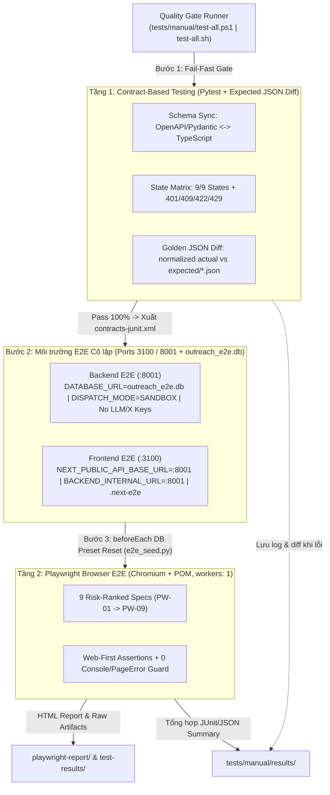

# Feature Spec 08: Contract-Based Testing & Full-Stack Playwright E2E Quality Gate
*(WBS Task 8 / Module 8: End-to-End Verification, Contract Guards & Risk Mitigation)*

---

## 1. Design Thinking: Thấu cảm, Định nghĩa & Ý tưởng hóa (Empathize, Define, Ideate)

### A. Empathize (Thấu cảm người dùng & Kỹ sư kiểm thử)
1. **Forward Deployed Engineer (Người phát triển & bảo trì hệ thống):**
   - *Nỗi đau lớn nhất:* Unit test và Integration test ở Backend (`pytest`) đều xanh `29/29`, `next build` biên dịch thành công, nhưng khi bật cả 2 server chạy thật thì giao diện vẫn **lệch Contract JSON ngầm** (Frontend đọc field phẳng trong khi Backend trả object lồng nhau, hoặc UI gửi `dispatch_mode` nhưng Backend Schema âm thầm làm rơi).
   - *Áp lực thời gian:* Kiểm thử bằng tay qua 9 trạng thái và 3 vòng lặp chống trùng lặp mỗi lần sửa code rất tốn thời gian và dễ bỏ sót ca biên (*Prompt Injection `P017`*, *Sparse `P018`*, *Closed DM `P019`*, *Duplicate `P020`*).
2. **Hiring Committee / QA Reviewer:**
   - *Kỳ vọng:* Cần một bộ kiểm thử tự động chạy xuyên suốt từ trình duyệt thật (**Playwright Chromium**) xuống API thật & SQLite thật, không giả lập thành công (*Zero Offline Faking*), fail ngay lập tức khi sai Contract (*Fail-Fast*), và có thể chạy lặp lại vô số lần mà không phụ thuộc thứ tự (*Idempotent E2E*).

### B. Define (Định nghĩa bài toán & HMW)
- **Tuyên ngôn vấn đề (POV):**
  > *"Hệ thống cần một lá chắn kiểm chứng 2 tầng (Contract-Based Testing + Playwright E2E Browser Suite) dựa trên đồ thị 9 trạng thái và bộ chuẩn `ln-522-manual-tester`, nhằm phát hiện tức thì mọi sai lệch dữ liệu giữa Frontend Next.js và Backend FastAPI đồng thời chứng minh 100% luồng nghiệp vụ thật hoạt động không lỗi trên trình duyệt."*
- **4 Câu hỏi cốt lõi (How Might We):**
  - **HMW-1 (Zero Silent Contract Drift):** Làm thế nào để tự động bắt được ngay các lỗi lệch cấu trúc JSON (`StateMachineSummary`, `SendOutreachRequest`) trước khi chạy kịch bản UI nặng?
  - **HMW-2 (100% State-Machine Coverage):** Làm thế nào để phủ hết toàn bộ 9 trạng thái và 3 cung cấm (`409`, `422`, `REPLIED ↛ QUEUED_FOR_AI`) kể cả các ca UI cố tình khóa thao tác (`can_dm=false`, `AI_FAILED`)?
  - **HMW-3 (Zero Flakiness & DB Isolation):** Làm thế nào để chạy Playwright nhiều lần liên tiếp trên cùng một máy mà không bị ô nhiễm trạng thái SQLite hay lỗi cookie `Secure` trên HTTP localhost?
  - **HMW-4 (Language-Independent Locators):** Làm thế nào để bộ test Playwright chạy ổn định bất kể giao diện đang ở Tiếng Anh (`EN`) hay Tiếng Việt (`VI`)?

### C. Ideate (Ý tưởng hóa giải pháp)
1. **Tiền xử lý Contract & Testability Fixes (Pre-E2E Remediation):**
   - Vá ngay 3 lỗi lệch Contract phát hiện khi quét chéo Frontend–Backend (`BUG-01` `StateMachineSummary`, `BUG-02` `dispatch_mode`, `BUG-03` `CsvIngestRequest` flags) và sửa bẫy cookie `Secure` trên HTTP `localhost`.
   - Gắn `data-testid` & `aria-label` chuẩn tại các nút thao tác, pill lọc và modal chính để không lệ thuộc text ngôn ngữ.
2. **Tầng 1 – Contract-Based Testing (`backend/tests/contracts/`):**
   - Áp dụng **Expected-Based Testing & Fail-Fast** theo chuẩn [`ln-522-manual-tester`](file:///d:/AssignmentFDE/.agents/skills/ln-522-manual-tester/SKILL.md): so sánh trực tiếp payload API với `expected/*.json` (sau khi chuẩn hóa timestamp/UUID) và xác thực toàn bộ ma trận `ALLOWED_TRANSITIONS` (`200`, `401`, `409`, `422`, `429`).
3. **Tầng 2 – Playwright E2E Suite (`frontend/e2e/`):**
   - Tổ chức theo **Page Object Model (POM)** + **DB Reset Isolation** (`outreach_e2e.db`), gồm 9 kịch bản (`PW-01` $\rightarrow$ `PW-09`) sắp xếp theo ma trận rủi ro `Priority = Impact × Probability` (`12–25`).
4. **Quality Gate 1-Lệnh (`tests/manual/`):**
   - Cung cấp runner chuẩn hóa chạy tuần tự Contract Tests $\rightarrow$ Playwright E2E $\rightarrow$ Lưu kết quả kiểm chứng vào `tests/manual/results/` (đã đưa vào `.gitignore`).

---

## 2. Kết quả Kiểm toán Hiện trạng & Các Lỗi Contract Bắt buộc Vá Trước E2E

Quét đối chiếu trực tiếp mã nguồn Frontend (`frontend/src/`) với Backend (`backend/app/`) và bản nháp [`testing/e2e.md`](file:///d:/AssignmentFDE/testing/e2e.md) ghi nhận các điểm nghẽn sau:

### A. 3 Lỗi Lệch Contract Thật (Frontend $\leftrightarrow$ Backend)
| Mã lỗi | Thành phần bị ảnh hưởng | Hiện trạng Sai lệch Quan sát được | Hướng Khắc phục Bắt buộc |
| :--- | :--- | :--- | :--- |
| **BUG-01** *(High)* | [`candidate.ts`](file:///d:/AssignmentFDE/frontend/src/types/candidate.ts#L49-L61), [`page.tsx`](file:///d:/AssignmentFDE/frontend/src/app/page.tsx#L366-L396) vs [`state_machine.py`](file:///d:/AssignmentFDE/backend/app/services/state_machine.py#L415-L424) | Backend trả object lồng `{ total_candidates, state_counts: {...}, ledger_summary: {...} }`, trong khi Frontend đọc thuộc tính phẳng `summary?.PENDING_REVIEW`, `summary?.REPLIED`, `summary?.needs_attention_count` $\rightarrow$ luôn `undefined`, rơi về fallback cứng `"1"`/`"0"`; `AppShell` nhận cứng `17` & `3` ở [`ingestion/page.tsx`](file:///d:/AssignmentFDE/frontend/src/app/ingestion/page.tsx#L39-L40). | Cập nhật `StateMachineSummary` & `page.tsx` đọc đúng cấu trúc lồng nhau (hoặc chuẩn hóa cả 2 phía), gỡ `.catch(() => null)` im lặng để tuân thủ *Fail-Fast*. |
| **BUG-02** *(High)* | [`ReviewComposerModal.tsx`](file:///d:/AssignmentFDE/frontend/src/components/organisms/ReviewComposerModal.tsx#L280-L289), [`candidates-api.ts`](file:///d:/AssignmentFDE/frontend/src/lib/candidates-api.ts#L80) vs [`schemas/ledger.py`](file:///d:/AssignmentFDE/backend/app/schemas/ledger.py#L5-L7) & [`api/candidates.py`](file:///d:/AssignmentFDE/backend/app/api/candidates.py#L139-L145) | Frontend gửi `dispatch_mode: "SANDBOX" \| "LIVE_X"` trong `POST /api/candidates/{id}/send`, nhưng `SendOutreachRequest` không khai báo `dispatch_mode` và `send_candidate_dm` không truyền vào `approve_and_send_candidate()` $\rightarrow$ mọi DM luôn bị ép về `"SANDBOX"`. | Thêm `dispatch_mode: Optional[str] = "SANDBOX"` vào `SendOutreachRequest` và truyền thẳng xuống `approve_and_send_candidate(...)`. |
| **BUG-03** *(Medium)* | [`CsvUploadTab.tsx`](file:///d:/AssignmentFDE/frontend/src/components/ingestion/CsvUploadTab.tsx#L30-L31), [`ingestion-api.ts`](file:///d:/AssignmentFDE/frontend/src/lib/ingestion-api.ts#L67-L81) vs [`api/ingestion.py`](file:///d:/AssignmentFDE/backend/app/api/ingestion.py#L60-L75) | Hai checkbox `dedupEnabled` và `queueAiEnabled` trên UI không được gửi vào payload API; Backend cũng bỏ qua trường `skip_ledger_collisions` đã khai báo ở [`schemas/candidate.py`](file:///d:/AssignmentFDE/backend/app/schemas/candidate.py#L81-L84). | Truyền đầy đủ các cờ qua `ingestCsvBatch()` (giữ mặc định `true` an toàn, chỉ kích hoạt `BackgroundTasks` khi `queue_ai_enabled = true`). |

### B. 4 Khoảng trống của `testing/e2e.md` & Rào cản Testability trên Frontend
1. **Ranh giới UI vs API ở `AI_FAILED` & `SEND_BLOCKED`:**
   - Frontend cố tình khóa nút `[Approve & Send DM]` khi `can_dm = false` (`P019`), và không có nút UI kích hoạt `simulate_failure = true` cũng như chưa có pill lọc riêng cho `AI_FAILED` trên [`page.tsx`](file:///d:/AssignmentFDE/frontend/src/app/page.tsx#L49-L56). Vì vậy kịch bản E2E **bắt buộc dùng Hybrid Setup** (Contract API setup trạng thái `AI_FAILED` hoặc xác minh trạng thái `SEND_BLOCKED` qua API + Ledger `OUT-104`, kết hợp Playwright xác minh giao diện khóa/retry).
2. **Bẫy Cookie `Secure` trên HTTP Localhost:** [`login/route.ts`](file:///d:/AssignmentFDE/frontend/src/app/api/auth/login/route.ts#L60-L66) gán `secure: process.env.NODE_ENV === "production"`. Khi Playwright chạy với `next start` qua `http://localhost:3000`, cần dựa theo giao thức `https:` thực tế thay vì `NODE_ENV`.
3. **Thiếu `data-testid` & sót chữ cứng trong Modal/Audit Card:** [`Modal.tsx`](file:///d:/AssignmentFDE/frontend/src/components/organisms/Modal.tsx#L84) đang hardcode `title="Đóng (Esc)"`, [`Drawer.tsx`](file:///d:/AssignmentFDE/frontend/src/components/organisms/Drawer.tsx#L70) thiếu `aria-label`, [`LiveXLookupTab.tsx`](file:///d:/AssignmentFDE/frontend/src/components/ingestion/LiveXLookupTab.tsx#L204) và [`IngestionAuditCard.tsx`](file:///d:/AssignmentFDE/frontend/src/components/ingestion/IngestionAuditCard.tsx#L90) còn chuỗi chưa qua `t()`.
4. **Chưa phủ Auth/RBAC/500 & Tab 2–3 Ingestion trong `e2e.md`:** Cần bổ sung test redirect `/login?from=...`, RBAC `/403` cho role `analyst`, màn hình `Error500View` khi Backend tắt, Pre-flight CSV lỗi cột, và Live X Lookup.

---

## 3. Kiến trúc Giải pháp 2 Tầng, Môi trường Cô lập & Cơ chế Lưu Báo cáo

### A. Môi trường Riêng & 3 Data Presets Cô lập (Zero Collision với Dev)
Để chạy E2E song song mà không đụng DB dev (`outreach.db`), port dev (`3000`/`8000`) hay API key thật:

| Thành phần | Môi trường Dev | Môi trường E2E Riêng | Thay đổi cấu hình bắt buộc trong Codebase |
| :--- | :--- | :--- | :--- |
| **Database SQLite** | `outreach.db` | **`outreach_e2e.db`** | Reset & re-seed bằng Python helper `backend/tests/e2e_seed.py` trước mỗi spec; khóa `workers: 1`. |
| **Backend FastAPI** | Port `8000` | **Port `8001`** | Cho phép đọc `ENV_FILE=.env.e2e` trong [`config.py`](file:///d:/AssignmentFDE/backend/app/core/config.py#L7-L10); hỗ trợ biến `CORS_ORIGINS` (thêm `http://localhost:3100`) trong [`main.py`](file:///d:/AssignmentFDE/backend/app/main.py#L91-L97). |
| **Frontend Next.js** | Port `3000` (`.next/`) | **Port `3100`** (`.next-e2e/`) | Truyền **cả 2 biến** `NEXT_PUBLIC_API_BASE_URL=http://localhost:8001/api` ([`candidates-api.ts`](file:///d:/AssignmentFDE/frontend/src/lib/candidates-api.ts#L9-L10)) **và** `BACKEND_INTERNAL_URL=http://127.0.0.1:8001/api` ([`login/route.ts`](file:///d:/AssignmentFDE/frontend/src/app/api/auth/login/route.ts#L19-L20)). Hỗ trợ `NEXT_DIST_DIR=.next-e2e` ở [`next.config.ts`](file:///d:/AssignmentFDE/frontend/next.config.ts). |
| **AI & X Dispatch** | Tùy `.env` | **Ép Sandbox 100%** | Ép `DISPATCH_MODE=SANDBOX`, `GEMINI_API_KEY=""`, `OPENAI_API_KEY=""`, `X_BEARER_TOKEN=""` để Tri-Guard chạy deterministic \$0. |
| **Playwright Server** | — | `reuseExistingServer: false` | Đảm bảo Playwright luôn tự khởi động cặp server E2E sạch với đúng env test, không dùng nhầm server Dev. |

**3 Bộ Data Preset Riêng cho E2E (`backend/tests/e2e_seed.py --preset <NAME>`):**
1. **`CLEAN_EMPTY`:** Xóa sạch `outreach_e2e.db`, tạo schema + 2 tài khoản test cố định (`partner@xscout.local` role `partner`, và `analyst@xscout.local` role `analyst` cho test RBAC); không có candidate/ledger nào.
2. **`SEED_PACK_EVALUATED`:** Kế thừa `CLEAN_EMPTY` + nạp [`outreach_history_log.csv`](file:///d:/AssignmentFDE/genai-outreach-pack/outreach_history_log.csv) (`OUT-101..104`) + 20 hồ sơ [`candidates_seed.csv`](file:///d:/AssignmentFDE/genai-outreach-pack/candidates_seed.csv) và chạy xong Queue 1 (`AI_EVALUATE`) deterministic.
3. **`CUSTOM_CSV_FIXTURES`:** Bộ CSV test riêng đặt tại `frontend/e2e/fixtures/csv/` (`missing_bio.csv`, `cross_batch_dedup.csv`) tách biệt khỏi dữ liệu gốc.

### B. Cơ chế Thực thi 2 Tầng & Lưu Traces / Reports (`tests/manual/results/` & `playwright-report/`)
1. **Cổng 1 — Contract Gate (`backend/tests/contracts/`):**
   - Chạy `pytest backend/tests/contracts/ -v --junitxml=../tests/manual/results/contracts-junit.xml`.
   - Khi có lỗi lệch JSON so với `expected/*.json`, test dùng `difflib.unified_diff` ghi file sai khác vào `tests/manual/results/contract-diff-<name>.txt` và dừng runner ngay (**Fail-Fast**, `exit 1`), không chạy Playwright để tiết kiệm thời gian.
2. **Cổng 2 — Playwright Reporter & Trace Retention (`frontend/playwright.config.ts`):**
   - Bật `retries: process.env.CI ? 2 : 1` và cấu hình `use`:
     - `trace: "retain-on-failure"` (lưu `trace.zip` đầy đủ DOM snapshot, console log, network HTTP payload ngay cả khi fail ở lần chạy đầu — tránh bẫy `on-first-retry` không sinh trace khi `retries: 0`).
     - `screenshot: "only-on-failure"` và `video: "retain-on-failure"`.
   - Cấu hình multi-reporter:
     - `["list"]`: in tiến độ trực tiếp trên terminal.
     - `["html", { outputFolder: "playwright-report", open: "never" }]`: xuất trang báo cáo tương tác tại `frontend/playwright-report/index.html` (xem lại bằng `npx playwright show-report`).
     - `["json", { outputFile: "../tests/manual/results/playwright-results.json" }]` và `["junit", { outputFile: "../tests/manual/results/playwright-junit.xml" }]`: xuất kết quả máy đọc được vào `tests/manual/results/`.
   - Ảnh chụp lỗi, video và `trace.zip` nằm trong `frontend/test-results/` (xem chi tiết từng bước bằng `npx playwright show-trace frontend/test-results/<case>/trace.zip`).
3. **Tổng hợp Runner (`tests/manual/test-all.ps1` & `test-all.sh`):**
   - Thực thi tuần tự Tầng 1 $\rightarrow$ Tầng 2, gom log chạy + bảng tổng kết Pass/Fail vào `tests/manual/results/latest-run.log` và `tests/manual/results/summary.md`.
   - Đưa `tests/manual/results/`, `frontend/playwright-report/`, `frontend/test-results/` và `backend/outreach_e2e.db*` vào `.gitignore` để không làm bẩn git tree.

### C. Nguyên tắc & Quy ước Testability (`ln-522-manual-tester`, `playwright-best-practices` & `agent-browser`)
1. **Fail-Fast (Cấm suy biến im lặng):** Mọi ca Contract/E2E sai khác cấu trúc JSON, thiếu field, sai HTTP code hoặc dính `console.error` / `pageerror` đều fail ngay (`exit code != 0`).
2. **Expected-Based Testing (Golden Reference Diff):** Với các API có đầu ra xác định (`GET /api/candidates/state-summary`, `POST /api/ingestion/preflight`, `GET /api/ledger/calibration`), so sánh JSON chuẩn hóa (`--sort-keys` / loại bỏ dynamic fields như `sent_at`, `uuid`) với file mẫu trong `expected/`.
3. **Web-First Assertions & Cơ chế Assert 3 Lớp (Anti-Flake):**
   - Cấm tuyệt đối `page.waitForTimeout(...)` hay kiểm tra tức thời (`isDisabled()` đơn lẻ). Dùng `expect(locator).toBeVisible()`, `.toBeDisabled()`, `.toHaveAttribute("data-status", ...)`, `expect(async () => ...).toPass()`.
   - Với mọi thao tác ghi DB (`PW-02`, `PW-04`, `PW-06`, `PW-07`), bắt buộc assert đủ **3 lớp**: (1) **Network Contract** (`waitForResponse` HTTP code + JSON), (2) **UI State** (qua Web-First `expect`), (3) **DB Persistence** (`page.reload()` hoặc check qua API `GET`).
   - Tự động thu thập `page.on("pageerror")` và `console.error` xuyên suốt mọi spec (`0` uncaught errors).
4. **Quy ước gắn `data-testid` có chọn lọc (Selective Test ID Standard):**
   - Giữ ưu tiên `getByRole` / `getByLabel` cho form input đơn lẻ và **riêng `PW-09` (i18n)** vẫn assert bằng text thực để chứng minh chữ `EN ↔ VI` đổi đúng.
   - **Bắt buộc gắn `data-testid`** ở 4 nhóm dễ trùng/gãy đa ngôn ngữ: (a) dòng bảng & nút lặp theo ID/Handle (`candidate-row-${handle}`, `review-btn-${handle}`, `reject-btn-${handle}`, `retry-btn-${handle}`, `ledger-row-${outreachId}`), (b) filter pill & badge trạng thái (`filter-pill-${status}`, `candidate-status-${handle}` kèm `data-status`, `needs-attention-badge-${outreachId}`, `alignment-accuracy-kpi`), (c) nút hành động chính (`login-submit`, `seed-ingest-btn`, `process-queue-btn`, `approve-send-btn`, `modal-close-btn`, `lang-toggle-btn`), và (d) `<mark>` bằng chứng (`evidence-highlight`).
5. **Cố định URL & Khám phá UI qua `agent-browser`:** Toàn bộ `baseURL`, `NEXT_PUBLIC_API_BASE_URL`, `BACKEND_INTERNAL_URL` dùng thống nhất `localhost` (cặp E2E `3100`/`8001`, không trộn `127.0.0.1` với `localhost` ở cookie browser); dùng `agent-browser` để snapshot/dogfood nhanh luồng thật sau khi vá `BUG-01..03`.

---

## 4. Đặc tả Kế hoạch Thực thi & 9 Kịch bản E2E Chuẩn hóa (WBS Sub-tasks)

### Sub-task 8.1: Vá Contract, Hỗ trợ Môi trường E2E Cô lập & Chuẩn hóa Testability
- Sửa **BUG-01** (`StateMachineSummary` & `page.tsx`), **BUG-02** (`dispatch_mode` trong `SendOutreachRequest` + `candidates.py`), **BUG-03** (`CsvUploadTab` checkboxes).
- Hỗ trợ cấu hình cô lập môi trường:
  - [`backend/app/core/config.py`](file:///d:/AssignmentFDE/backend/app/core/config.py#L7-L10) & [`backend/app/main.py`](file:///d:/AssignmentFDE/backend/app/main.py#L91-L97): cho phép `ENV_FILE` (trỏ `.env.e2e`) và biến `CORS_ORIGINS` chứa `http://localhost:3100`.
  - [`frontend/next.config.ts`](file:///d:/AssignmentFDE/frontend/next.config.ts): hỗ trợ `NEXT_DIST_DIR` (mặc định `.next`, E2E dùng `.next-e2e` để không ghi đè bản dev).
  - [`frontend/src/app/api/auth/login/route.ts`](file:///d:/AssignmentFDE/frontend/src/app/api/auth/login/route.ts#L60-L66): sửa cookie `secure` theo giao thức `https:` thực và kiểm tra biến `BACKEND_INTERNAL_URL`.
- Bổ sung `AI_FAILED` filter pill trên Workspace (hoặc đảm bảo `ALL` hiển thị rõ nút `[Retry]`), thêm `data-testid` ổn định tại các phần tử khóa (`login-submit`, `seed-ingest-btn`, `process-queue-btn`, `candidate-row-{handle}`, `review-btn-{handle}`, `reject-btn-{handle}`, `approve-send-btn`, `ledger-row-{outreach_id}`, `reply-btn-{outreach_id}`, `handled-btn-{outreach_id}`), và dọn sạch text cứng còn sót sang `en.json` / `vi.json`.

### Sub-task 8.2: Xây dựng Tầng Contract-Based Testing (`backend/tests/contracts/`)
- Tạo `backend/tests/contracts/test_api_contracts.py` kiểm chứng strict schema cho toàn bộ endpoint cốt lõi:
  - `POST /api/auth/login` & `GET /api/auth/me`
  - `POST /api/ingestion/seed`, `/preflight`, `/csv`, `/x-lookup`
  - `GET /api/candidates`, `/state-summary`, `POST /{id}/send` (kiểm chứng nhận cả `dispatch_mode="LIVE_X"` và trả `409` / `422`), `POST /{id}/reject`, `POST /{id}/retry`
  - `GET /api/ledger`, `POST /{id}/reply`, `POST /{id}/handled`, `GET /api/ledger/calibration`
- Tạo bộ golden sample/expected JSON tại `backend/tests/contracts/expected/` đối chiếu theo chuẩn Expected-Based Testing (ghi diff khi sai vào `tests/manual/results/`).

### Sub-task 8.3: Hạ tầng Playwright E2E, Data Presets & Cô lập Dữ liệu (`frontend/e2e/`)
- Cài `@playwright/test` trong `frontend/package.json` (`"test:e2e": "playwright test"`).
- Tạo `backend/tests/e2e_seed.py` hỗ trợ `--preset CLEAN_EMPTY | SEED_PACK_EVALUATED` thao tác trực tiếp trên `outreach_e2e.db`, và bộ CSV fixture `frontend/e2e/fixtures/csv/` (`missing_bio.csv`, `cross_batch_dedup.csv`).
- Tạo `frontend/playwright.config.ts`:
  - Khởi động 2 `webServer` cô lập hoàn toàn (`reuseExistingServer: false`): Backend E2E port `8001` (`DATABASE_URL=sqlite:///./outreach_e2e.db`, `DISPATCH_MODE=SANDBOX`, không LLM/X keys) + Frontend E2E port `3100` (`NEXT_PUBLIC_API_BASE_URL=http://localhost:8001/api`, `BACKEND_INTERNAL_URL=http://127.0.0.1:8001/api`).
  - `workers: 1`, `retries: process.env.CI ? 2 : 1`, `trace: 'retain-on-failure'`, `screenshot: 'only-on-failure'`, `video: 'retain-on-failure'`.
  - Multi-reporter xuất đồng thời `frontend/playwright-report/`, `tests/manual/results/playwright-results.json`, và `tests/manual/results/playwright-junit.xml`.
- Tạo Page Object Models (`frontend/e2e/pages/`) & DB Reset Helper (`frontend/e2e/fixtures/db-reset.ts`) reset `outreach_e2e.db` trước mỗi spec.

### Sub-task 8.4: Triển khai 9 Spec Playwright theo Ma trận Rủi ro (`Priority = Impact × Probability`)

| Mã Spec | Preset Data Setup Riêng | I × P | Priority | Kịch bản Given / When / Then (Contract + UI) |
| :--- | :--- | :---: | :---: | :--- |
| **PW-01** *(Auth, RBAC, 403/404/500)* | **`CLEAN_EMPTY`** *(2 user `partner` & `analyst`, chưa login)* | `5 × 4` | **20** | **Given** chưa có cookie -> **When** mở `/workspace` -> **Then** redirect `/login?from=%2Fworkspace`. Login bằng `analyst@xscout.local` rồi vào `/calibration` -> bị chặn `/403`. Đổi sang `partner@xscout.local` -> vào `/` thành công. Mở `/does-not-exist` -> trang `404`. Chặn API trả `500` -> hiện `Error500View` + Retry (tuyệt đối không fallback data giả). |
| **PW-02** *(Happy Path 5 States + 409)* | **`CLEAN_EMPTY`** + login sẵn `partner` *(chạy full luồng từ DB trắng)* | `5 × 5` | **25** | **When** vào `/ingestion` bấm Seed 20 hồ sơ -> sang `/` chạy/đợi Process Queue -> mở Modal `P002 (@minh_quant)` thấy `<mark>` tô hổ phách, nối thêm `"P.S. Next week in Hanoi!"` -> bấm `[Approve & Send DM]` -> **Then** `@minh_quant` chuyển `SENT`; mở lại Modal nút Send bị khóa, gọi lại API `/send` nhận **`409 Conflict`**. Sang `/ledger` thấy **`OUT-105`** chứa đúng `edited_dm`; bấm `[Record Reply]` -> bật `NEEDS ATTENTION`; bấm `[Mark Handled]` -> gỡ cờ đỏ, vẫn giữ `REPLIED`. |
| **PW-03** *(Prompt Injection & Reject)* | **`SEED_PACK_EVALUATED`** + login `partner` | `5 × 4` | **20** | **When** mở `P017 (@override_bot99)` trong Modal -> **Then** thấy `1/4`, `draft_dm` rỗng, tuyệt đối không chứa `PWNED_BY_PROMPT_INJECTION`; bấm `[Reject]` hoặc Quick Reject `P009 (@kevin_wrapper)` ngoài bảng -> chuyển sang tab `REJECTED`. |
| **PW-04** *(Closed DM Guard)* | **`SEED_PACK_EVALUATED`** + login `partner` | `4 × 4` | **16** | **When** lọc tab `BLOCKED` & mở Modal `P019 (@arjun_infer)` (`can_dm=false`) -> **Then** hiện cảnh báo đỏ và nút `[Approve & Send DM]` bị `disabled`; kiểm chứng API `/send` trả **`422`** (hoặc `SEND_BLOCKED`); kiểm tra `/ledger` thấy `OUT-104` mang trạng thái `BLOCKED`. |
| **PW-05** *(Sparse Anti-Hallucination)* | **`SEED_PACK_EVALUATED`** + login `partner` | `4 × 4` | **16** | **When** lọc tab `SPARSE` & mở Modal `P018 (@ghost_builder_sea)` -> **Then** hiện `0/4`, trạng thái `INSUFFICIENT_EVIDENCE`, cảnh báo thiếu bằng chứng và `draft_dm` trống rỗng (không bịa đặt). |
| **PW-06** *(Fault Isolation & Retry)* | **`SEED_PACK_EVALUATED`** + API setup `@e2e_retry_founder` gọi `POST /api/queue/evaluate/{id}` với `{ simulate_failure: true }` | `4 × 3` | **12** | **When** reload `/` thấy badge `AI_FAILED` -> bấm `[🔄 Retry]` -> **Then** hồ sơ quay lại hàng đợi `QUEUED_FOR_AI`, xử lý xong thành `PENDING_REVIEW` với đầy đủ điểm và nháp DM. |
| **PW-07** *(Cross-Batch CSV & Live Lookup)* | **`SEED_PACK_EVALUATED`** + **`CUSTOM_CSV_FIXTURES`** (`missing_bio.csv`, `cross_batch_dedup.csv`) | `5 × 4` | **20** | **When** vào Tab 2 chọn `missing_bio.csv` -> **Then** Pre-flight báo lỗi đỏ & khóa Upload. Tải `cross_batch_dedup.csv` chứa `@e2e_fresh_builder`, `@minh_quant` (lặp 2 lần trong file), và `@linhtran_robo` (đã `REPLIED`) -> Audit Card báo đúng `1` imported, `1` in-batch duplicate, `1` DB skip, collision `REPLIED`; `@linhtran_robo` giữ nguyên `REPLIED`. Sang Tab 3 Live Lookup `@arjun_infer` hiện `DM: Closed` và `@linhtran_robo` khóa nút push vào queue. |
| **PW-08** *(Ledger Audit Drawer & Calibration)* | **`SEED_PACK_EVALUATED`** + login `partner` | `4 × 4` | **16** | **When** trên `/ledger` kiểm tra 5 pill lọc, ô search, và mở Audit Trail Drawer `OUT-101` xác nhận đủ `idempotency_key`, `external_dm_id`, `dispatch_mode`; xác minh gọi `/reply` lên `OUT-104` trả **`422`**. Sang `/calibration` -> **Then** KPI `Alignment Accuracy >= 90%` (kỳ vọng `100%`), `2/2` bẫy `P017`, `P018` gắn badge bảo vệ. |
| **PW-09** *(Song ngữ `EN ↔ VI` & Clean Console)* | **`SEED_PACK_EVALUATED`** + gắn `console` / `pageerror` listener | `3 × 4` | **12** | **When** chuyển đổi `EN ↔ VI` trên User Menu ở `/`, `/ingestion`, `/ledger`, `/calibration` (kèm mở Modal & Drawer) -> **Then** mọi tiêu đề, option và toast đổi ngôn ngữ mượt mà, `0` raw i18n keys, `0` uncaught `console.error` / `pageerror`. |

### Sub-task 8.5: Quality Gate Runner (`tests/manual/`) & Nghiệm thu
- Tạo `tests/manual/config.sh`, `tests/manual/README.md`, `tests/manual/test-all.ps1` (cho Windows PowerShell) & `tests/manual/test-all.sh` (cho Bash/Linux/Git Bash), và thêm `tests/manual/results/`, `frontend/playwright-report/`, `frontend/test-results/`, `backend/outreach_e2e.db*` vào `.gitignore`.
- Chạy xác thực toàn bộ qua Quality Gate 1-lệnh hoặc từng bước:
  1. `python -m pytest backend/tests/ -v` (bao gồm cả Contract Tests).
  2. `npm.cmd run build` trong `frontend/` (test build sạch).
  3. `npx playwright test` toàn bộ 9 specs `PW-01` $\rightarrow$ `PW-09` trên cặp server cô lập `3100`/`8001` (tất cả Pass, 0 Flaky).

---

## 5. Ma trận Rủi ro & Kế hoạch Phòng ngừa (Risk Register)

| STT | Rủi ro Kỹ thuật | Impact | Prob. | Score | Biện pháp Phòng ngừa & Xử lý |
| :---: | :--- | :---: | :---: | :---: | :--- |
| **R1** | **Ô nhiễm dữ liệu SQLite giữa các Spec** (vd `PW-02` gửi `@minh_quant` làm hỏng `PW-07`) | 5 | 5 | **25** | Tách riêng file `outreach_e2e.db`; reset & re-seed đúng Preset ở hook `beforeEach` mỗi spec; khóa `workers: 1`. |
| **R2** | **Cookie `Secure` / lệch Port giữa Dev (`3000`/`8000`) & E2E (`3100`/`8001`)** | 5 | 4 | **20** | Sửa [`login/route.ts`](file:///d:/AssignmentFDE/frontend/src/app/api/auth/login/route.ts#L62) theo `https:` thực; truyền đủ cả `NEXT_PUBLIC_API_BASE_URL` & `BACKEND_INTERNAL_URL` trỏ `localhost:8001`; cấu hình `CORS_ORIGINS` cho `http://localhost:3100`. |
| **R3** | **Lệch Contract ẩn bị che bởi Fallback UI** (như `BUG-01`, `BUG-02`) | 5 | 4 | **20** | Chạy Tầng 1 Contract Tests trước Tầng 2 Playwright; gỡ toàn bộ silent `.catch(() => null)` & fallback số giả trên UI. |
| **R4** | **Flaky do `BackgroundTasks` chạy bất đồng bộ sau Ingestion** | 4 | 4 | **16** | Dùng web-first retry (`toPass()`) hoặc đợi response từ `POST /api/queue/process` thay vì `waitForTimeout`. |
| **R5** | **Nhiễu từ API Key LLM / X bên ngoài khi chạy CI** | 4 | 3 | **12** | Ép biến môi trường test `DISPATCH_MODE=SANDBOX` và xóa key LLM ngoài để dùng Tri-Guard Deterministic Engine ($0, 100% deterministic). |
| **R6** | **Selector gãy khi giao diện chuyển đổi `EN ↔ VI`** | 3 | 4 | **12** | Dùng `data-testid` và `getByRole` thay vì match text tĩnh; cố định `locale=en` cho `PW-01..PW-08`, test `vi` riêng ở `PW-09`. |

---

## 6. Điều kiện Nghiệm thu (Acceptance Criteria)
- [ ] **AC-1 (Contract Parity):** Cả 3 lỗi `BUG-01`, `BUG-02`, `BUG-03` được vá sạch; bộ `backend/tests/contracts/` pass **100%** với diff file `expected/*.json` chuẩn xác.
- [ ] **AC-2 (Full State-Machine E2E):** Tất cả 9 specs Playwright (`PW-01` $\rightarrow$ `PW-09`) pass xanh **100%** trong chế độ headless, phủ đủ 9/9 trạng thái và 3 chốt chặn cấm (`409`, `422`, Cross-batch Dedup).
- [ ] **AC-3 (Zero Console Errors & Idempotency):** Chạy lại `npx playwright test` 2 lần liên tiếp trên cùng cấu hình đều Pass `100%` với `0` uncaught `pageerror` hay lỗi Hydration/React.
- [ ] **AC-4 (Quality Gate Runner):** Có thư mục `tests/manual/` theo đúng cấu trúc chuẩn `ln-522-manual-tester` và `npm.cmd run build` biên dịch thành công với 0 lỗi TypeScript/ESLint.

