# Feature Spec 09: Database Performance, Hybrid RAG Pipeline & Verify Gate 2 (Grounding Guard)
*(WBS Task 9 / Module 03: Database Indexing, Semantic Chunking, Hybrid Retrieval BM25 + Vector, Cross-Encoder Reranking & Verbatim Citation Verification)*

---

## 1. Design Thinking: Thấu cảm, Định nghĩa & Ý tưởng hóa (Empathize, Define, Ideate)

### A. Empathize (Thấu cảm người dùng & Kiến trúc sư hệ thống)
1. **VC Investment Partner (Người dùng duyệt hồ sơ):**
   - Trong môi trường thực tế, một CTO/Founder như **`@linhtran_robo` (`P001`)** không chỉ có 2 bài tweet ngắn trong file tĩnh, mà có tới **3,000 bài tweets** (99% là tin tức đời thường, cà phê, bóng đá, tuyển dụng) kèm theo repo GitHub và bài báo nghiên cứu PDF dài 20–30 trang.
   - *Nỗi sợ lớn nhất:* Nếu hệ thống nhét toàn bộ 3,000 bài tweets nối bằng `" || "` vào Prompt, LLM sẽ dính hiệu ứng **"Lost in the Middle"** (bỏ sót 2 bài tweet kỹ thuật đắt giá nhất về `diffusion policy 18ms trên Jetson AGX Orin` và `Active stereo + tactile wrist feedback`), tốn `$0.50`/người và chờ 30 giây, hoặc trích dẫn sai lệch số liệu kỹ thuật.
2. **Forward Deployed AI Architect / Kỹ sư Hệ thống:**
   - *Nỗi đau chuyển giao (Prototype $\rightarrow$ Production Gap):* Repo hiện tại đã làm rất tốt **3-Tier Deduplication** ([`candidate.py`](file:///d:/AssignmentFDE/backend/app/models/candidate.py), [`ledger.py`](file:///d:/AssignmentFDE/backend/app/models/ledger.py)) và **Verbatim Substring Check** ([`ai_evaluator.py`](file:///d:/AssignmentFDE/backend/app/services/ai_evaluator.py#L161-L176)), nhưng đang nối cứng toàn bộ tweets bằng `" || "` ở [`ingestion.py` (dòng 491)](file:///d:/AssignmentFDE/backend/app/services/ingestion.py#L491) và chưa có đường ống **RAG 5 Trạm** (`Chunking` $\rightarrow$ `Composite Index SQL Filter` $\rightarrow$ `Hybrid Search BM25 + Vector` $\rightarrow$ `Cross-Encoder Reranking` $\rightarrow$ `Verify Gate 2 Citation + Verbatim Grounding`).
   - *Yêu cầu vận hành:* Giải pháp phải chạy **Turnkey Zero-Config** trên SQLite trong môi trường local/test ($0 chi phí, không bắt cài dịch vụ ngoài khi chấm bài), đồng thời tương thích 100% với **PostgreSQL + `pgvector` (`HNSW`)** khi triển khai Production.

### B. Define (Định nghĩa bài toán & HMW)
- **Tuyên ngôn vấn đề (POV):**
  > *"Hệ thống cần nâng cấp Trụ cột 3 từ cơ chế nối chuỗi tĩnh (`||`) sang Đường ống Truy xuất Thông tin Lai 5 Trạm (5-Station Hybrid RAG Pipeline) kèm Chốt Kiểm Chứng Sự Thật Kép (Verify Gate 2: Source ID Citation + Verbatim Substring Check), đảm bảo lọc chính xác Top 3 bằng chứng kỹ thuật tinh hoa nhất trong `< 150ms` trước khi gọi LLM và kiểm thử độc lập bằng `Recall@3 == 1.0` với chi phí LLM = `$0`."*
- **4 Câu hỏi cốt lõi (How Might We):**
  - **HMW-1 (Semantic Chunking & Metadata Preservation):** Làm thế nào để cắt văn bản dài (nhiều bài tweets, Markdown/PDF kỹ thuật) thành các mẩu nhỏ (`CandidateChunk`) có gối đầu (`overlap`) mà không bao giờ chặt đứt câu thông số kỹ thuật (`64ms to 18ms on a single Jetson AGX Orin`) và luôn giữ nguyên thẻ căn cước nguồn (`chunk_id`, `post_id`, `created_at`)?
  - **HMW-2 (Sub-5ms Hard Filtering & Composite Indexing):** Làm thế nào để kết hợp `Composite Index` ở tầng Database nhằm lọc cứng 50 triệu mẩu văn bản xuống đúng ứng viên/trạng thái mục tiêu trong `< 5ms` trước khi chạy tìm kiếm ngữ nghĩa?
  - **HMW-3 (Hybrid BM25 + Vector + Cross-Encoder Reranking):** Làm thế nào để bắt trọn cả **mã công nghệ chính xác** (`TensorRT`, `INT8`, `Jetson AGX Orin` ở bài `185500101`) lẫn **ngữ cảnh triển khai thực địa không chứa từ khóa** (`lighting glare off shrink-wrapped pallets... Active stereo + tactile wrist feedback` ở bài `185500102`), rồi gạn lọc từ Top 25 xuống đúng Top 3 mẩu đắt giá nhất?
  - **HMW-4 (Verify Gate 2 & Decoupled Retrieval Testing):** Làm thế nào để tách rời hoàn toàn kiểm thử khâu tìm kiếm (`Retrieval Eval: Recall@3` không tốn tiền gọi LLM) khỏi khâu kiểm chứng trích dẫn nguyên văn (`Verbatim & Source ID Grounding Check`)?

### C. Ideate (Ý tưởng hóa giải pháp)
1. **Kiến trúc 5 Trạm Lọc Sự Thật (5-Station RAG & Verify Gate 2 Pipeline):**
   - **Trạm 1 (Ingestion & Semantic Chunking):** Xây dựng bảng `candidate_chunks` và bộ cắt văn bản `SemanticChunker` bảo toàn ranh giới câu/đoạn/tweet, hỗ trợ `chunk_overlap` (10–15%) và gắn đầy đủ metadata (`chunk_id`, `post_id`, `source_type`, `created_at`).
   - **Trạm 2 (Database Hard Filtering & Composite Index):** Đánh `Composite Index` trên bảng `candidates` (`idx_candidates_review_queue`) và `candidate_chunks` (`idx_chunks_handle_source`), cung cấp tiện ích chẩn đoán truy vấn `EXPLAIN QUERY PLAN` / `EXPLAIN ANALYZE`.
   - **Trạm 3 (Hybrid Search = BM25 + Vector Embedding + RRF):** Kết hợp thuật toán từ khóa **Okapi BM25** với **Dense Vector Cosine Similarity** (hỗ trợ `pgvector HNSW` trên PostgreSQL và Vector Engine nội bộ nhẹ trên SQLite) gộp điểm qua công thức **Reciprocal Rank Fusion (RRF)** để lấy Top 25 chunks.
   - **Trạm 4 (Cross-Encoder Reranker):** Chấm điểm sóng đôi `(Rubric Query, Candidate Chunk)` trên tập Top 25 để cắt bỏ hoàn toàn 90% bài nhiễu (cà phê, bóng đá, tin tức chung), chỉ giữ lại **Top 3 chunks** tinh khiết nhất đưa vào Prompt A4 (~460 tokens).
   - **Trạm 5 (Chốt Verify 2 — Dual Grounding Guard):** Kiểm tra kép bằng Python: (a) `evidence_snippet` phải nằm nguyên văn (`verbatim substring`) trong tập dữ liệu gốc, và (b) `evidence_post_id` / `evidence_chunk_id` phải thuộc đúng tập **Top 3 chunks** đã truy xuất.

---

## 2. Mục tiêu Cốt lõi & Đối chiếu Hiện trạng (As-Is vs. To-Be)

Dựa trên tài liệu [`MODULE_03_DATABASE_RAG_AND_VERIFY_GATE_2.md`](file:///d:/AssignmentFDE/MODULE_03_DATABASE_RAG_AND_VERIFY_GATE_2.md), kế hoạch này nâng cấp trực tiếp các thành phần của Trụ cột 3 trong repo `D:\AssignmentFDE`:

| Trạm xử lý (Trụ cột 3) | Hiện trạng trong Repo (`As-Is`) | Mục tiêu Nâng cấp (`To-Be` theo Module 03) | File Codebase Tác động |
| :--- | :--- | :--- | :--- |
| **Trạm 1: Data Ingestion & Chunking** | Chuẩn hóa CSV/Handle tốt, nhưng nối toàn bộ tweets bằng `" \|\| "` vào 1 cột `TEXT` (`recent_tweets`). | Tạo bảng `candidate_chunks` + service `rag_retriever.py` cắt văn bản theo ranh giới ngữ nghĩa (`Semantic/Recursive Chunking`), có gối đầu (`overlap`) và giữ `post_id`, `created_at`, `source_type`. | [`backend/app/models/chunk.py`](file:///d:/AssignmentFDE/backend/app/models/chunk.py) *(mới)*, [`backend/app/services/ingestion.py`](file:///d:/AssignmentFDE/backend/app/services/ingestion.py) |
| **Trạm 2: Database & Composite Index** | Chỉ có `index=True` đơn lẻ trên từng cột (`handle`, `x_user_id`, `status`). | Bổ sung `Composite Index` (`idx_candidates_review_queue`, `idx_chunks_handle_created`) + hàm kiểm tra kế hoạch thực thi (`EXPLAIN` / `Index Scan` vs `Seq Scan`). | [`backend/app/models/candidate.py`](file:///d:/AssignmentFDE/backend/app/models/candidate.py), [`backend/app/models/chunk.py`](file:///d:/AssignmentFDE/backend/app/models/chunk.py) |
| **Trạm 3: Hybrid Search (`BM25` + `Vector`)** | Không có bước tìm kiếm; bê nguyên chuỗi `recent_tweets` vào Prompt. | Chạy song song **BM25 Lexical Search** + **Semantic Vector Search** (tương thích `pgvector HNSW` & SQLite fallback), hợp nhất thứ hạng bằng **Reciprocal Rank Fusion (RRF)** lấy Top 25. | [`backend/app/services/rag_retriever.py`](file:///d:/AssignmentFDE/backend/app/services/rag_retriever.py) *(mới)* |
| **Trạm 4: Cross-Encoder Reranking** | Không có bước lọc tinh. | Bộ chấm điểm **Cross-Encoder Reranker** đối chiếu sóng đôi Top 25 chunks với Rubric quỹ đầu tư để gạn lấy **Top 3 chunks** đắt giá nhất đưa vào Prompt. | [`backend/app/services/rag_retriever.py`](file:///d:/AssignmentFDE/backend/app/services/rag_retriever.py) *(mới)*, [`backend/app/services/ai_evaluator.py`](file:///d:/AssignmentFDE/backend/app/services/ai_evaluator.py) |
| **Trạm 5: Chốt Verify 2 (`Grounding Check`)** | Đã có `_verify_verbatim_grounding()` kiểm tra chuỗi con nguyên văn trên `bio \|\| recent_tweets`. | Nâng cấp thành **Dual Verify Gate 2**: Kiểm tra chuỗi nguyên văn (`Verbatim Substring`) + Đối chiếu mã nguồn trích dẫn (`post_id` / `chunk_id` nằm trong Top-K chunks). | [`backend/app/services/ai_evaluator.py`](file:///d:/AssignmentFDE/backend/app/services/ai_evaluator.py) |
| **Phụ lục Kiểm thử: 3 Tầng Pytest** | Đã có Test Tầng 2 (`test_dual_queue_and_ai.py`) và Tầng 3 (`test_ingestion.py`). | Bổ sung đầy đủ bộ test chuyên biệt **`test_rag_and_verify_gate_2.py`** gồm: **Test 1 (`Recall@3 == 1.0` trên 100 bài viết của `@linhtran_robo`)**, **Test 2 (`Verbatim & Citation Anti-Hallucination`)**, **Test 3 (`3-Tier DB Dedup & Composite Index Scan`)**. | [`backend/tests/test_rag_and_verify_gate_2.py`](file:///d:/AssignmentFDE/backend/tests/test_rag_and_verify_gate_2.py) *(mới)* |

---

## 3. Kiến trúc Kỹ thuật Chi tiết: 5 Trạm Lọc Sự Thật Cho `@linhtran_robo`

```mermaid
flowchart LR
    subgraph S1["Trạm 1: Data Ingestion & Chunking"]
        Raw["Hồ sơ @linhtran_robo\n(Bio + 100..3,000 Tweets + Markdown/PDF)"] --> Clean["Data Cleaning\n(UTF-8 BOM, Markdown Table Preservation)"]
        Clean --> Chunker["Semantic / Recursive Chunker\n(Boundary Split + 15% Overlap)"]
        Chunker --> Meta["Gắn Metadata JSON\n(chunk_id, handle, post_id, created_at)"]
    end

    subgraph S2["Trạm 2 (T+0ms -> T+5ms): Hard SQL Filter"]
        Meta --> DB[("PostgreSQL / SQLite\ncandidate_chunks\n+ Composite Indexes")]
        DB --> HardSQL["WHERE candidate_handle = 'linhtran_robo'\n(Index Scan < 5ms)"]
    end

    subgraph S3["Trạm 3 (T+5ms -> T+35ms): Hybrid Search"]
        HardSQL --> BM25["Thợ săn 1: Okapi BM25\n(Bắt mã cứng: TensorRT, INT8, Jetson)"]
        HardSQL --> Vec["Thợ săn 2: Vector Search (HNSW / Cosine)\n(Bắt ngữ nghĩa: Active stereo, tactile wrist)"]
        BM25 --> RRF["Reciprocal Rank Fusion (RRF)\nHợp bích lấy Top 25 Chunks"]
        Vec --> RRF
    end

    subgraph S4["Trạm 4 (T+35ms -> T+150ms): Reranking"]
        RRF --> Rerank["Cross-Encoder Reranker\n(Đối chiếu sóng đôi với Scoring Rubric)"]
        Rerank --> Top3["Gạn lọc Top 3 Chunks Tinh Hoa\n(185500101: 0.98 | 185500102: 0.95)"]
    end

    subgraph S5["Trạm 5 (T+1400ms): Chốt Verify Gate 2"]
        Top3 --> Prompt["In Tờ giấy A4 (~460 tokens)\n<untrusted_candidate_data>"]
        Prompt --> LLM["LLM Evaluation\n(Fit Score + Snippet + Draft DM)"]
        LLM --> Gate2["Verify Gate 2 (Python Code Guard)\n1. Verbatim Substring Check\n2. Source post_id / chunk_id Check"]
    end
```



### 3.1. Trạm 1: Schema `CandidateChunk` & Chiến lược Cắt Văn Bản Ngữ Nghĩa (`Semantic Chunking`)
1. **Thiết kế Bảng `candidate_chunks` (`backend/app/models/chunk.py`):**
   - Lưu trữ từng mẩu thông tin độc lập của ứng viên thay vì nhồi toàn bộ vào 1 ô text:
     - `id`: Primary Key.
     - `chunk_id`: Mã định danh duy nhất (VD: `chk_linhtran_robo_185500101_0`, `unique=True, index=True`).
     - `candidate_id`: Foreign Key trỏ tới `candidates.id` (`ondelete="CASCADE"`).
     - `candidate_handle`: Handle chuẩn hóa (`linhtran_robo`), đánh chỉ mục kết hợp.
     - `source_type`: Loại nguồn (`"x_post"`, `"bio"`, `"technical_doc"`).
     - `post_id`: Mã bài đăng gốc hoặc trang tài liệu (VD: `"185500101"`, `"185500102"`).
     - `created_at_source`: Ngày tạo bài viết gốc (VD: `"2026-11-06"`).
     - `text`: Nội dung đoạn văn bản đã làm sạch.
     - `token_count`: Số lượng từ/token ước tính của mẩu.
     - `embedding_json`: Vector biểu diễn ngữ nghĩa của mẩu văn bản (tương thích SQLite `TEXT/JSON` và tự động ánh xạ sang `vector(1536)` khi chạy với `pgvector` trên PostgreSQL).
2. **Thuật toán `semantic_chunk_candidate_documents()`:**
   - **Không cắt cứng theo số ký tự cố định (Naive Fixed-Char Split):** Tuyệt đối không cắt ở ký tự thứ 500 làm đứt đôi câu `"Finally got our diffusion policy inference latency down from 64ms"` và `"to 18ms on a single Jetson AGX Orin..."`.
   - **Cắt theo ranh giới tự nhiên (Recursive / Semantic Boundaries):**
     1. Tách theo từng bài đăng độc lập (`||` hoặc danh sách JSON `recent_posts` từ [`P001.json`](file:///d:/AssignmentFDE/genai-outreach-pack/profiles/P001.json)).
     2. Với văn bản/bài báo dài (Markdown/PDF), tách theo tiêu đề (`#`, `##`), đoạn văn (`\n\n`), rồi đến câu hoàn chỉnh (`. `).
     3. **Gối đầu ngữ cảnh (`Chunk Overlap = 15%` / 1–2 câu cuối):** Nếu một đoạn dài vượt ngưỡng `max_words` (150–300 từ), tự động lặp lại câu cuối của mẩu trước vào đầu mẩu sau.
     4. **Bảo toàn Metadata bắt buộc:** Mọi mẩu sinh ra đều mang theo `post_id` và `created_at_source` để phục vụ truy vết ở Trạm 5.

### 3.2. Trạm 2: `Composite Index` & Chẩn đoán Truy vấn `EXPLAIN` (`< 5ms`)
1. **Bổ sung Chỉ mục Kết hợp (`Composite Index`) trong SQLAlchemy Models:**
   - Trên bảng `candidates` ([`backend/app/models/candidate.py`](file:///d:/AssignmentFDE/backend/app/models/candidate.py)):
     ```python
     __table_args__ = (
         Index(
             "idx_candidates_review_queue",
             "status",
             "can_dm",
             "fit_score",
             "updated_at",
         ),
     )
     ```
     Phục vụ trực tiếp truy vấn phổ biến nhất trên bàn duyệt HITL (`WHERE status = 'PENDING_REVIEW' AND can_dm = true AND fit_score >= 3 ORDER BY updated_at DESC`).
   - Trên bảng `candidate_chunks` ([`backend/app/models/chunk.py`](file:///d:/AssignmentFDE/backend/app/models/chunk.py)):
     ```python
     __table_args__ = (
         Index(
             "idx_chunks_handle_source",
             "candidate_handle",
             "source_type",
             "post_id",
         ),
     )
     ```
     Giúp Trạm 2 lọc cứng từ 50 triệu chunks xuống đúng 3,000 chunks của `candidate_handle = 'linhtran_robo'` bằng **Index Scan** trong `< 1.5ms` thay vì **Sequential Scan (`Seq Scan`)**.
2. **Hàm Chẩn đoán Kế hoạch Truy vấn (`explain_candidate_chunk_query`):**
   - Hỗ trợ chạy `EXPLAIN ANALYZE` (trên PostgreSQL) hoặc `EXPLAIN QUERY PLAN` (trên SQLite) và xác nhận kế hoạch thực thi sử dụng **`USING INDEX idx_chunks_handle_source`** (không bị quét tuần tự toàn bảng).

### 3.3. Trạm 3: Tìm Kiếm Kết Hợp `Hybrid Search` (`Okapi BM25` + `Vector Embedding` + `RRF`)
Để không phụ thuộc cứng vào API trả phí khi chạy test offline nhưng vẫn đạt chuẩn kiến trúc FDE thực chiến:
1. **Người thợ săn số 1 — Từ khóa chính xác (`Okapi BM25 Scorer`):**
   - Tokenize văn bản giữ nguyên các mã kỹ thuật đặc thù (`tensorrt`, `int8`, `fp16`, `jetson`, `agx`, `orin`, `ros2`, `cuda`, `18ms`, `64ms`, `93.4%`, `3pl`).
   - Tính điểm BM25 với $k_1 = 1.5, b = 0.75$:
     $$\text{Score}_{\text{BM25}}(D, Q) = \sum_{q \in Q} \text{IDF}(q) \cdot \frac{f(q, D) \cdot (k_1 + 1)}{f(q, D) + k_1 \cdot \left(1 - b + b \cdot \frac{|D|}{\text{avgdl}}\right)}$$
   - **Tác dụng:** Bắt dính ngay lập tức bài tweet `185500101` của `@linhtran_robo` nhờ khớp chính xác cụm mã phần cứng/lượng tử hóa (`Jetson AGX Orin`, `TensorRT`, `INT8`).
2. **Người thợ săn số 2 — Ngữ nghĩa Vector (`Dense Semantic Embedding + HNSW / Cosine`):**
   - Cung cấp 2 chế độ tương thích qua `RuntimeGateway`:
     - **Chế độ Production (`PostgreSQL + pgvector` hoặc Live Embedding API):** Sử dụng vector 1,536 chiều với chỉ mục **`HNSW` (`vector_cosine_ops`)** để đạt `Recall > 98%` dưới `10ms`.
     - **Chế độ Local / Deterministic (`Built-in Technical Concept Space Embedding`):** Ánh xạ văn bản vào không gian vector ngữ nghĩa đa trục chuyên biệt cho DeepTech/Robotics/AI Infrastructure (nhận diện mối liên hệ ngữ nghĩa giữa *"warehouse pilot, lighting glare, shrink-wrapped pallets, active stereo, tactile wrist feedback, depth estimation, grasp polybags"* với *"embodied AI robotics hardware sensor deployment in production"* ngay cả khi không chứa chữ `"robotics"` hay `"AI"`).
   - **Tác dụng:** Bắt dính bài tweet số 2 (`185500102`) của `@linhtran_robo` mà tìm kiếm từ khóa đơn thuần sẽ bỏ sót.
3. **Hợp bích bằng `Reciprocal Rank Fusion (RRF)` ($k = 60$):**
   - Kết hợp bảng xếp hạng Top 20 của BM25 (`rank_bm25`) và Top 20 của Vector Search (`rank_vector`):
     $$\text{RRF\_Score}(d) = \frac{1}{k + \text{rank}_{\text{BM25}}(d)} + \frac{1}{k + \text{rank}_{\text{vector}}(d)}$$
   - Xuất ra danh sách **Top 25 mẩu ứng viên (`top_25_candidates`)** chuyển sang Trạm 4.

### 3.4. Trạm 4: Bộ Lọc Tinh `Cross-Encoder Reranking` (Gạn Đục Khơi Trong)
Tại sao phải có Trạm 4? Vì trong Top 25 mẩu lấy ra từ 3,000 bài viết vẫn lẫn các bài nhiễu có chứa từ khóa công nghệ nhưng không phải bằng chứng năng lực (VD: *"Hôm nay đọc tin tức về AI và Robot bên Mỹ thấy hay quá"*, hoặc bài thông báo tuyển dụng).
- **Cơ chế `cross_encoder_rerank(query, candidate_chunks, top_k=3)`:**
  - Chấm điểm sóng đôi (`0.00` $\rightarrow$ `1.00`) từng mẩu trong Top 25 dựa trên 3 tín hiệu tương tác chéo giữa Rubric và Chunk:
    1. **Concrete Engineering Metrics & Benchmark Signal:** Có chứa số liệu đo đạc thực nghiệm, độ trễ, thông lượng, tỷ lệ thành công (`64ms to 18ms`, `93.4% across 1,200 picks`, `p99`, `fps`, `tok/s`) không?
    2. **First-Hand Builder / Production Pilot Ownership:** Có bằng chứng tự tay triển khai thực tế (`our diffusion policy`, `our live 3PL warehouse pilot in Tuas, Singapore`, `saved us`, `we built`) thay vì bình luận tin tức chung chung hay nói chuyện cà phê/bóng đá không?
    3. **Query-Chunk Cross-Attention Alignment:** Độ khớp sâu với yêu cầu Rubric (`Embodied AI / Robotics / Hardware Inference / SEA Deployment`).
  - **Kết quả:**
    - Mẩu `185500101` đạt `>= 0.95` điểm.
    - Mẩu `185500102` đạt `>= 0.90` điểm.
    - Các mẩu nhiễu (cà phê, bóng đá, chúc Tết, chia sẻ tin tức dạo) bị ép xuống `< 0.30` điểm và bị cắt bỏ hoàn toàn.
  - Chỉ giữ lại **Top 3 chunks** (`top_k=3`) để đóng gói vào thẻ `<untrusted_candidate_data>` gửi cho LLM.

### 3.5. Trạm 5: Chốt Verify Gate 2 — Kiểm Chứng Sự Thật Kép Bằng Code (`Verbatim + Citation Grounding`)
Nâng cấp [`backend/app/services/ai_evaluator.py`](file:///d:/AssignmentFDE/backend/app/services/ai_evaluator.py):
1. **Prompt A4 chỉ nạp Top-K Chunks từ RAG (khi ứng viên có nhiều bài viết/chunks):**
   - Trong `build_fortified_candidate_prompt(candidate, retrieved_chunks=...)`, hiển thị rõ từng mẩu kèm `[post_id=...]` để LLM trích dẫn đúng nguồn và không bao giờ bị quá tải token.
2. **Chốt Verify Gate 2 (`verify_gate_2_grounding`):**
   - **Kiểm tra 1 — `Verbatim Substring Guard`:** Giữ nguyên chốt chặn cốt lõi `_verify_verbatim_grounding(snippet, candidate)` — câu `evidence_snippet` phải nằm nguyên văn từng chữ trong văn bản gốc (`bio`, `recent_tweets` hoặc tập `retrieved_chunks`). Nếu LLM tự ý sửa `"18ms"` thành `"5ms"`, chốt chặn bác bỏ ngay và trích câu nguyên văn từ mẩu Top 1 đè vào.
   - **Kiểm tra 2 — `Source Post/Chunk Citation Guard`:** Xác thực câu `evidence_snippet` đã chọn thuộc về đúng `post_id` / `chunk_id` có thật trong tập Top-K chunks đã truy xuất của ứng viên đó (không cho phép trích dẫn nhầm sang hồ sơ người khác hoặc bài viết không tồn tại).

---

## 4. Kế Hoạch Thực Hiện Chi Tiết Từng Bước (Step-by-Step Implementation Plan)

### Bước 1: Tạo Model `CandidateChunk` & Cập nhật `Composite Index` (Trạm 1 & Trạm 2)
- **File tạo mới:** [`backend/app/models/chunk.py`](file:///d:/AssignmentFDE/backend/app/models/chunk.py)
  - Định nghĩa model SQLAlchemy `CandidateChunk` (`tablename = "candidate_chunks"`) với đầy đủ các cột: `id`, `chunk_id`, `candidate_id`, `candidate_handle`, `source_type`, `post_id`, `created_at_source`, `text`, `token_count`, `embedding_json`, `created_at`.
  - Khai báo `Index("idx_chunks_handle_source", "candidate_handle", "source_type", "post_id")`.
- **File cập nhật:** [`backend/app/models/candidate.py`](file:///d:/AssignmentFDE/backend/app/models/candidate.py)
  - Bổ sung `Index("idx_candidates_review_queue", "status", "can_dm", "fit_score", "updated_at")` vào `__table_args__`.
- **File cập nhật:** [`backend/app/models/__init__.py`](file:///d:/AssignmentFDE/backend/app/models/__init__.py) (hoặc nơi đăng ký metadata `Base`) để `Base.metadata.create_all()` tự động tạo bảng `candidate_chunks` và các `Composite Index`.

### Bước 2: Xây dựng Đường Ống RAG 4 Trạm Đầu trong `backend/app/services/rag_retriever.py` (Trạm 1 $\rightarrow$ Trạm 4)
- **File tạo mới:** [`backend/app/services/rag_retriever.py`](file:///d:/AssignmentFDE/backend/app/services/rag_retriever.py)
  - **Hàm 1 (Trạm 1 — Cleaning & Semantic Chunking):**
    - `clean_technical_text(raw_text: str) -> str`: Gọt sạch UTF-8 BOM (`\ufeff`), chuẩn hóa khoảng trắng nhưng bảo toàn cấu trúc bảng Markdown (`| ... |`) và tiêu đề (`#`, `##`).
    - `build_chunks_for_candidate(candidate: Candidate, raw_posts: Optional[List[Dict]] = None, extra_markdown_docs: Optional[List[Dict]] = None, max_words: int = 180, overlap_words: int = 30) -> List[CandidateChunk]`:
      - Tự động tách `bio` và các bài viết trong `recent_tweets` (hoặc `raw_posts` từ JSON như `P001.json` có `post_id="185500101"`, `"185500102"`).
      - Nếu có tài liệu dài (PDF/Markdown), cắt theo ranh giới câu/đoạn tự nhiên kèm gối đầu `overlap_words` (không bao giờ cắt ngang từ hoặc cắt đứt câu chứa số liệu kỹ thuật) và gắn thẻ metadata chuẩn.
    - `sync_candidate_chunks(db: Session, candidate: Candidate, ...) -> List[CandidateChunk]`: Lưu idempotent các chunks của ứng viên vào bảng `candidate_chunks`.
  - **Hàm 2 (Trạm 2 — Hard SQL Filtering & Query Plan Inspector):**
    - `hard_filter_candidate_chunks(db: Session, handle: str, source_types: Optional[List[str]] = None) -> List[CandidateChunk]`: Lọc cứng bằng SQL thông qua `idx_chunks_handle_source`.
    - `explain_chunk_filter_plan(db: Session, handle: str) -> Dict[str, Any]`: Chạy `EXPLAIN QUERY PLAN` (SQLite) / `EXPLAIN ANALYZE` (PostgreSQL) trả về bằng chứng sử dụng Index (`uses_index: True`, `plan_detail: ...`).
  - **Hàm 3 (Trạm 3 — Hybrid Search `BM25` + `Vector` + `RRF`):**
    - `compute_bm25_scores(query: str, chunks: List[CandidateChunk]) -> List[Tuple[CandidateChunk, float]]`
    - `compute_vector_scores(query: str, chunks: List[CandidateChunk]) -> List[Tuple[CandidateChunk, float]]`
    - `hybrid_search_chunks(query: str, chunks: List[CandidateChunk], top_k: int = 25) -> List[Dict[str, Any]]`: Kết hợp kết quả của BM25 và Vector bằng công thức **Reciprocal Rank Fusion (RRF, $k=60$)** để lấy ra Top 25 mẩu.
  - **Hàm 4 (Trạm 4 — Cross-Encoder Reranker):**
    - `rerank_chunks_cross_encoder(query: str, hybrid_candidates: List[Dict[str, Any]], top_k: int = 3) -> List[CandidateChunk]`: Chấm điểm tinh lọc từ Top 25 xuống **Top 3 chunks** (`score` từ `0.00` đến `1.00`), loại bỏ hoàn toàn các bài nhiễu đời thường.
  - **Hàm Tổng hợp (End-to-End Retrieval Entrypoint — khớp trực tiếp với Phụ lục Thực hành của Module 03):**
    - `search_and_rerank_candidate_chunks(db: Session, handle: str, query: str = ..., top_k: int = 3) -> List[CandidateChunk]`

### Bước 3: Tích hợp RAG & Nâng cấp Chốt Verify Gate 2 trong `ai_evaluator.py` & `ingestion.py` (Trạm 5)
- **File cập nhật:** [`backend/app/services/ingestion.py`](file:///d:/AssignmentFDE/backend/app/services/ingestion.py)
  - Khi nạp Seed Pack (`ingest_seed_pack`) hoặc nạp Batch (`ingest_candidate_batch`), tự động đọc thêm metadata `recent_posts` từ `genai-outreach-pack/profiles/*.json` (nếu có, ví dụ `P001.json` có `post_id: "185500101"` và `"185500102"`) để đồng bộ sang bảng `candidate_chunks` qua `sync_candidate_chunks()`.
- **File cập nhật:** [`backend/app/services/ai_evaluator.py`](file:///d:/AssignmentFDE/backend/app/services/ai_evaluator.py)
  - Trong `evaluate_candidate_with_ai(candidate, db=None, ...)`:
    - Nếu ứng viên có chunks trong `candidate_chunks`, gọi `search_and_rerank_candidate_chunks(db, handle=candidate.handle, top_k=3)` để chỉ đưa **Top 3 mẩu đắt giá nhất** vào Prompt A4 thay vì nhồi toàn bộ lịch sử bài viết.
    - Nâng cấp `_verify_verbatim_grounding(snippet, candidate, retrieved_chunks=None)` để kiểm chứng kép: câu trích dẫn vừa phải khớp nguyên văn (`verbatim`), vừa truy xuất được `post_id` / `chunk_id` nguồn từ tập Top 3 chunks.

### Bước 4: Xây dựng Bộ Kiểm Thử 3 Tầng Chuẩn FDE (`backend/tests/test_rag_and_verify_gate_2.py`)
Hiện thực hóa trọn vẹn 3 bài test trong **Phụ lục Thực hành** và **Bài tập Thực hành** của [`MODULE_03_DATABASE_RAG_AND_VERIFY_GATE_2.md` (dòng 225–336)](file:///d:/AssignmentFDE/MODULE_03_DATABASE_RAG_AND_VERIFY_GATE_2.md#L225-L336):
1. **Bài Test Số 1 (`test_retrieval_pipeline_finds_golden_tweets_for_linhtran_robo`):**
   - Nạp **100 bài viết** cho `@linhtran_robo` vào bảng `candidate_chunks`: gồm **98 bài nhiễu** (uống cà phê, xem bóng đá, chúc Tết, chia sẻ tin tức công nghệ chung chung, tuyển dụng...) + **2 bài kỹ thuật vàng** (`post_id = "185500101"` về `diffusion policy 64ms to 18ms on Jetson AGX Orin` và `post_id = "185500102"` về `3PL warehouse pilot in Tuas, Active stereo + tactile wrist feedback`).
   - Gọi `search_and_rerank_candidate_chunks(db=db_session, handle="linhtran_robo", query="embodied AI robotics hardware latency production benchmarks in Southeast Asia", top_k=3)` (**$0 chi phí LLM**).
   - Xác thực **`recall_at_3 == 1.0`** (cả `"185500101"` và `"185500102"` đều nằm trong Top 3 và đứng ở 2 vị trí đầu tiên với điểm Reranker `> 0.90`).
2. **Bài Test Số 1B (`test_semantic_chunking_preserves_sentence_boundaries_and_metadata` & `test_hybrid_vs_single_hunter_blindspots`):**
   - Kiểm tra cắt tài liệu PDF/Markdown dài 20 trang có chứa bảng thông số `64ms -> 18ms` và `93.4% across 1,200 picks`: đảm bảo không cắt đứt giữa câu, có `overlap` và giữ nguyên `post_id`/`chunk_id`.
   - Chứng minh bằng test thực tế: Nếu chỉ dùng từ khóa đơn thuần tìm `"robotics AI hardware"`, bài `185500102` (*"lighting glare off shrink-wrapped pallets... Active stereo + tactile wrist feedback"*) sẽ bị xếp hạng thấp, nhưng nhờ **Hybrid Search (BM25 + Vector) + Reranker**, bài `185500102` được kéo thẳng lên Top 2.
3. **Bài Test Số 2 (`test_grounding_and_anti_hallucination_for_linhtran_robo`):**
   - Kiểm tra **Chốt Verify Gate 2**:
     - Khi AI trích dẫn đúng câu từ Top 3 chunks $\rightarrow$ Cho qua, khớp `100%` chữ nguyên văn trong hồ sơ gốc và DM dài `200..600` ký tự, không chứa cụm từ làm quen giả tạo (`"we met at"`, `"mutual friend"`).
     - Khi AI cố tình bịa hoặc sửa 1 con số (VD: sửa `"18ms"` thành `"5ms"` hoặc bịa câu ngoài hồ sơ) $\rightarrow$ `_verify_verbatim_grounding()` lập tức phát hiện `norm_snippet not in source_pool`, bác bỏ câu bịa và khôi phục câu nguyên văn thật từ Top chunk (`185500101`).
4. **Bài Test Số 3 (`test_db_composite_index_scan_and_3_tier_deduplication`):**
   - Kiểm tra `explain_chunk_filter_plan(db_session, "linhtran_robo")` xác nhận Database dùng **Index Scan (`idx_chunks_handle_source`)** chứ không quét tuần tự toàn bảng.
   - Kiểm tra khóa chống trùng lặp 3 tầng trên `@linhtran_robo` (`@LinhTran_Robo` viết hoa, nạp lặp 2 lần trong CSV, hoặc đã nằm trong `outreach_ledger` `OUT-101` trạng thái `REPLIED`) $\rightarrow$ Chặn cứng từ cửa, giữ nguyên trạng thái `REPLIED`.

---

## 5. Tiêu chí Nghiệm thu (Acceptance Criteria)
- [x] **AC-1 (Trạm 1 - Semantic Chunking & Metadata):** Hồ sơ ứng viên và các bài viết/tài liệu dài được tách thành các `CandidateChunk` có đầy đủ `chunk_id`, `candidate_handle`, `post_id`, `created_at_source`, `text`; không cắt đứt câu chứa số liệu kỹ thuật.
- [x] **AC-2 (Trạm 2 - Composite Index & Sub-5ms Plan):** Các chỉ mục kết hợp `idx_candidates_review_queue` và `idx_chunks_handle_source` được khởi tạo trong schema; lệnh `EXPLAIN` xác nhận truy vấn lọc chunks của `@linhtran_robo` sử dụng Index Scan.
- [x] **AC-3 (Trạm 3 & 4 - Hybrid Search + Cross-Encoder Reranker `Recall@3 == 1.0`):** Giữa 100 bài viết của `@linhtran_robo` (98 bài nhiễu có cả *Hard Negatives* + 2 bài kỹ thuật thật `185500101` & `185500102`), hàm `search_and_rerank_candidate_chunks(..., top_k=3)` tìm trúng cả 2 bài vàng (`Recall@3 == 1.0`) trong `< 150ms` mà không tốn `$0.01` gọi LLM.
- [x] **AC-4 (Trạm 5 - Verify Gate 2 Anti-Hallucination & Citation Check):** Mọi `evidence_snippet` bị sửa đổi dù chỉ 1 con số (`18ms` $\rightarrow$ `5ms`) đều bị `_verify_verbatim_grounding()` chặn lại và thay bằng trích dẫn nguyên văn kèm đúng `post_id` từ dữ liệu gốc.
- [x] **AC-5 (Zero Regression):** Toàn bộ bộ test hiện có của repo cùng file test mới `test_rag_and_verify_gate_2.py` đều **PASS 100%**.
### A. Tóm tắt trực quan luồng hoạt động (Mental Model)
Khi hệ thống đồng bộ một ứng viên như **`@linhtran_robo` (`P001`)** với hàng trăm đến **3,000 bài tweets + tài liệu kỹ thuật PDF/Markdown**:
1. **Trước khi gọi LLM (Gemini)** để gửi "tờ giấy A4" nhờ chấm điểm, hệ thống gọi tới **Đội Thư Ký RAG (`rag_retriever.py`)**.
2. **Thư ký RAG** làm 4 việc trong vòng `< 150ms`:
   - **Bước 1 (`Chunking + Metadata` - Trạm 1):** Cắt 3,000 bài tweets và tài liệu dài thành các phiếu nhỏ (`CandidateChunk`), có gối đầu (`Overlap ~15%`) để không bao giờ cắt đứt câu thông số kỹ thuật (`64ms to 18ms`), mỗi phiếu đều đóng dấu mã bài gốc (`post_id`, `created_at`).
   - **Bước 2 (`Hard SQL Filter` - Trạm 2):** Dùng `Composite Index` trong Database lọc cứng 50 triệu phiếu xuống đúng các phiếu của `candidate_handle = 'linhtran_robo'` trong `< 5ms` (`Index Scan`, không bao giờ `Seq Scan`).
   - **Bước 3 (`Hybrid Search: BM25 + Vector` - Trạm 3):**
     - **Thợ săn BM25 (Tìm theo chữ chính xác):** Bắt dính các phiếu có mã chip/công nghệ cụ thể (`Jetson AGX Orin`, `TensorRT`, `INT8` $\rightarrow$ bắt trúng bài `185500101`).
     - **Thợ săn Vector (Tìm theo tọa độ ngữ nghĩa):** Biến câu văn thành vector tọa độ để bắt dính các phiếu mô tả triển khai thực tế dù không chứa chữ `"Robotics"` hay `"AI"` (*"lighting glare off shrink-wrapped pallets... Active stereo + tactile wrist feedback"* $\rightarrow$ bắt trúng bài `185500102`).
     - Hợp nhất thứ hạng của cả 2 bằng công thức **RRF (`Reciprocal Rank Fusion`)** lấy ra **Top 25 phiếu**.
   - **Bước 4 (`Cross-Encoder Reranker` - Trạm 4):** Chấm điểm tinh lọc từng phiếu trong Top 25 đối chiếu với Rubric quỹ đầu tư, loại bỏ hoàn toàn các bài nhiễu (cà phê, bóng đá, chúc Tết) và cả các **"bẫy từ khóa" (*Hard Negatives* như bài retweet tin tức báo chí về chip Jetson hay bài đăng tuyển dụng)**, chỉ trả về **ĐÚNG TOP 3 CHUNKS** đắt giá nhất!
3. **In tờ giấy A4 & Chốt Verify Gate 2 (Trạm 5):**
   - Chỉ in **Top 3 chunks** (~460 tokens) lên tờ giấy A4 gửi cho LLM thay vì nhét cả 3,000 tweets.
   - Khi LLM trả kết quả, **Chốt Verify Gate 2** kiểm tra kép bằng code Python: câu `evidence_snippet` phải nằm nguyên văn từng chữ/con số trong dữ liệu gốc (`Verbatim Substring Check`) và thuộc đúng `post_id`/`chunk_id` của tập Top 3 chunks.

### A. Tóm tắt trực quan luồng hoạt động (Mental Model)
Khi hệ thống đồng bộ một ứng viên như **`@linhtran_robo` (`P001`)** với hàng trăm đến **3,000 bài tweets + tài liệu kỹ thuật PDF/Markdown**:
1. **Trước khi gọi LLM (Gemini)** để gửi "tờ giấy A4" nhờ chấm điểm, hệ thống gọi tới **Đội Thư Ký RAG (`rag_retriever.py`)**.
2. **Thư ký RAG** làm 4 việc trong vòng `< 150ms`:
   - **Bước 1 (`Chunking + Metadata` - Trạm 1):** Cắt 3,000 bài tweets và tài liệu dài thành các phiếu nhỏ (`CandidateChunk`), có gối đầu (`Overlap ~15%`) để không bao giờ cắt đứt câu thông số kỹ thuật (`64ms to 18ms`), mỗi phiếu đều đóng dấu mã bài gốc (`post_id`, `created_at`).
   - **Bước 2 (`Hard SQL Filter` - Trạm 2):** Dùng `Composite Index` trong Database lọc cứng 50 triệu phiếu xuống đúng các phiếu của `candidate_handle = 'linhtran_robo'` trong `< 5ms` (`Index Scan`, không bao giờ `Seq Scan`).
   - **Bước 3 (`Hybrid Search: BM25 + Vector` - Trạm 3):**
     - **Thợ săn BM25 (Tìm theo chữ chính xác):** Bắt dính các phiếu có mã chip/công nghệ cụ thể (`Jetson AGX Orin`, `TensorRT`, `INT8` $\rightarrow$ bắt trúng bài `185500101`).
     - **Thợ săn Vector (Tìm theo tọa độ ngữ nghĩa):** Biến câu văn thành vector tọa độ để bắt dính các phiếu mô tả triển khai thực tế dù không chứa chữ `"Robotics"` hay `"AI"` (*"lighting glare off shrink-wrapped pallets... Active stereo + tactile wrist feedback"* $\rightarrow$ bắt trúng bài `185500102`).
     - Hợp nhất thứ hạng của cả 2 bằng công thức **RRF (`Reciprocal Rank Fusion`)** lấy ra **Top 25 phiếu**.
   - **Bước 4 (`Cross-Encoder Reranker` - Trạm 4):** Chấm điểm tinh lọc từng phiếu trong Top 25 đối chiếu với Rubric quỹ đầu tư, loại bỏ hoàn toàn các bài nhiễu (cà phê, bóng đá, chúc Tết) và cả các **"bẫy từ khóa" (*Hard Negatives* như bài retweet tin tức báo chí về chip Jetson hay bài đăng tuyển dụng)**, chỉ trả về **ĐÚNG TOP 3 CHUNKS** đắt giá nhất!
3. **In tờ giấy A4 & Chốt Verify Gate 2 (Trạm 5):**
   - Chỉ in **Top 3 chunks** (~460 tokens) lên tờ giấy A4 gửi cho LLM thay vì nhét cả 3,000 tweets.
   - Khi LLM trả kết quả, **Chốt Verify Gate 2** kiểm tra kép bằng code Python: câu `evidence_snippet` phải nằm nguyên văn từng chữ/con số trong dữ liệu gốc (`Verbatim Substring Check`) và thuộc đúng `post_id`/`chunk_id` của tập Top 3 chunks.
