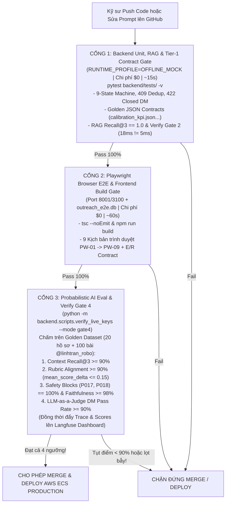

# Feature Spec 10: Langfuse SDK Observability (`@observe`), Dual-Mode Embedding Gateway & Probabilistic AI Evals (`LLM-as-a-Judge` in `verify_live_keys.py`) — Verify Gate 4
*(WBS Task 10 / Module 03 & Module 05 Convergence: SDK-First Distributed Tracing with `langfuse`, Live Gemini/OpenAI Embeddings + `SEMANTIC_CONCEPT_AXES` ($0 Fallback), and Golden Dataset + `LLM-as-a-Judge` Quality Gate integrated into `verify_live_keys.py`)*

---

## 1. Triết Lý Thiết Kế: "SDK-First, Ít Code Tay, Có Ngay Dashboard Tracing Chuyên Nghiệp & Zero Regression"

### A. Tại sao chọn hướng `langfuse` Python SDK + Mở rộng `verify_live_keys.py` có sẵn?
Thay vì tự code tay hệ thống đo giờ, tự nhân giá tiền token hay tự vẽ bảng Dashboard từ con số 0, chúng ta áp dụng đúng chuẩn kỹ nghệ FDE hiện đại (tương tự Azure AI Tracing / Langfuse):
1. **Dùng trực tiếp `langfuse` Python SDK (`pip install langfuse` + decorator `@observe()`):**
   - Chỉ cần gắn decorator `@observe()` lên đúng **4 hàm sẵn có** trong luồng chấm điểm (`Pre-Guard` $\rightarrow$ `RAG Hybrid Retrieval & Rerank` $\rightarrow$ `LLM Generation` $\rightarrow$ `Post-Guard Verify Gate 2 & Judge`).
   - Khi điền `LANGFUSE_PUBLIC_KEY` và `LANGFUSE_SECRET_KEY` (tài khoản miễn phí trên `https://cloud.langfuse.com` hoặc self-hosted Docker), **Langfuse Web Dashboard** tự động dựng sẵn:
     - **Biểu đồ cây 4 Spans** (từng mili-giây `latency_ms`, Input/Output của từng trạm).
     - **Biểu đồ Token & Chi phí `$USD`** theo thời gian thực.
     - **Bảng điểm `Scores` (`langfuse_context.score_current_trace`)**: Đẩy trực tiếp điểm `verify_gate_2_verbatim`, `judge_faithfulness`, `judge_no_fake_familiarity`, `rubric_score_delta` lên Dashboard để lọc ca lỗi và bấm 1 nút **"Add to Dataset"** (Data Flywheel)!
   - Khi chạy `pytest` hoặc Playwright E2E ở chế độ `OFFLINE_MOCK` (hoặc chưa cấu hình key Langfuse): SDK tự động chạy ở chế độ **`no-op` (`enabled=False`)** — tốn `0ms`, không gọi mạng, không làm thay đổi bất kỳ JSON contract nào!
2. **Tận dụng công cụ hạ tầng có sẵn [`backend/scripts/verify_live_keys.py`](file:///d:/AssignmentFDE/backend/scripts/verify_live_keys.py) cho Trạm 1, 2 & 4 (`Golden Dataset` + `LLM-as-a-Judge`):**
   - Trong repo đã có sẵn `run_llm_gate(full_benchmark=True)` đọc 20 hồ sơ chuẩn. Ta chỉ cần tích hợp gọn hàm **`judge_dm_quality_with_llm()` (`LLM-as-a-Judge` ~40 dòng)** và kiểm định **RAG `Recall@3`** ngay vào `verify_live_keys.py` là hoàn tất **Cổng 3 CI/CD (Verify Gate 4)** mà không phải đẻ thêm hệ thống song song!
3. **Nâng cấp gọn `compute_semantic_embedding()` (~25 dòng) trong [`rag_retriever.py`](file:///d:/AssignmentFDE/backend/app/services/rag_retriever.py):**
   - Tự động gọi **Live Gemini Embedding API (`text-embedding-004`, 768 chiều)** hoặc **OpenAI Embedding API (`text-embedding-3-small`, 1,536 chiều)** khi có API Key, và tự động lùi về **10 trục `SEMANTIC_CONCEPT_AXES`** khi chạy `OFFLINE_MOCK` ($0).

---

## 2. Bản Đồ Vận Hành Theo 3 `RUNTIME_PROFILE`, 3 Cổng CI/CD & 4 Hành Động Hậu Observability

### A. Hành vi của Backend Test, Playwright E2E & Hệ thống theo từng `RUNTIME_PROFILE`

| Chế độ `RUNTIME_PROFILE` | Vector Embedding (Trạm 1 & 3 RAG) | Chấm điểm & `LLM-as-a-Judge` | `langfuse` SDK (`@observe`) | Backend Test (`pytest`) & Playwright E2E (`PW-01..PW-09`) chạy thế nào? |
| :--- | :--- | :--- | :--- | :--- |
| **`OFFLINE_MOCK`** *(Môi trường `dev`, Máy chấm bài, Cổng 1 & 2 CI/CD)* | Dùng **10 trục `SEMANTIC_CONCEPT_AXES`** (`10d`, `$0`, deterministic 100%). | Dùng `_evaluate_deterministically()` & `SEMANTIC_RULE_JUDGE` (`$0`). | Chạy `no-op` (`enabled=False`), không gửi mạng, `0ms` overhead. | - **Backend `pytest`:** Chạy 100% unit & contract tests (`$0`). Các nhánh gọi Live Embedding / Langfuse SDK được test qua `unittest.mock.patch`.<br>- **Playwright E2E:** Luôn chạy ở chế độ này trên port `8001`/`3100` (`outreach_e2e.db`) để UI test nhanh, ổn định 100%, không bị flaky do mạng hay rate-limit `429`. |
| **`HYBRID_AUTO`** *(Môi trường `staging`, Máy Dev khi cắm thử Key)* | Nếu có `GEMINI_API_KEY` / `OPENAI_API_KEY` $\rightarrow$ Gọi **Live Embedding (`768d` / `1536d`)**; nếu không có $\rightarrow$ Lùi về `SEMANTIC_CONCEPT_AXES` (`10d`). | Có Key $\rightarrow$ Gọi **Live Gemini / OpenAI** cho cả Evaluator & `LLM-as-a-Judge`; không có Key $\rightarrow$ Lùi về deterministic. | Nếu có `LANGFUSE_PUBLIC_KEY` $\rightarrow$ Bắn **4-Span Trace + Scores** lên **Langfuse Dashboard**; nếu không $\rightarrow$ `no-op`. | Chạy `python -m backend.scripts.verify_live_keys --mode all` để kiểm định thật các dịch vụ đã cắm Key và đẩy Trace thật lên Langfuse Dashboard. |
| **`LIVE_PRODUCTION`** *(Môi trường `prod` trên AWS ECS)* | **Bắt buộc** gọi Live Embedding API (`768d` / `1536d`). | **Bắt buộc** gọi Live LLM (Cấm fallback ngầm về `$0`; nếu lỗi API $\rightarrow$ chuyển sang `AI_FAILED` hiện nút Retry). | **Bật 100%** — Ghi hộp đen mọi lượt chấm điểm ứng viên lên Langfuse Dashboard. | Trước khi được Merge & Deploy lên `prod`, code/prompt mới bắt buộc phải vượt qua **Cổng 3 CI/CD (`verify_live_keys.py --mode gate4`)**! |

---

### B. Quy Tắc 3 Cổng Chặn CI/CD (Điều kiện bắt buộc để một PR được Merge & Deploy lên Production)



---

### C. Sau Khi Đo Được Cây Trace 4 Spans Trên Langfuse Dashboard Rồi Thì Làm GÌ Tiếp Theo? (4 Hành Động Vận Hành Thực Tế)

Khi mở **Langfuse Dashboard** và nhìn thấy cây **4-Span Trace** của `@linhtran_robo` (kèm các điểm `Scores`), kỹ sư FDE thực hiện **4 hành động vận hành (Operational Playbook)**:

1. **Hành động 1 — Bắt bệnh nghẽn cổ chai độ trễ (`Latency Bottleneck Triage`):**
   - Nhìn vào thanh thời gian của 4 Spans trên Langfuse:
     - `Span 1 (Pre-Guard)` (`~2ms`) $\rightarrow$ `Span 2 (Hybrid RAG & Rerank)` (`~110ms`) $\rightarrow$ `Span 3 (LLM Generation)` (`~1,280ms`) $\rightarrow$ `Span 4 (Post-Guard & Judge)` (`~30ms`).
   - Nếu tổng thời gian vọt lên `12 giây`: Nhìn vào Span nào dài nhất sẽ biết ngay thủ phạm nằm ở Database/Embedding (`Span 2`) hay do mạng gọi Google Gemini (`Span 3`) để sửa đúng chỗ trong 5 phút.
2. **Hành động 2 — Cầu chì cắt máu túi tiền (`Token & Cost Anomaly Alert`):**
   - `Span 3` trên Langfuse tự động thống kê `input_tokens: 460`, `output_tokens: 145`, `cost: $0.000042` (nhờ `Span 2` đã gạn 3,000 bài xuống đúng Top 3 chunks).
   - Nếu có ai sửa code làm hỏng bộ lọc Top 3 khiến `input_tokens` vọt lên `45,000 tokens` (`$0.04`/người), biểu đồ Cost trên Langfuse dựng đứng lên $\rightarrow$ Kỹ sư phát hiện và rollback ngay trước khi cháy ngân sách.
3. **Hành động 3 — Phân định trách nhiệm lỗi khi AI chấm sai (`RAG Fault` vs `LLM Prompt Fault`):**
   - Khi Partner thắc mắc *"Sao ứng viên này giỏi mà AI chấm có 2 điểm?"*, mở Trace của ứng viên đó trên Langfuse:
     - Nếu `Span 2 (RAG)` trả về `selected_post_ids` toàn bài uống cà phê (bỏ sót bài kỹ thuật) $\rightarrow$ **Lỗi tại bộ tìm kiếm RAG (Trạm 3 & 4)**, cần chỉnh lại Embedding/Reranker chứ không phải sửa Prompt LLM!
     - Nếu `Span 2 (RAG)` đã lấy đúng 2 bài kỹ thuật vàng đưa vào tờ giấy A4 rồi, mà `Span 3 (LLM)` vẫn chấm 2 điểm $\rightarrow$ **Lỗi tại câu hướng dẫn Rubric trong Prompt (`ai_evaluator.py`)**!
     - Nếu `Span 4 (Post-Guard)` ghi nhận score `verify_gate_2_verbatim = 0` (`hallucination_rejected = True`) $\rightarrow$ Biết được model LLM ở `Span 3` vừa cố tình bịa số liệu (`18ms` $\rightarrow$ `5ms`) và đã bị chốt chặn Python cứu nguy.
4. **Hành động 4 — Vòng lặp Tiến hóa (`Data Flywheel`: Đưa ca lỗi vào Golden Dataset):**
   - Trên Langfuse Dashboard, lọc các Trace có `score < 1.0` hoặc các hồ sơ bị Partner bấm `[Override Fit Score]` trên UI.
   - Bấm **`[Add to Dataset]`** trên Langfuse (hoặc thêm vào `fund_reference_scores.csv`) để biến ca lỗi thực tế đó thành đề thi bắt buộc ở **Cổng 3 CI/CD** cho mọi lần sửa Prompt về sau!

---

## 3. Kiểm Toán 5 Điểm Bảo Vệ Để Không Làm Vỡ Test & Contract Hiện Có

| Thành phần hiện có | Yêu cầu bảo vệ nghiêm ngặt (Zero Regression) | Cách thực hiện bằng SDK gọn nhẹ |
| :--- | :--- | :--- |
| **1. `GET /api/ledger/calibration`** ([`test_api_contracts.py` dòng 332](file:///d:/AssignmentFDE/backend/tests/contracts/test_api_contracts.py#L332), [`test_ledger_and_calibration.py` dòng 174](file:///d:/AssignmentFDE/backend/tests/test_ledger_and_calibration.py#L174)) | Contract Test khóa cứng response chỉ có 2 key `{"kpi", "items"}` khớp từng chữ với `calibration_kpi.json` và cấm gọi LLM ngoài. | **Giữ nguyên 100%** `/api/ledger/calibration`. Mọi kiểm định xác suất Live + `LLM-as-a-Judge` đặt trong `verify_live_keys.py` (và route độc lập nếu cần). |
| **2. `reset_clean_users.py`** ([`test_verification_tools.py` dòng 62](file:///d:/AssignmentFDE/backend/tests/test_verification_tools.py#L62)) | Khi chạy lệnh reset DB sạch giữ lại user, bảng mới `candidate_chunks` không được để sót dữ liệu mồ côi. | Thêm `db.query(CandidateChunk).delete()` và reset `sqlite_sequence` cho `candidate_chunks` trong `reset_clean_users.py`. |
| **3. `RuntimeGateway` (`/api/system/runtime`)** ([`test_runtime_gateway.py`](file:///d:/AssignmentFDE/backend/tests/test_runtime_gateway.py)) | Giữ nguyên 100% các trường `runtime_profile`, `ai_evaluation`, `x_lookup`, `dm_dispatch`. | Bổ sung `resolve_embedding_plan()` và trường `"rag_embedding"` + `"observability"` (báo trạng thái Langfuse SDK) vào `/api/system/runtime`. |
| **4. Chốt đồng bộ chiều Vector (`10d` vs `768d`/`1536d`)** ([`rag_retriever.py`](file:///d:/AssignmentFDE/backend/app/services/rag_retriever.py)) | Nếu chunk trong DB cũ được lưu bằng `SEMANTIC_CONCEPT_AXES` (10 chiều), sau đó bật `GEMINI_API_KEY` (query ra 768 chiều), phép nhân `_cosine_similarity` không được lỗi. | Trong `compute_vector_scores()`, nếu `len(chunk_vec) != len(query_vec)`, tự động gọi `compute_semantic_embedding(chunk.text)` cùng hệ quy chiếu với `query_vec`. |
| **5. Playwright E2E (`PW-01..PW-09`)** | Không làm chậm hoặc làm lệch snapshot E/R của 9 bài test trình duyệt. | Khi chạy E2E (`OFFLINE_MOCK`), `langfuse` SDK tự động ở chế độ `no-op` (`0ms`), giữ nguyên 100% tốc độ và kết quả E2E. |

---

## 4. Đặc Tả Code Thay Đổi Cụ Thể (Ngắn Gọn, Chuẩn SDK)

### Bước 1: Cài đặt `langfuse` SDK & Khai báo cấu hình (`requirements.txt`, `config.py`, `runtime_gateway.py`)
1. **Trong [`backend/requirements.txt`](file:///d:/AssignmentFDE/backend/requirements.txt):**
   - Thêm `langfuse>=2.50.0` (hoặc wrapper tương thích tự động dùng `langfuse.decorators.observe` khi package được cài đặt và fallback nhẹ nếu môi trường offline chưa pip install).
2. **Trong [`backend/app/core/config.py`](file:///d:/AssignmentFDE/backend/app/core/config.py):**
   - Thêm:
     ```python
     GEMINI_EMBEDDING_MODEL: str = os.getenv("GEMINI_EMBEDDING_MODEL", "text-embedding-004")
     OPENAI_EMBEDDING_MODEL: str = os.getenv("OPENAI_EMBEDDING_MODEL", "text-embedding-3-small")
     LANGFUSE_PUBLIC_KEY: str = os.getenv("LANGFUSE_PUBLIC_KEY", "")
     LANGFUSE_SECRET_KEY: str = os.getenv("LANGFUSE_SECRET_KEY", "")
     LANGFUSE_HOST: str = os.getenv("LANGFUSE_HOST", "https://cloud.langfuse.com")
     ```
3. **Trong [`backend/app/core/runtime_gateway.py`](file:///d:/AssignmentFDE/backend/app/core/runtime_gateway.py):**
   - Thêm `EmbeddingExecutionPlan` & `RuntimeGateway.resolve_embedding_plan()`:
     - `OFFLINE_MOCK` hoặc không có Key $\rightarrow$ `LOCAL_CONCEPT_10D` (`semantic-concept-axes-10d`, `dimensions=10`).
     - Có `GEMINI_API_KEY` $\rightarrow$ `LIVE_GEMINI_EMBEDDING` (`text-embedding-004`, `dimensions=768`).
     - Có `OPENAI_API_KEY` $\rightarrow$ `LIVE_OPENAI_EMBEDDING` (`text-embedding-3-small`, `dimensions=1536`).

---

### Bước 2: Gắn `langfuse` SDK (`@observe()`) cho 4 Spans & Nhánh Live Embedding (`rag_retriever.py` & `ai_evaluator.py`)
1. **Tạo helper mỏng `backend/app/core/langfuse_tracing.py` (~60 dòng):**
   - Khởi tạo và bọc `langfuse.decorators.observe` + `langfuse_context` từ **Langfuse Python SDK**.
   - Tự động tắt (`enabled=False`) khi `RUNTIME_PROFILE == "OFFLINE_MOCK"` hoặc khi `LANGFUSE_PUBLIC_KEY` chưa cấu hình để `pytest` không bao giờ gọi mạng ngầm.
   - Ghi nhận đồng thời span metadata vào bộ nhớ đệm của tiến trình (`get_last_candidate_trace(handle)`) để khi bạn test trên máy local (ngay cả lúc chưa mở web `cloud.langfuse.com`), bạn vẫn xem được ngay cây **4-Span Langfuse Trace** qua CLI hoặc `verify_live_keys.py`!
2. **Gắn `@observe()` trực tiếp lên 4 Spans của `@linhtran_robo`:**
   - **`Span 1: Pre-Guard Check`** trên hàm kiểm tra `detect_prompt_injection` & `detect_sparse_profile`.
   - **`Span 2: Hybrid Retrieval & Rerank`** trên hàm `search_and_rerank_candidate_chunks()` (và `@observe(name="Embedding Generation")` trên hàm `compute_semantic_embedding()`).
   - **`Span 3: LLM Generation`** (`as_type="generation"`) trên hàm `_call_external_llm()` / `_evaluate_deterministically()`, tự động đẩy `model`, `input_tokens`, `output_tokens` và `cost` vào `langfuse_context.update_current_observation(...)`.
   - **`Span 4: Post-Guard Verify Gate 2`** trên hàm `_enforce_post_guards()`, tự động đẩy điểm `langfuse_context.score_current_trace(name="verify_gate_2_verbatim", value=1.0)` lên Langfuse Dashboard!
3. **Bổ sung nhánh gọi Live Gemini / OpenAI Embedding API vào `compute_semantic_embedding()` trong [`rag_retriever.py`](file:///d:/AssignmentFDE/backend/app/services/rag_retriever.py):**
   - Gọi `POST .../models/text-embedding-004:embedContent` (Gemini 768 chiều) hoặc `POST https://api.openai.com/v1/embeddings` (OpenAI 1,536 chiều) khi `RuntimeGateway.resolve_embedding_plan().allow_external_embedding == True`.
   - Bổ sung **Dimension Alignment Guard** trong `compute_vector_scores()`.

---

### Bước 3: Tích hợp Gọn `LLM-as-a-Judge` & Cổng Verify Gate 4 vào [`backend/scripts/verify_live_keys.py`](file:///d:/AssignmentFDE/backend/scripts/verify_live_keys.py)
1. **Thêm hàm `judge_dm_quality_with_llm(candidate, draft_dm, allow_external_llm=True)` (~45 dòng) trong [`ai_evaluator.py`](file:///d:/AssignmentFDE/backend/app/services/ai_evaluator.py):**
   - Gắn `@observe(name="LLM-as-a-Judge DM Evaluation", as_type="generation")`.
   - Khi chạy Live LLM: Gửi `<hồ_sơ_gốc>` + `<bức_thư_dm>` cho Gemini/OpenAI với `temperature=0.0` và `responseSchema` chấm 3 tiêu chí Boolean:
     ```json
     {"cites_real_evidence": true, "no_fake_familiarity": true, "peer_to_peer_cta": true, "reason": "..."}
     ```
   - Kết hợp chốt kiểm tra số liệu thực tế & mẫu câu làm quen giả tạo biến tướng (*"I remember bumping into you at the Singapore robotics meetup last month"*), sau đó bắn điểm `langfuse_context.score_current_trace(name="llm_judge_dm_pass", value=1.0)` lên Langfuse Dashboard!
2. **Nâng cấp [`backend/scripts/verify_live_keys.py`](file:///d:/AssignmentFDE/backend/scripts/verify_live_keys.py):**
   - Mở rộng `run_llm_gate()` và thêm `--mode gate4` (`run_verify_gate_4_probabilistic_eval()`):
     - Kiểm tra **Dual-Mode Embedding** (`10d` vs `768d`/`1536d`) và **RAG `Recall@3 == 1.0`** trên 100 bài viết của `@linhtran_robo`.
     - Chấm điểm `fit_score` và chạy **`judge_dm_quality_with_llm()` (`LLM-as-a-Judge`)** cho các bức thư `draft_dm` sinh ra.
     - In ra bảng tổng kết 4 chỉ số của Học phần 5 (`Context Recall@3`, `Rubric Alignment`, `Faithfulness`, `LLM-as-a-Judge Pass Rate`) + Cây **Langfuse 4-Span Trace** của `@linhtran_robo` và flush toàn bộ trace lên Langfuse Dashboard!

---

### Bước 4: Cập nhật `reset_clean_users.py`, Hạ tầng `.env`/`Docker`/`CI-CD` & Bộ Test `test_probabilistic_qa_and_verify_gate_4.py`
1. **Trong [`backend/reset_clean_users.py`](file:///d:/AssignmentFDE/backend/reset_clean_users.py):** Xóa sạch bảng `CandidateChunk` (`candidate_chunks`) và cập nhật [`backend/tests/test_verification_tools.py`](file:///d:/AssignmentFDE/backend/tests/test_verification_tools.py).
2. **Trong [`backend/.env.example`](file:///d:/AssignmentFDE/backend/.env.example), [`.env.docker.example`](file:///d:/AssignmentFDE/.env.docker.example), [`docker-compose.yml`](file:///d:/AssignmentFDE/docker-compose.yml) và [`.github/workflows/ci-cd.yml`](file:///d:/AssignmentFDE/.github/workflows/ci-cd.yml):**
   - Khai báo biến `GEMINI_EMBEDDING_MODEL`, `OPENAI_EMBEDDING_MODEL`, `LANGFUSE_PUBLIC_KEY`, `LANGFUSE_SECRET_KEY`, `LANGFUSE_HOST`.
   - Thêm bước chạy **Cổng 3 (`python -m backend.scripts.verify_live_keys --mode gate4`)** vào `.github/workflows/ci-cd.yml`.
3. **Viết file test [`backend/tests/test_probabilistic_qa_and_verify_gate_4.py`](file:///d:/AssignmentFDE/backend/tests/test_probabilistic_qa_and_verify_gate_4.py):**
   - Kiểm chứng Dual-Mode Embedding (`10d` `SEMANTIC_CONCEPT_AXES` $\leftrightarrow$ `768d` Gemini / `1536d` OpenAI + Dimension Alignment Guard).
   - Kiểm chứng `judge_dm_quality_with_llm` (`LLM-as-a-Judge`) bắt dính câu làm quen lách Regex (*"I remember bumping into you at the Singapore robotics meetup"*) và số liệu bịa (`"5ms"`).
   - Kiểm chứng `langfuse` SDK `@observe()` tạo đủ 4 Spans cho `@linhtran_robo` và `verify_live_keys.py --mode gate4` đạt 100% tiêu chí.

---

## 5. Tiêu Chí Nghiệm Thu (Acceptance Criteria)
- [ ] **AC-1 (Langfuse SDK `@observe` Integration):** 4 Spans của luồng đánh giá ứng viên được gắn decorator `@observe()` chuẩn của `langfuse` SDK, tự động đẩy Trace + Scores lên Langfuse Dashboard khi có key và chạy `no-op` (`0ms`) khi chạy `OFFLINE_MOCK`.
- [ ] **AC-2 (Dual-Mode Embedding Gateway):** Tự động chuyển giữa `SEMANTIC_CONCEPT_AXES` (`10d`) và Live Gemini (`768d`) / OpenAI (`1536d`) Embedding API, có chốt chống lệch chiều vector khi tính Cosine.
- [ ] **AC-3 (`LLM-as-a-Judge` & `verify_live_keys.py --mode gate4`):** Tích hợp gọn vào `ai_evaluator.py` và `verify_live_keys.py`, chấm đủ 4 chỉ số xác suất của `MODULE_05`.
- [ ] **AC-4 (100% Zero Regression):** Toàn bộ Backend Unit Tests, Tier-1 Contract Tests (`test_api_contracts.py`), `reset_clean_users.py` và Playwright E2E giữ nguyên trạng thái **PASS 100%**.
