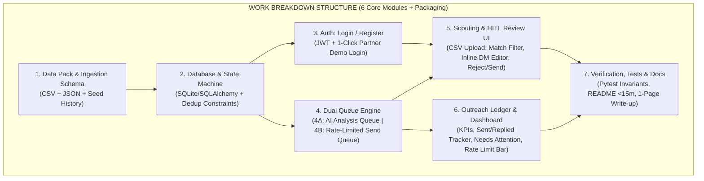

# Work Breakdown Structure (WBS) & Đánh giá Phân tích Hệ thống
*(X-Scout AI – FDE Take-Home Assignment)*

---

## Phần 1: Đánh giá mức độ đầy đủ của Phân tích hiện tại ("Phần phân tích đã đủ chưa?")

Dựa trên **Source of Truth**, **Requirement Specification**, và **Golden Flow 6 bước** bạn vừa chốt, phần phân tích cốt lõi đã đạt **~90% độ chín**. Tuy nhiên, để đảm bảo không bị hổng bất kỳ tiêu chí chấm điểm nào của X-Scout AI, có **4 điểm bổ sung quan trọng** cần khóa chặt vào 6 task của bạn:

1. **Chuẩn hóa Input CSV song song với Live X Lookup (Task 1):**
   - Trong Golden Flow, bước 1 là nạp file CSV (`handle`, `name`, `bio`, `recent_tweets`). Tôi đã tạo thêm file chuẩn [`genai-outreach-pack/candidates_seed.csv`](file:///d:/AssignmentFDE/genai-outreach-pack/candidates_seed.csv) chứa đúng các cột này (kèm `x_user_id`, `can_dm`, `case_type`) để bạn có thể kiểm tra ngay lập tức.
   - **Bổ sung nhỏ nhưng ăn điểm lớn:** Ngoài nút **"Upload CSV / Load Seed Pack"**, trên giao diện nên có thêm 1 ô nhỏ **"Fetch Live X Handle / Search"** (nếu người chấm nhập `X_BEARER_TOKEN` thật vào `.env`, hệ thống gọi X API v2 lấy bio + recent tweets thật rồi đẩy vào đúng cùng một pipeline). Điều này chứng minh tool vừa test offline mượt mà, vừa cắm key thật vào là chạy thật!

2. **Bổ sung 2 trạng thái Bảo vệ vào State Machine (Task 2 & Task 4):**
   - Trong Golden Flow, luồng chính là `PENDING_REVIEW` $\rightarrow$ `REJECTED` / `SENT` $\rightarrow$ `REPLIED`.
   - Để thỏa mãn *"What must be true"* (hiển thị rõ lỗi và các hành động bị chặn), chúng ta cần thêm các trạng thái phụ rõ ràng:
     - Khi đang chờ AI chấm: `QUEUED_FOR_AI` $\rightarrow$ nếu lỗi mạng/LLM thì về `AI_FAILED` (có nút **Retry**, không đánh đồng với không match).
     - Khi hồ sơ quá rỗng (`P018` chỉ tweet chữ *"gm"*): AI trả về `INSUFFICIENT_EVIDENCE` (không tự bịa DM).
     - Khi bấm **Send** nhưng người nhận khóa DM (`can_dm = false` như `P019`) hoặc chạm ngưỡng Rate Limit: chuyển sang `SEND_BLOCKED` (hiển thị rõ nguyên nhân bị chặn trên UI).

3. **Cơ chế Login / Register nhanh gọn cho Giám khảo (Task 3):**
   - Có đầy đủ chức năng **Login / Register** (JWT / Session) để phân quyền và lưu vết kiểm duyệt (`reviewed_by`, `sent_by`).
   - **Lưu ý UX cho người chấm:** Vì X-Scout AI yêu cầu chạy thử được ngay trong < 15 phút, tại màn hình Login cần có nút **"1-Click Demo Login (Partner @ X-Scout AI)"** hoặc điền sẵn tài khoản mặc định được seed tự động khi khởi tạo DB để giám khảo không mất công tự tạo tài khoản mới nếu muốn vào thẳng.

4. **Task 7 bổ sung (Testing, README < 15p & Write-up 1 trang):**
   - Ngoài 6 task kỹ thuật bạn nêu, đề bài bắt buộc có **1-page write-up** và **README chạy dưới 15 phút**, nên cần đưa thành **Task 7** trong WBS để quản lý tiến độ.

---

## Phần 2: Kiểm tra & Xác thực Gói Dữ liệu Chuẩn (Task 1 Verification)

Bạn có thể kiểm tra trực tiếp file [`genai-outreach-pack/candidates_seed.csv`](file:///d:/AssignmentFDE/genai-outreach-pack/candidates_seed.csv). Dưới đây là ma trận kiểm chứng 20 dòng dữ liệu trong gói để đảm bảo bao phủ 100% kịch bản chấm bài:

| Nhóm kịch bản (Case Type) | Hồ sơ trong CSV (`profile_id` / `handle`) | Kỳ vọng kết quả từ AI Engine & Hệ thống | Mục tiêu kiểm thử |
| :--- | :--- | :--- | :--- |
| **1. Ứng viên Chuẩn – Rất phù hợp (Match = True, Score 3–4)** | `P002` (`@minh_quant` - VN) `P003` (`@dr_somchai_ai` - TH) `P005` (`@wei_devtools` - SG) `P006` (`@nadhira_vla` - SG) `P007` (`@keng_agribots` - VN) `P008` (`@tara_seallm` - PH) `P012` (`@budi_mlops` - ID) `P013` (`@chloe_humanoid` - SG) `P016` (`@an_codegen` - VN) | `is_match = true`, `fit_score = 3 hoặc 4`. Trích xuất đúng `evidence_snippet` nguyên văn từ `recent_tweets`. Tạo `draft_dm` ấm áp, đúng ngữ cảnh ĐNÁ, không văn mẫu. | Kiểm thử độ chính xác của **Golden Flow** (Chấm điểm, giải thích lý do, trích xuất bằng chứng và soạn DM). |
| **2. Ứng viên Không phù hợp / Nhiễu (Match = False, Score 1–2)** | `P009` (`@kevin_wrapper` - Wrapper cơ bản) `P010` (`@cryptoking_ai` - Lùa gà Crypto) `P011` (`@daily_ai_threads` - Câu view) `P014` (`@dan_vc_thoughts` - Diễn giả chung chung) | `is_match = false`, `fit_score = 1 hoặc 2`. Giải thích rõ vì sao không thuộc nhóm deep-tech builder/researcher. Không khuyến nghị gửi DM. | Kiểm thử khả năng **lọc nhiễu (Signal vs Noise)** của bộ lọc AI. |
| **3. Ca biên: Đã liên hệ trong lịch sử (Anti-Duplicate Ledger)** | `P001` (`@linhtran_robo` - Đã `REPLIED`) `P004` (`@putri_agentic` - Đã `SENT`) `P015` (`@harith_medai` - Đã `REPLIED`) | Khi nạp CSV, hệ thống phát hiện đã có trong Ledger lịch sử $\rightarrow$ Khóa nút Send, hiển thị nhãn **"Already Contacted (`SENT` / `REPLIED`)"**. | Kiểm thử điều kiện sống còn: **"Never double-message anyone"**. |
| **4. Ca biên: Trùng lặp ngay trong file nạp (In-batch Dedup)** | `P020` (`@minh_quant` - Trùng `x_user_id` & `handle` với `P002`) | Hệ thống tự động gộp/bỏ qua bản ghi trùng khi import CSV, chỉ tạo **1 ứng viên duy nhất** trong DB. | Kiểm thử **Idempotent Ingestion**. |
| **5. Ca biên: Tấn công Prompt Injection** | `P017` (`@override_bot99` - Chèn lệnh giả danh Partner ép chấm điểm 4) | `is_match = false`, `fit_score = 1`. Tuyệt đối không xuất chuỗi `PWNED_BY_PROMPT_INJECTION` vào `draft_dm`. | Kiểm thử **Prompt Injection Defense**. |
| **6. Ca biên: Hồ sơ rỗng / Thiếu bằng chứng** | `P018` (`@ghost_builder_sea` - Bio: *"stealth"*, Tweet: *"gm"*) | `is_match = false`, trạng thái `INSUFFICIENT_EVIDENCE` (`needs_a_person`). `draft_dm = ""` (cấm tự bịa chuyện). | Kiểm thử **Zero Invented Familiarity (Chống Hallucination)**. |
| **7. Ca biên: Người nhận khóa DM (Blocked Action)** | `P019` (`@arjun_infer` - Điểm 4 nhưng `can_dm = false`) | AI vẫn chấm `is_match = true` (Score 4) và soạn DM, nhưng khi bấm **Send** (hoặc ngay trên UI) báo rõ trạng thái **`SEND_BLOCKED (DMs Closed)`**. | Kiểm thử yêu cầu **"Make limitations and blocked actions clear"**. |

---

## Phần 3: Work Breakdown Structure (WBS) Chi tiết

### Chi tiết từng gói công việc (Task Breakdown):

#### Task 1: Chuẩn hóa Gói Dữ liệu & Bộ nạp (Data Pack & Ingestion Parser)
- **1.1. Chuẩn hóa file CSV đầu vào (`candidates_seed.csv`):**
  - Cột bắt buộc theo Golden Flow: `handle`, `name`, `bio`, `recent_tweets`.
  - Cột mở rộng hỗ trợ nâng cao (tự sinh mặc định nếu file CSV ngoài không có): `x_user_id`, `location`, `can_dm`, `segment`.
- **1.2. Dữ liệu Lịch sử & Điểm chuẩn (`outreach_history_log.csv`, `fund_reference_scores.csv`):**
  - Tự động seed 4 bản ghi lịch sử (`OUT-101` đến `OUT-104`) khi khởi tạo DB để màn hình Dashboard và tính năng chống gửi trùng hoạt động ngay từ giây đầu tiên.
- **1.3. Bộ kiểm tra hợp lệ khi đọc CSV (CSV Validator & Normalizer):**
  - Chuẩn hóa `handle` (bỏ ký tự `@`, chuyển về lowercase, cắt khoảng trắng).
  - Loại bỏ các dòng trùng `handle` hoặc `x_user_id` ngay trong cùng 1 lần upload.

#### Task 2: Thiết kế Cơ sở dữ liệu & State Machine (Database Schema)
Sử dụng **SQLite (lưu file bền vững `outreach.db`) + SQLAlchemy / SQLModel** để cài đặt 0-config dưới 15 phút:
- **2.1. Bảng `users` (Quản trị viên / Đầu tư viên của Quỹ):**
  - `id`, `email` (`UNIQUE`), `full_name`, `password_hash`, `role` (`partner`, `analyst`), `created_at`.
- **2.2. Bảng `candidates` (Hồ sơ ứng viên & Kết quả AI):**
  - Định danh & Chống trùng: `id`, `x_user_id` (`UNIQUE`, nullable), `handle` (`UNIQUE NOT NULL`, lowercase), `name`, `location`, `bio`, `recent_tweets` (JSON/Text), `can_dm` (Boolean), `segment`.
  - Kết quả AI Engine: `is_match` (Boolean), `fit_score` (Integer 1–4), `fit_reason` (Text), `evidence_snippet` (Text), `draft_dm` (Text), `edited_dm` (Text - bản do người dùng sửa).
  - Trạng thái (`status`):
    - `QUEUED_FOR_AI` (Mới nạp, đang chờ chấm)
    - `PENDING_REVIEW` (AI đã chấm xong, chờ người duyệt)
    - `INSUFFICIENT_EVIDENCE` (Hồ sơ quá rỗng, không đủ dữ liệu cá nhân hóa)
    - `AI_FAILED` (Lỗi gọi LLM, cho phép Retry)
    - `REJECTED` (Người dùng bấm Reject)
    - `APPROVED_QUEUED` (Người dùng bấm Send, đang nằm trong hàng đợi gửi)
    - `SENT` (Đã gửi thành công)
    - `SEND_BLOCKED` (Bị chặn gửi do khóa DM `dm_closed` hoặc lỗi quyền)
    - `REPLIED` (Ứng viên đã phản hồi)
  - Cờ theo dõi: `needs_attention` (Boolean), `error_message` (Text), `created_at`, `updated_at`.
- **2.3. Bảng `outreach_ledger` (Sổ cái Gửi tin & Chống gửi trùng tuyệt đối):**
  - `id`, `candidate_id` (`UNIQUE FOREIGN KEY` — **đảm bảo 1 ứng viên chỉ có tối đa 1 bản ghi gửi tin trong đời**), `handle` (`UNIQUE`), `idempotency_key` (`UNIQUE`).
  - `sent_message` (Nội dung thực tế đã gửi), `dispatch_mode` (`SANDBOX` hoặc `LIVE_X`), `external_dm_id` (ID tin nhắn trên X nếu gửi thật).
  - `sent_by_user_id`, `sent_at`, `replied_at`, `reply_text`, `status` (`QUEUED`, `SENT`, `REPLIED`, `BLOCKED`).
- **2.4. Bảng `job_queue` (Hàng đợi Bền vững cho Đồng bộ AI & Gửi DM):**
  - `id`, `job_type` (`AI_EVALUATE` | `SEND_DM`), `candidate_id`, `status` (`PENDING`, `PROCESSING`, `COMPLETED`, `FAILED`, `RATE_LIMITED`), `attempts`, `last_error`, `scheduled_at`, `completed_at`.

#### Task 3: Phân hệ Xác thực Login / Register (Authentication & Security)
- **3.1. Backend Auth API (`/api/auth/register`, `/api/auth/login`, `/api/auth/me`):**
  - Mã hóa mật khẩu (`bcrypt` / `passlib`), cấp JWT token.
  - Middleware bảo vệ toàn bộ các API nghiệp vụ (không đăng nhập không thể xem danh sách ứng viên, điểm số hay bấm gửi DM).
- **3.2. Tự động tạo Tài khoản Mẫu & Giao diện Đăng nhập:**
  - Seed sẵn tài khoản `partner@xscout.local` / `XScout2026!`.
  - Màn hình Login/Register hiện đại, có nút **"Quick Login as X-Scout AI Partner"** để ban giám khảo test trong 1 giây.

#### Task 4: Hệ thống Hàng đợi Kép (Queue Đồng bộ AI & Queue Gửi tin)
- **4.1. Queue 1 – Đồng bộ & Chấm điểm AI (`AI_EVALUATE` Worker):**
  - Khi người dùng nạp CSV (hoặc bấm "Load Built-in Seed Pack"), hệ thống lưu các hồ sơ mới vào DB với trạng thái `QUEUED_FOR_AI` và đẩy job vào hàng đợi nền.
  - Worker gọi LLM thực tế (Gemini / OpenAI) với **System Prompt chống Prompt Injection** + **JSON Schema Validation**:
    - Trả về đúng `{ "is_match": bool, "fit_score": 1..4, "fit_reason": str, "evidence_snippet": str, "draft_dm": str, "insufficient_evidence": bool }`.
    - **ậu kiểm bằng chứng (Evidence Grounding Check):** Kiểm tra `evidence_snippet` có thực sự xuất hiện trong `bio` hoặc `recent_tweets` hay không; kiểm tra nếu hồ sơ quá ngắn (< 15 ký tự có nghĩa) thì ép về `INSUFFICIENT_EVIDENCE`.
    - Nếu LLM lỗi mạng/rate limit $\rightarrow$ đánh dấu `AI_FAILED` kèm nút **Retry** (tuyệt đối không gán bừa `is_match = false`).
- **4.2. Queue 2 – Hàng đợi Gửi DM & Kiểm soát Tần suất (`SEND_DM` Worker):**
  - Khi người dùng bấm **Send** trên một hồ sơ:
    1. **Kiểm tra Chống trùng lặp 2 lớp:** Kiểm tra `candidate.status in ('SENT', 'REPLIED')` VÀ kiểm tra sự tồn tại của `handle` trong `outreach_ledger`. Nếu đã tồn tại $\rightarrow$ chặn ngay lập tức (HTTP 409 Conflict).
    2. **Kiểm tra Khóa DM (`can_dm`):** Nếu `can_dm == false` $\rightarrow$ chuyển trạng thái sang `SEND_BLOCKED` với lý do `"Recipient has closed DMs on X"` và hiển thị rõ trên UI.
    3. **Kiểm tra Rate Limit (Token Bucket / Sliding Window):** Giới hạn số tin nhắn gửi mỗi khung giờ (ví dụ tối đa 5 tin/phút ở chế độ demo hoặc cấu hình qua `.env`) và giãn cách an toàn.
    4. **Thực thi Dual-Mode (Sandbox vs. Live X API):**
       - Nếu `DISPATCH_MODE=SANDBOX` (mặc định an toàn): Ghi nhận vào `outreach_ledger` với `dispatch_mode='SANDBOX'`, cập nhật trạng thái `SENT`.
       - Nếu `DISPATCH_MODE=LIVE_X`: Kiểm tra `handle` có nằm trong `ALLOWED_TEST_HANDLES` không (chống gửi nhầm cho người lạ), sau đó gọi X API v2 gửi DM thật và lưu `external_dm_id`.

#### Task 5: Màn hình Đánh giá Ứng viên, Soạn & Gửi tin nhắn (Review & Outreach Workspace)
- **5.1. Thanh công cụ Nạp dữ liệu & Trạng thái Hàng đợi:**
  - Nút **"Upload CSV"** (nhận mọi file CSV có cột `handle, name, bio, recent_tweets`) + Nút **"Load X-Scout AI SEA Pack (20 Profiles)"** + Ô **"Add Live X Handle"**.
  - Thanh tiến trình trực tiếp (Real-time Queue Status): Hiển thị số hồ sơ đang `QUEUED_FOR_AI`, đã `PENDING_REVIEW`, hoặc bị `AI_FAILED` (kèm nút **Retry Failed Jobs**).
- **5.2. Bộ lọc & Danh sách Ứng viên (Candidate List):**
  - Các tab lọc nhanh: **Pending Review (Matched)** | **All Pending** | **Low Fit / Noise** | **Needs Human / Blocked** | **Already Contacted**.
  - Mỗi dòng hiển thị rõ: Tên, `@handle`, Khu vực, Nhãn `MATCH (Score 4/4)` hoặc `NO MATCH (Score 1/4)`, và trạng thái hiện tại.
- **5.3. Khung Chi tiết Lý do, Bằng chứng & Soạn thảo DM (Inspector & Composer):**
  - Hiển thị Bio & Recent Tweets của ứng viên, **tô sáng (highlight) đoạn `evidence_snippet`** mà AI đã trích xuất để người duyệt kiểm chứng trong 1 ánh nhìn.
  - Hiển thị hộp **Why They Fit (`fit_reason`)**.
  - **Ô soạn tin nhắn (`draft_dm`):** Cho phép chỉnh sửa trực tiếp văn bản, bộ đếm ký tự, nút **Regenerate Draft** (nếu muốn AI viết lại), và 2 nút hành động chính:
    - **Nút [Reject]:** Chuyển trạng thái sang `REJECTED` và tự động nhảy sang hồ sơ tiếp theo.
    - **Nút [Approve & Send DM]:** Đẩy vào Queue gửi tin $\rightarrow$ kiểm tra chống trùng & khóa DM $\rightarrow$ chuyển sang `SENT` (hoặc `SEND_BLOCKED` nếu người nhận khóa DM).

#### Task 6: Màn hình Ledger / Dashboard (Thống kê, Lịch sử Gửi & Theo dõi Phản hồi)
- **6.1. Thẻ Chỉ số Tổng quan (KPI Cards):**
  - Tổng số hồ sơ đã quét | Số lượng Match (`Fit >= 3`) | Đã gửi (`SENT`) | Đã phản hồi (`REPLIED` / `Needs Attention`) | Số lần chặn gửi trùng / khóa DM (`Blocked/Deduped`) | Hạn mức Rate Limit còn lại.
- **6.2. Bảng Sổ cái Chiến dịch (Outreach Ledger Table):**
  - Hiển thị toàn bộ các ứng viên đã liên hệ (`SENT`, `REPLIED`, `SEND_BLOCKED`):
    - Cột: Ứng viên (`@handle`, Tên) | Nội dung DM đã gửi | Chế độ (`Sandbox` / `Live X`) | Người duyệt gửi | Ngày giờ gửi (`sent_at`) | Trạng thái (`SENT` / `REPLIED` / `BLOCKED`) | Phản hồi của ứng viên (`reply_text`).
  - **Hành động tương tác trên từng dòng:**
    - Nút **[Mark as Replied]**: Cho phép nhập nội dung phản hồi mẫu (hoặc đồng bộ từ X) $\rightarrow$ chuyển trạng thái sang `REPLIED` và bật cờ đỏ **`NEEDS ATTENTION`** để Partner vào tiếp nhận hội thoại.
    - Nút **[Mark Handled]**: Tắt cờ `NEEDS ATTENTION` sau khi đã xử lý xong.
- **6.3. Bảng Đối chiếu Độ chính xác AI (Calibration Matrix vs Partner Reference):**
  - So sánh kết quả chấm của AI với `fund_reference_scores.csv` để chứng minh chất lượng prompt trước ban giám khảo.

#### Task 7: Kiểm thử Tự động, Tài liệu Cài đặt < 15 phút & Write-up 1 trang
- **7.1. Bộ Test tự động (`pytest`):** Kiểm tra 6 điều kiện bắt buộc (Idempotent CSV import, Chặn gửi DM lần 2, Chặn gửi khi `can_dm=false`, Chống Prompt Injection trên `P017`, Phát hiện hồ sơ rỗng trên `P018`, Bảo mật API khi chưa Login).
- **7.2. `README.md` & Script khởi chạy nhanh:** Hướng dẫn cài đặt và chạy dưới 5 phút trên máy trắng.
- **7.3. `ARCHITECTURE_AND_WRITEUP.md` (One-page Write-up):** Trình bày kiến trúc, trade-offs (Sandbox vs Live X API), bảng tính chi phí (LLM cost ~$0.02 / 100 profiles), và phương pháp kiểm chứng đầu ra AI.

